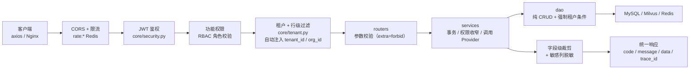
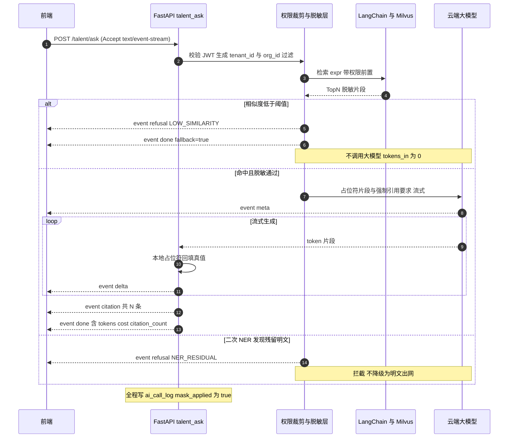

# 2026 顶配版 AI 数字化人才平台 · 接口设计文档

| 项目 | 内容 |
| --- | --- |
| 文档名称 | 2026 顶配版 AI 数字化人才平台 — 接口设计文档 |
| 版本 | v1.0 |
| 状态 | 与《需求分析文档》**v1.3**、《架构设计文档》**v1.0**、《数据库设计文档》**v1.0** 对齐 · 一期范围：F-3 档案与数字画像模块 |
| 上游依据 | 需求分析文档 v1.3（§3 权限 / §4 功能点 / §8.2 页面 · §8.4 主链路 / §10.4 Agent 契约）· 架构设计文档 v1.0（§4.3 AI 中台落位 / §5 目录树 router 清单）· 数据库设计文档 v1.0（§3 TBL-01~28 / §6 枚举 / §7 Milvus） |
| 编制角色 | AI 应用开发工程师 |
| 文档读者 | 后端工程师、前端工程师、测试、架构师 |
| 协议 | HTTP/1.1 + JSON（UTF-8）· SSE（问答与任务进度）· multipart/form-data（文件上传） |
| 网关 | 开发：Vite proxy `/api` → `localhost:8002`；生产：Nginx 托管 dist + 反代 `/api` → 应用区 |
| 编制日期 | 2026-09-21 |

### 修订记录

| 版本 | 日期 | 修订人 | 修订内容 |
| --- | --- | --- | --- |
| v1.0 | 2026-09-21 | AI 应用开发工程师 | 首版：**API-01 ~ API-95** 全量清单 + 14 个关键接口详规 + 权限矩阵（接口×角色）+ SSE 流式约定 + 幂等与并发 + 联调清单 + API→F→TBL 追踪矩阵 |
| v1.0-勘误 | 2026-09-21 | AI 应用开发工程师 | 修正编号重号：§10 待确认问题 **Q-10~Q-12 → Q-23~Q-25**（原编号与需求文档 §14 的 Q-10/11/12 冲突，违反「编号一经分配永不复用」）；同步修正 §0.2 编号字典与 §10 引言中的编号池描述（Q-1~Q-22 已分配）。无其他章节引用受影响 |

---

## 0. 文档说明

### 0.1 本文档回答什么

**「前端怎么调、后端怎么应、错了怎么判」** —— 把需求文档的功能点与数据库设计的表，落成可被前后端同时执行的**接口契约**。

| 不回答 | 去哪个文档 |
| --- | --- |
| 功能为什么要做、验收怎么定 | 需求分析文档 v1.3 §4 / §12.3 |
| 接口落在哪一层、目录哪个文件 | 架构设计文档 v1.0 §4 / §5 |
| 字段存哪张表、什么类型、什么索引 | 数据库设计文档 v1.0 §4 / §5 |

### 0.2 统一编号字典（全套文档共用）

| 前缀 | 含义 | 已用编号 | 本文档是否新增 |
| --- | --- | --- | --- |
| `F-x.y` | 功能点 | F-1.x / F-3.x / F-9.x / F-A0.x | 否（引用） |
| `TBL-nn` | 数据表 | TBL-01 ~ TBL-28 | 否（引用） |
| **`API-nn`** | **接口** | **API-01 ~ API-95** | ✅ **本文档首次分配** |
| `COL-nn` | Milvus collection | COL-01 ~ COL-03 | 否（引用） |
| `SQ-n` | 时序图 | SQ-1 ~ SQ-3（架构文档）· SQ-4 ~ SQ-6（类图与时序图文档） | 否 |
| `Q-n` | 待确认问题 | Q-1 ~ Q-22（需求文档）· **Q-23 ~ Q-25（本文档新增）** | ✅ 追加 |
| `P-n` | 原型页面 | 待原型图文档分配 | 否 |

> **编号一经分配永不复用**。删除的条目保留编号并标注「已废弃 vX.Y」。

### 0.3 追踪链

```text
F-x.y（功能点）  →  TBL-nn（涉及表）  →  API-nn（接口）  →  P-n（页面）  →  T-x.y（开发任务）
       需求文档            数据库设计          本文档          原型图文档        开发计划
```

反向校验铁律：**每个 API 必须能反查到至少一个 F-x.y，且至少关联一张 TBL-nn**。做不到就是「接口多做了」；反之某 F-x.y 无任何 API 承载，就是「功能漏了」。

### 0.4 一期接口规模

| 域 | 接口数 | 承载功能点 |
| --- | :-: | --- |
| A 认证与会话 | 6 | F-1.2 / F-1.3 |
| B 组织与用户 | 11 | F-1.1 / F-1.3 |
| C 角色与权限 | 5 | F-1.3 |
| D 数据字典与配置 | 5 | F-1.7 |
| E 审计日志 | 2 | F-1.5 |
| F 人才档案 | 6 | F-3.2 / F-3.4 / F-3.10 / F-3.11 |
| G 批量导入与数据质量 | 8 | F-3.1 / F-3.8 / F-A0.4 |
| H 解析复核漏斗 | 6 | F-3.2 / F-3.3 / F-3.3.1 |
| I 标签体系 | 7 | F-3.4 / F-3.4.1 |
| J 查重与合并 | 5 | F-3.5 / F-3.10 |
| K 语义检索 | 1 | F-3.6 |
| L 档案 RAG 问答与脱敏 | 4 | F-3.7 / F-3.9 |
| M 变更留痕与版本回溯 | 4 | F-3.10 |
| N 个人信息权利响应 | 10 | F-3.11 |
| O AI 中台 | 9 | F-9.1 / F-9.2 / F-9.5 / F-1.6 |
| P Agent 与人工介入 | 6 | F-A0.1~A0.5 |
| **合计** | **95** | 一期 30 个功能点全覆盖 |

---

## 1. 通用约定（全篇复用，前端 axios 封装直接照此实现）

### 1.1 基础约定

| 项 | 约定 |
| --- | --- |
| BaseURL | `/api/v1`（axios `baseURL = '/api/v1'`） |
| 请求头 | `Authorization: Bearer <access_token>`　`Content-Type: application/json`　`X-Request-Id: <uuid>`（可选，用于跨端串联） |
| 统一响应 | `{ "code": 0, "message": "ok", "data": {...}, "page": null, "trace_id": "..." }` |
| 成功判定 | **`code == 0`**（不是 HTTP 200 —— 降级场景 HTTP 200 但 `code` 可为非 0） |
| HTTP 状态码 | 仅表达传输层语义：200/400/401/403/404/409/413/415/422/429/500/503/504。业务语义一律看 `code` |
| 分页请求 | `?page=1&per_page=20`，`page` 从 1 起，`per_page` **上限 100**（超出按 100 处理并在 `page` 中回显实际值） |
| 分页响应 | `data` **直接放数组**，分页信息放**同级 `page`**：`page = {total, page, per_page, pages}`；**不得把 items 整包塞进 `data`** |
| 时间格式 | 请求与响应统一 `YYYY-MM-DD HH:mm:ss`（服务器本地时区，一期单时区）；纯日期用 `YYYY-MM-DD` |
| 金额 | `DECIMAL` 序列化为**字符串**，字段名带单位（`cost_yuan`）；相似度/置信度序列化为 `float`，字段名带语义（`score` / `confidence`） |
| 布尔 | `true` / `false`（**不用 0/1**；数据库 TINYINT 由 Schema 层转换） |
| 枚举 | 请求与响应**一律传 `int` 的 `*_code`**，同时响应附 `*_name` 供前端直接展示（避免前端各写一份映射表） |
| 入参严格 | Pydantic `model_config = {"extra": "forbid"}` —— **字段拼错直接 422**，静默忽略是事故源 |
| 空值 | 未填字段一律返回 `null`，**不返回空字符串**（前端据此区分「未知」与「空」） |
| 限流响应头 | `X-RateLimit-Limit` / `X-RateLimit-Remaining` / `Retry-After`（429 时必带） |

### 1.2 🔴 雪花 ID 必须序列化为字符串（本项目最强约束）

> **承接数据库设计文档 §0.1 精度坑**：主键为**雪花 ID（int64）**，最大值可超 `Number.MAX_SAFE_INTEGER`（9.007e15）。**JavaScript 的 `Number` 只有 53 位有效精度**，直接以数字下发会导致**末位被静默截断**，前端拿到的 ID 与真实 ID 不一致 —— 后续用它请求详情必然 404。

| 约定 | 内容 |
| --- | --- |
| 响应 | **所有 `id` / `*_id` / `*_ids` 字段一律 `string`**，Swagger 上声明为 `type: string, format: int64` |
| 请求 | 路径参数与 body 中的 ID **接受 string 或 number**，服务端统一转 int64；**前端必须传 string** |
| 生成 | Pydantic 统一配置 `json_encoders = {int: lambda v: str(v) if abs(v) > 2**53 else v}`，或对 ID 字段显式声明 `Annotated[str, ...]` |
| 自检 | 联调冒烟必须包含一条「用列表返回的 ID 请求详情」用例 —— 这是**唯一能当场暴露精度丢失**的检查 |
| 反面案例 | 同类项目曾因合同要素接口返回数字型雪花 ID，前端截断后请求详情稳定 404，排查耗时超过 1 天 |

### 1.3 请求上下文（服务端如何拿到权限数据）

| 来源 | 内容 | 用途 |
| --- | --- | --- |
| JWT `sub` | `user_id` | 操作人 |
| JWT `tid` | `tenant_id` | **所有 SQL 强制条件**（数据库设计 §0 原则 5） |
| JWT `oid` | `org_id` | 行级权限（本部门） |
| JWT `rls` | `roles[]`（如 `["HR"]`） | 功能权限判定 |
| JWT `dsc` | `data_scope`（1 全部 / 2 本部门 / 3 本人 / 4 仅统计值） | 行级 + 字段级裁剪依据 |
| JWT `exp` | 过期时间 | 40101 |

**红线**：`tenant_id`、`org_id`、`data_scope` **只从 JWT 读取，绝不接受前端传参**。前端传参只能用于**收窄**范围（如 `filters.org_ids` 必须是本部门子集），超出范围一律 40301。

### 1.4 请求处理链（中间件顺序，不可调换）



| 序 | 中间件 | 关键红线 |
| :-: | --- | --- |
| 1 | CORS + 限流 | 按 `uid` + 接口维度限流（F-1.6）；超限 42901 |
| 2 | JWT 鉴权 | 失败 40101；**锁定策略**：连续 5 次密码错误锁定 10 分钟（F-1.2） |
| 3 | 功能权限 | 角色无该接口权限 → 40301 |
| 4 | 租户 + 行级过滤 | **ORM 全局 QueryFilter 自动注入**（§3.3 需求），**不依赖各接口手写条件** |
| 5 | 参数校验 | `extra=forbid`；失败 40001 / 422 |
| 6 | 业务编排 | 事务边界在 service；跨库（MySQL + Milvus）操作需**补偿编排**（见 §6.3） |
| 7 | 字段级裁剪 | `EXEC` 仅统计值 → 明细接口直接 40301；敏感列（身份证/手机/邮箱）默认不下发明文 |
| 8 | 统一响应 | 任何异常都不得裸抛 —— 由 `exception_handlers.py` 兜成统一结构 |

### 1.5 错误码表（三类：业务 / 系统 / 第三方）

> 对齐 F-1.4「错误码表覆盖业务/系统/第三方三类」。**码段规划**：`4xxxx` 业务，`5xxxx` 系统与第三方。

| code | HTTP | 类别 | 含义 | 前端处理 |
| :-: | :-: | :-: | --- | --- |
| 0 | 200 | — | 成功 | — |
| 40001 | 400 | 业务 | 参数校验失败 | 表单字段下红字（`data.fields[]` 指明字段） |
| 40002 | 400 | 业务 | 参数超出业务上限（如 `per_page>100`、批量确认 >200 条） | 提示拆批 |
| 40101 | 401 | 业务 | 未登录 / Token 过期 | 静默 refresh；失败跳登录页 |
| 40102 | 401 | 业务 | 账号或密码错误 | 提示错误；连续 5 次锁定 10 分钟 |
| 40103 | 401 | 业务 | 账号被锁定 | 显示剩余锁定时间 |
| 40301 | 403 | 业务 | 无权限（含**跨租户 / 跨部门越权**） | 提示无权限，不暴露资源是否存在 |
| 40401 | 404 | 业务 | 资源不存在（含**已软删**） | 空态页 |
| 40901 | 409 | 业务 | 唯一约束冲突 | 提示重名（如标签 `tag_code` 重复） |
| 40902 | 409 | 业务 | 并发状态冲突（已被他人处理） | 刷新后重试（复核 / 待办 / 审批） |
| 40903 | 409 | 业务 | 幂等键冲突（返回首次结果） | 按返回结果正常续跑，不报错 |
| 40904 | 409 | 业务 | 依赖前置未满足（删除部门仍有在职人员） | 提示先处理引用 |
| 41301 | 413 | 业务 | 上传文件超限（单文件 >50MB / 批量 >100 份） | 提示拆分 |
| 41501 | 415 | 业务 | 文件格式不支持 | 提示支持的格式清单 |
| 42201 | 422 | 业务 | 状态机非法流转（如审批已完成的申请） | 刷新页面 |
| 42901 | 429 | 系统 | 触发限流 | 按 `Retry-After` 退避重试 |
| 50000 | 500 | 系统 | 服务内部错误 | 提示重试 + 上报 `trace_id` |
| 50001 | 500 | 系统 | 数据库错误 | 同上（`trace_id` 必查） |
| 50002 | 500 | 系统 | 对象存储（MinIO）异常 | 同上 |
| **50301** | **200** | **第三方** | **AI/检索服务降级** —— HTTP 200，`data.degraded=true` + 兜底内容 | 展示降级徽标 + 兜底文案 |
| 50302 | 200 | 第三方 | 向量检索降级为关键词模式 | 展示「已降级为关键词检索」提示 |
| 50401 | 504 | 第三方 | 模型调用超时（超 NFR 超时阈值） | 提示重试；重试仍失败走人工 |
| 50402 | 504 | 第三方 | OCR 服务超时 | 该文件标记失败，可单文件重试 |

> 🔴 **降级不抛 500 的实现要求（F-1.6）**：下游 AI/检索异常时**返回 HTTP 200 + `code=0`**，在 `data` 中带 `degraded: true` 与 `degraded_reason`，并附兜底文案。前端据 `degraded` 渲染徽标。**严禁**把第三方异常包装成 50000 —— 那会让前端无法区分「业务失败」与「服务降级」，也无法统计降级率。

### 1.6 幂等约定

| 场景 | 机制 |
| --- | --- |
| 创建类接口 | 支持 `Idempotency-Key` 请求头（= 雪花 ID 或 UUID）。服务端以 `(tenant_id, idempotency_key)` 建唯一索引缓存首次响应；重复请求返回**首次结果 + `code=40903`**，前端按成功处理 |
| 强制要求幂等的接口 | **API-36 创建导入任务**（`import_task.idempotent_key`，TBL-20）、**API-79 审批删除**、**API-94 处理人工待办** |
| 可选幂等 | 其余 POST 创建类接口 |
| 键有效期 | 24 小时（Redis `idem:<tid>:<key>`），过期后同键视为新请求 |

### 1.7 字段级裁剪与脱敏（响应侧统一规则）

| 角色 `data_scope` | 行级 | 字段级 |
| --- | --- | --- |
| 1 全部（ADM） | 全量 | 可见业务字段；**但导出类接口仍需留痕** |
| 1 全部（HR） | 全量业务数据 | **可见明文身份字段**（业务必需） |
| 2 本部门（MGR） | 本部门子树（`org_id in [...]`） | 可见业务字段；身份证/手机/邮箱**默认脱敏展示**（`138****8888`） |
| 3 本人（EMP） | 仅本人 | 仅本人档案；他人一律 40301 |
| 4 仅统计值（EXEC / AIOPS / AUDIT） | **不可见业务明细** | 明细接口一律 40301；仅聚合接口（看板 / 统计）可用 |

> 规则落地在**序列化层**（Schemas），不在各接口手写 —— 与行级过滤同样遵循「集中注入、不分散实现」。
> **不区分「不存在」与「无权限」**：越权访问一律返回 40301（**不返回 40401**），避免通过状态码探测资源存在性。

---

## 2. 接口清单

### 2.1 命名与路径规范

| 规范 | 约定 | 示例 |
| --- | --- | --- |
| 资源名 | 复数名词 | `/talents`、`/roles`、`/dicts` |
| 动作 | 放子路径，不用动词开头 | `/talent/import` ✅　`/getTalent` ❌ |
| 大小写 | 全小写 + 连字符 | `/audit-logs` ✅　`/auditLogs` ❌ |
| 层级 | 资源原则 ≤2 段；从属子资源/动作再下沉 ≤2 段 | `/talent/import/{task_id}/report/export`（合法但已到上限） |
| 模块命名空间 | 模块级动作用 `/talent/*`（**与需求文档 §8.4 主链路 `/api/v1/talent/ask` 保持一致**） | `/talent/search`、`/talent/ask` |
| 实体资源 | 档案实体走 RESTful 复数 `/talents` | `/talents/{id}`、`/talents/{id}/tags` |
| 查询参数 | `snake_case`，筛选器前缀 `filters.` | `?filters.org_ids=1,2&page=1` |
| 排序 | `sort=field` / `sort=-field`（`-` 为倒序） | `?sort=-updated_at` |

> **说明（有意保留的双形态）**：档案**实体**用 `/talents`（符合 RESTful 复数资源）；档案**模块动作与子域**用 `/talent/*`。原因是需求文档 §8.4 已定稿主链路为 `/api/v1/talent/ask`，架构文档 SQ-1~SQ-3 也沿用 `/api/v1/talent/import|search|ask`。**接口文档不得单方面改动已定稿的上游链路命名**，故保留两种形态并在本表显式声明。

### 2.2 全量接口清单

> 图例：⭐ = 本文档 §3 有详细定义（含失败示例）；↳ = 从属子路径。

**A · 认证与会话（F-1.2 / F-1.3）**

| 编号 | 方法 | 路径 | 说明 | 权限 | 功能点 | 涉及表 |
| :-: | :-: | --- | --- | --- | --- | --- |
| ⭐API-01 | POST | `/auth/login` | 账号密码登录，签发 Token | 公开 | F-1.2 | TBL-02 |
| API-02 | POST | `/auth/refresh` | 刷新 access_token | 持 refresh_token | F-1.2 | — |
| API-03 | POST | `/auth/logout` | 登出，吊销会话 | 已登录 | F-1.2 | — |
| API-04 | GET | `/auth/me` | 当前用户信息与数据域 | 已登录 | F-1.2 | TBL-02/TBL-07 |
| API-05 | GET | `/auth/permissions` | 按钮级权限快照（`v-perm` 用） | 已登录 | F-1.3 | TBL-04/TBL-06 |
| API-06 | PUT | `/auth/password` | 修改本人密码 | 已登录 | F-1.2 | TBL-02 |

**B · 组织与用户（F-1.1 / F-1.3）**

| 编号 | 方法 | 路径 | 说明 | 权限 | 功能点 | 涉及表 |
| :-: | :-: | --- | --- | --- | --- | --- |
| API-07 | GET | `/orgs/tree` | 组织架构树（≥5 级） | ADM/HR | F-1.1 | TBL-07 |
| API-08 | POST | `/orgs` | 新建部门 | ADM | F-1.1 | TBL-07 |
| API-09 | PUT | `/orgs/{id}` | 修改部门（含移动父节点） | ADM/HR | F-1.1 | TBL-07 |
| API-10 | DELETE | `/orgs/{id}` | 删除部门（有在职人员拒绝） | ADM | F-1.1 | TBL-07/TBL-02 |
| API-11 | GET | `/positions` | 岗位列表 | ADM/HR | F-1.1 | TBL-08 |
| API-12 | POST | `/positions` | 新建岗位 | ADM | F-1.1 | TBL-08 |
| API-13 | GET | `/users` | 用户列表（分页） | ADM | F-1.1 | TBL-02/TBL-07 |
| API-14 | POST | `/users` | 新建用户 | ADM | F-1.1 | TBL-02 |
| API-15 | PUT | `/users/{id}` | 修改用户（含启用/禁用） | ADM | F-1.1 | TBL-02 |
| API-16 | PUT | `/users/{id}/roles` | 分配角色 | ADM | F-1.3 | TBL-05 |
| API-17 | POST | `/users/import` | 批量导入用户（Excel 模板） | ADM | F-1.1 | TBL-02/TBL-05 |

**C · 角色与权限（F-1.3）**

| 编号 | 方法 | 路径 | 说明 | 权限 | 功能点 | 涉及表 |
| :-: | :-: | --- | --- | --- | --- | --- |
| API-18 | GET | `/roles` | 角色列表（7 预置 + 自定义） | ADM | F-1.3 | TBL-03 |
| API-19 | POST | `/roles` | 新建自定义角色 | ADM | F-1.3 | TBL-03 |
| API-20 | PUT | `/roles/{id}` | 修改角色（含 `data_scope`） | ADM | F-1.3 | TBL-03 |
| API-21 | GET | `/permissions/tree` | 权限点树（菜单/按钮/接口） | ADM | F-1.3 | TBL-04 |
| API-22 | PUT | `/roles/{id}/permissions` | 绑定权限点 | ADM | F-1.3 | TBL-06 |

**D · 数据字典与配置（F-1.7）**

| 编号 | 方法 | 路径 | 说明 | 权限 | 功能点 | 涉及表 |
| :-: | :-: | --- | --- | --- | --- | --- |
| API-23 | GET | `/dicts` | 字典类型列表 | ADM | F-1.7 | TBL-09 |
| API-24 | GET | `/dicts/{type_code}/items` | 字典项列表（如 `education_level`） | 已登录 | F-1.7 | TBL-10 |
| API-25 | POST | `/dicts/{type_code}/items` | 新增字典项 | ADM | F-1.7 | TBL-10 |
| API-26 | PUT | `/dict-items/{id}` | 修改字典项（**改前值/改后值留痕**） | ADM | F-1.7 | TBL-10/TBL-22 |
| API-27 | DELETE | `/dict-items/{id}` | 停用字典项（不物理删） | ADM | F-1.7 | TBL-10 |

**E · 审计日志（F-1.5）**

| 编号 | 方法 | 路径 | 说明 | 权限 | 功能点 | 涉及表 |
| :-: | :-: | --- | --- | --- | --- | --- |
| API-28 | GET | `/audit-logs` | 审计日志查询（用户/时间/操作类型） | ADM/AUDIT | F-1.5 | TBL-28 |
| API-29 | POST | `/audit-logs/export` | 导出审计日志（**导出行为自身留痕**） | ADM/AUDIT | F-1.5 | TBL-28/TBL-22 |

**F · 人才档案（F-3.2 / F-3.4 / F-3.10 / F-3.11）**

| 编号 | 方法 | 路径 | 说明 | 权限 | 功能点 | 涉及表 |
| :-: | :-: | --- | --- | --- | --- | --- |
| ⭐API-30 | GET | `/talents` | 档案列表（分页 + 多条件筛选） | ADM/HR/MGR(本部门) | F-3.2 | TBL-11/TBL-07 |
| ⭐API-31 | GET | `/talents/{id}` | 档案详情（**字段级裁剪**） | ADM/HR/MGR/EMP(本人) | F-3.2 | TBL-11~16 |
| API-32 | PUT | `/talents/{id}` | 编辑档案（**写变更留痕**） | ADM/HR | F-3.2/F-3.10 | TBL-11~16/TBL-22 |
| API-33 | DELETE | `/talents/{id}` | 归档档案（软删 + 向量同步清理） | ADM/HR | F-3.11 | TBL-11/COL-01~03 |
| API-34 | GET | `/talents/{id}/profile` | 数字画像（标签 + 向量摘要） | ADM/HR/MGR/EMP(本人) | F-3.4 | TBL-19/TBL-18/COL-01~03 |
| API-35 | POST | `/talents/export` | 导出档案列表（**留痕**） | ADM/HR | F-3.2/F-1.5 | TBL-11/TBL-28 |

**G · 批量导入与数据质量（F-3.1 / F-3.8 / F-A0.4）**

| 编号 | 方法 | 路径 | 说明 | 权限 | 功能点 | 涉及表 |
| :-: | :-: | --- | --- | --- | --- | --- |
| ⭐API-36 | POST | `/talent/import` | 创建导入任务（multipart，**强制幂等**） | ADM/HR | F-3.1 | TBL-20/TBL-21 |
| API-37 | GET | `/talent/import` | 导入任务列表 | ADM/HR | F-3.1 | TBL-20 |
| ⭐API-38 | GET | `/talent/import/{task_id}` | 任务详情与进度 | ADM/HR | F-3.1/F-3.8 | TBL-20 |
| API-39 | GET | `/talent/import/{task_id}/progress` | **SSE 实时进度流** | ADM/HR | F-3.1 | TBL-20/TBL-26 |
| API-40 | GET | `/talent/import/{task_id}/files` | 文件明细（含失败原因） | ADM/HR | F-3.1 | TBL-21 |
| ⭐API-41 | GET | `/talent/import/{task_id}/report` | 数据质量报告 | ADM/HR | F-3.8 | TBL-20/TBL-21/TBL-11 |
| API-42 | GET | `/talent/import/{task_id}/report/export` | 导出质量报告（Excel/PDF） | ADM/HR | F-3.8 | TBL-20 |
| API-43 | POST | `/talent/import/{task_id}/retry` | 失败文件批量重试 | ADM/HR | F-3.1/F-A0.4 | TBL-21/TBL-25 |

**H · 解析复核漏斗（F-3.2 / F-3.3 / F-3.3.1）**

| 编号 | 方法 | 路径 | 说明 | 权限 | 功能点 | 涉及表 |
| :-: | :-: | :-: | --- | --- | --- | --- |
| ⭐API-44 | GET | `/talent/review` | 复核队列（**按影响面/置信度过滤 + 抽样**） | ADM/HR | F-3.3 | TBL-16 |
| ⭐API-45 | GET | `/talent/review/{field_id}` | 单条复核详情（原文↔抽取并排） | ADM/HR | F-3.3 | TBL-16/TBL-11 |
| ⭐API-46 | POST | `/talent/review/confirm` | 批量确认（**上限 200 条**） | ADM/HR | F-3.3 | TBL-16/TBL-22 |
| API-47 | POST | `/talent/review/{field_id}/correct` | 修正单字段 | ADM/HR | F-3.3/F-3.10 | TBL-16/TBL-22 |
| API-48 | POST | `/talent/review/{field_id}/skip` | 标记免复核 | ADM/HR | F-3.3 | TBL-16 |
| API-49 | GET | `/talent/review/dashboard` | 复核工作量看板 | ADM/HR | F-3.3.1 | TBL-16 |

**I · 标签体系（F-3.4 / F-3.4.1）**

| 编号 | 方法 | 路径 | 说明 | 权限 | 功能点 | 涉及表 |
| :-: | :-: | :-: | --- | --- | --- | --- |
| API-50 | GET | `/talent/tag-dict` | 受控标签词表（三级树 + 同义词） | 已登录 | F-3.4.1 | TBL-18 |
| API-51 | POST | `/talent/tag-dict` | 新增标签（管理员直接启用） | ADM/HR | F-3.4.1 | TBL-18/TBL-22 |
| API-52 | PUT | `/talent/tag-dict/{id}` | 修改标签（含启用/停用，**留痕**） | ADM/HR | F-3.4.1 | TBL-18/TBL-22 |
| ⭐API-53 | POST | `/talent/tag-dict/suggestions` | **AI 建议标签**（入「待审核」，**不得直接入库**） | 系统/HR | F-3.4.1 | TBL-18 |
| ⭐API-54 | POST | `/talent/tag-dict/suggestions/{id}/review` | 审核标签建议（通过/驳回） | ADM/HR | F-3.4.1 | TBL-18/TBL-22 |
| API-55 | GET | `/talents/{id}/tags` | 人才标签（含来源：人工/AI） | ADM/HR/MGR/EMP(本人) | F-3.4 | TBL-19 |
| API-56 | PUT | `/talents/{id}/tags` | 人工调整标签（**只能选启用项**） | ADM/HR | F-3.4/F-3.4.1 | TBL-19/TBL-22 |

**J · 查重与合并（F-3.5 / F-3.10）**

| 编号 | 方法 | 路径 | 说明 | 权限 | 功能点 | 涉及表 |
| :-: | :-: | :-: | --- | --- | --- | --- |
| API-57 | GET | `/talent/dedup` | 重复候选对列表（相似度排序） | ADM/HR | F-3.5 | TBL-17/TBL-11 |
| API-58 | GET | `/talent/dedup/{pair_id}` | 并排对比明细 | ADM/HR | F-3.5 | TBL-17/TBL-11~16 |
| ⭐API-59 | POST | `/talent/dedup/{pair_id}/merge` | 一键合并（**生成快照供回滚**） | ADM/HR | F-3.5 | TBL-17/TBL-11/TBL-22 |
| API-60 | POST | `/talent/dedup/{pair_id}/ignore` | 忽略该候选对 | ADM/HR | F-3.5 | TBL-17 |
| API-61 | POST | `/talent/dedup/merges/{merge_id}/rollback` | 合并回滚（**依赖 F-3.10 快照**） | ADM/HR | F-3.5/F-3.10 | TBL-22/TBL-11 |

**K · 语义检索（F-3.6）**

| 编号 | 方法 | 路径 | 说明 | 权限 | 功能点 | 涉及表 |
| :-: | :-: | :-: | --- | --- | --- | --- |
| ⭐API-62 | POST | `/talent/search` | 语义人才检索（**权限前置过滤 + 命中理由**） | ADM/HR/MGR(本部门) | F-3.6 | COL-01~03/TBL-11 |

**L · 档案 RAG 问答与脱敏（F-3.7 / F-3.9）**

| 编号 | 方法 | 路径 | 说明 | 权限 | 功能点 | 涉及表 |
| :-: | :-: | :-: | --- | --- | --- | --- |
| ⭐API-63 | POST | `/talent/ask` | 档案 RAG 问答（**SSE 流式 + 脱敏回填 + 引用溯源**） | ADM/HR/MGR/EMP(本人) | F-3.7/F-3.9 | COL-01~03/TBL-11/TBL-24 |
| API-64 | GET | `/talent/ask/sessions/{session_id}` | 会话历史回看（≥10 轮） | 同上 | F-3.7 | TBL-24/Redis |
| API-65 | DELETE | `/talent/ask/sessions/{session_id}` | 清空会话 | 同上 | F-3.7 | Redis |
| API-66 | POST | `/talent/mask/verify` | **脱敏自检**（提交 ≥20 样例，返回漏检报告） | ADM/AIOPS | F-3.9 | — |

**M · 变更留痕与版本回溯（F-3.10）**

| 编号 | 方法 | 路径 | 说明 | 权限 | 功能点 | 涉及表 |
| :-: | :-: | :-: | --- | --- | --- | --- |
| API-67 | GET | `/talent/changes` | 变更留痕列表（档案/字段/来源/时间） | ADM/HR/AUDIT | F-3.10 | TBL-22 |
| API-68 | GET | `/talents/{id}/changes` | 单档案变更链 | ADM/HR/AUDIT | F-3.10 | TBL-22 |
| ⭐API-69 | GET | `/talents/{id}/snapshot` | 时间点快照回溯 | ADM/HR/AUDIT | F-3.10 | TBL-22/TBL-11~16 |
| API-70 | GET | `/talents/{id}/fields/{field_code}/history` | 单字段完整变更链 | ADM/HR/AUDIT | F-3.10 | TBL-22 |

**N · 个人信息权利响应（F-3.11）**

| 编号 | 方法 | 路径 | 说明 | 权限 | 功能点 | 涉及表 |
| :-: | :-: | :-: | --- | --- | --- | --- |
| API-71 | GET | `/privacy/me/profile` | 查阅本人档案（全字段 + 来源） | EMP(本人) | F-3.11 | TBL-11~16/TBL-22 |
| ⭐API-72 | POST | `/privacy/corrections` | 提交更正申请（入复核队列） | EMP(本人) | F-3.11 | TBL-16/TBL-22 |
| API-73 | GET | `/privacy/corrections` | 更正申请列表 | ADM/HR | F-3.11 | TBL-22 |
| API-74 | POST | `/privacy/corrections/{id}/resolve` | 处理更正申请（通知本人） | ADM/HR | F-3.11 | TBL-16/TBL-22 |
| API-75 | POST | `/privacy/deletions` | 提交删除申请 | EMP(本人) | F-3.11 | TBL-22 |
| API-76 | GET | `/privacy/deletions` | 删除申请列表 | ADM/HR | F-3.11 | TBL-22 |
| ⭐API-77 | POST | `/privacy/deletions/{id}/approve` | 审批删除（**软删 + Milvus 同步清理**） | ADM | F-3.11 | TBL-11/COL-01~03/TBL-22 |
| API-78 | POST | `/privacy/exports` | 提交导出申请（JSON + PDF） | EMP(本人) | F-3.11 | TBL-11~16 |
| API-79 | GET | `/privacy/exports/{id}/download` | 下载个人数据包（**留痕**） | EMP(本人)/ADM | F-3.11 | TBL-28 |
| API-80 | GET | `/privacy/requests` | 权利请求统一台账（含**处理时限统计**） | ADM/HR | F-3.11 | TBL-22 |

**O · AI 中台（F-9.1 / F-9.2 / F-9.5 / F-1.6）**

| 编号 | 方法 | 路径 | 说明 | 权限 | 功能点 | 涉及表 |
| :-: | :-: | :-: | --- | --- | --- | --- |
| API-81 | GET | `/ai/models` | 模型配置列表（本地/云端、路由规则） | AIOPS | F-9.1 | TBL-23 |
| API-82 | PUT | `/ai/models/{id}` | 修改模型配置与主备路由 | AIOPS | F-9.1 | TBL-23 |
| API-83 | GET | `/ai/models/health` | 模型健康与熔断状态 | ADM/AIOPS | F-9.1/F-1.6 | — |
| API-84 | GET | `/ai/prompts` | Prompt 模板列表（含版本） | AIOPS | F-9.2 | TBL-23 |
| API-85 | POST | `/ai/prompts` | 新建 Prompt 模板 | AIOPS | F-9.2 | TBL-23 |
| API-86 | PUT | `/ai/prompts/{id}` | 修改 Prompt（**生成新版本，不改历史**） | AIOPS | F-9.2 | TBL-23 |
| API-87 | POST | `/ai/prompts/{id}/rollback` | 回滚到指定版本 | AIOPS | F-9.2 | TBL-23 |
| ⭐API-88 | GET | `/ai/call-logs` | AI 调用日志（含 `mask_applied` 标记） | ADM/AIOPS/AUDIT | F-9.5 | TBL-24 |
| API-89 | GET | `/ai/cost-dashboard` | Token 成本看板（场景/模型/时间维度） | ADM/AIOPS | F-9.5 | TBL-24 |

**P · Agent 与人工介入（F-A0.1~A0.5）**

| 编号 | 方法 | 路径 | 说明 | 权限 | 功能点 | 涉及表 |
| :-: | :-: | :-: | --- | --- | --- | --- |
| API-90 | GET | `/agent/tasks` | Agent 任务列表 | ADM/HR/AIOPS | F-A0 | TBL-25 |
| API-91 | GET | `/agent/tasks/{task_id}` | 任务详情 + 图状态 | ADM/HR/AIOPS | F-A0.1 | TBL-25 |
| API-92 | GET | `/agent/tasks/{task_id}/steps` | 步骤回放（输入/输出/耗时） | ADM/HR/AIOPS | F-A0.5 | TBL-26 |
| API-93 | GET | `/agent/interrupts` | 人工介入待办列表 | ADM/HR/AIOPS | F-A0.3 | TBL-27 |
| ⭐API-94 | POST | `/agent/interrupts/{id}/resolve` | 处理待办（approved/rejected + 恢复执行） | ADM/HR/AIOPS | F-A0.3 | TBL-27/TBL-25 |
| API-95 | POST | `/agent/tasks/{task_id}/retry` | 重试失败任务 | ADM/AIOPS | F-A0.4 | TBL-25/TBL-26 |

> **合计 95 个接口**，一期 30 个功能点（F-3×13 + F-1×7 + F-9×3 + F-A0×7）**全部有接口承载**，无遗漏、无多余。

---

## 3. 关键接口详细定义

> 每个接口写全 5 件事：**① 权限　② 参数表（含约束）　③ 请求示例　④ 成功响应示例　⑤ 至少一个失败示例**。
> 行为边界（如"传已软删的 id 返回 404 而非 200"）写在 **备注** 中。

### API-01 · 登录 `POST /api/v1/auth/login`

**权限**：公开（无需 Token） | **对应**：F-1.2 | **涉及表**：TBL-02 | **幂等**：不适用

请求参数

| 字段 | 类型 | 必填 | 约束 | 说明 |
| --- | --- | :-: | --- | --- |
| username | string | ✅ | 3~64 字符 | 登录账号 |
| password | string | ✅ | 8~64 字符 | 明文传输（**须由 HTTPS 保护**），服务端 bcrypt 比对 |
| tenant_code | string | ❌ | ≤32 字符 | 多租户预留；一期留空即取默认租户 |

```json
// 请求
POST /api/v1/auth/login
Content-Type: application/json
{
  "username": "hr_zhang",
  "password": "********"
}
```

```json
// 成功响应
{
  "code": 0,
  "message": "ok",
  "data": {
    "access_token": "eyJhbGciOiJIUzI1NiIs...",
    "refresh_token": "eyJhbGciOiJIUzI1NiIs...",
    "expires_in": 7200,
    "user": {
      "id": "1839204771234567890",
      "username": "hr_zhang",
      "real_name": "张敏",
      "tenant_id": "1839204770000000001",
      "org_id": "1839204770000000100",
      "org_name": "人力资源部",
      "roles": ["HR"],
      "data_scope": 1,
      "data_scope_name": "全部"
    }
  },
  "trace_id": "9f2a1c7e4b0d"
}
```

```json
// 失败响应（连续第 5 次密码错误 → 锁定）
{ "code": 40103, "message": "账号已锁定，请 10 分钟后重试", "data": { "locked_seconds": 412 }, "trace_id": "9f2a1c7e4b0d" }
```

**备注**
- 密码**永不返回**，日志中亦不得出现；登录成功/失败均写审计日志（TBL-28）。
- 锁定策略：连续 5 次失败锁定 10 分钟（Redis `rate:login:<username>` 计数）。
- 支持对接甲方 SSO（OIDC/CAS 适配层预留）：后续新增 `POST /auth/sso/callback`，本期不实现。
- `expires_in` 由配置下发，前端不得硬编码。

---

### API-30 · 档案列表 `GET /api/v1/talents`

**权限**：ADM / HR / MGR（**仅本部门子树**） | **对应**：F-3.2 | **涉及表**：TBL-11 / TBL-07

查询参数

| 字段 | 类型 | 必填 | 约束 | 说明 |
| --- | --- | :-: | --- | --- |
| keyword | string | ❌ | ≤64 字符 | 姓名模糊匹配（**不做全文检索**；语义检索走 API-62） |
| filters.org_ids | string | ❌ | 逗号分隔 ≤50 个 | 部门筛选；**必须是本部门子树子集** |
| filters.education_level | int | ❌ | 字典 `education_level` | 学历（0=不限） |
| filters.work_years_min / _max | int | ❌ | 0~60 | 工作年限区间 |
| filters.tag_codes | string | ❌ | 逗号分隔 ≤10 个 | 标签筛选，**只能取启用项** |
| filters.data_status | int | ❌ | 0~4 | 档案状态（默认仅 `1 有效`） |
| sort | string | ❌ | 白名单字段 | 默认 `-updated_at`；白名单：`updated_at` / `created_at` / `work_years` |
| page / per_page | int | ❌ | 默认 1 / 20，上限 100 | 分页 |

```json
// 成功响应
{
  "code": 0,
  "message": "ok",
  "data": [
    {
      "id": "1839204770000001001",
      "name": "李伟",
      "gender": 1,
      "gender_name": "男",
      "org_id": "1839204770000000100",
      "org_name": "数据治理部",
      "education_level": 4,
      "education_level_name": "硕士",
      "work_years": 6,
      "top_tags": [
        { "tag_code": "SKILL_DATA_GOV", "tag_name": "数据治理" },
        { "tag_code": "SKILL_AI_PROJ", "tag_name": "AI 项目经验" }
      ],
      "data_status": 1,
      "data_status_name": "有效",
      "updated_at": "2026-09-21 14:22:07"
    }
  ],
  "page": { "total": 382, "page": 1, "per_page": 20, "pages": 20 },
  "trace_id": "a71b3e9c0f22"
}
```

```json
// 失败响应（MGR 传入非本部门 org_id）
{ "code": 40301, "message": "无权访问所选组织范围", "data": null, "trace_id": "a71b3e9c0f22" }
```

**备注**
- 🔴 **`id` 一律为字符串**（§1.2）。前端 localStorage / Pinia 中保存 ID 时不得 `parseInt`。
- `data_status` 默认过滤 `1 有效`；查询 `2 已合并` / `4 已删除` 需显式传参且仅 ADM/HR 可用。
- `top_tags` 最多返回 5 个，按标签权重降序；完整标签走 API-55。
- EMP 调用**直接 40301**（走 API-71 查阅本人）。
- MGR 的行级条件由 `core/tenant.py` 自动注入，**接口本身不接收也不信任 `org_id` 传参放宽**。

---

### API-31 · 档案详情 `GET /api/v1/talents/{id}`

**权限**：ADM / HR / MGR（本部门） / EMP（**仅本人**） | **对应**：F-3.2 / F-3.4 | **涉及表**：TBL-11 ~ TBL-16

路径参数

| 字段 | 类型 | 必填 | 说明 |
| --- | --- | :-: | --- |
| id | string | ✅ | 档案 ID（雪花 ID **字符串**） |

查询参数

| 字段 | 类型 | 必填 | 说明 |
| --- | --- | :-: | --- |
| with_detail | bool | ❌ | 默认 `true`；`false` 时不含履历明细（列表详情抽屉用，降低响应体） |

```json
// 成功响应（HR 视角，明文身份字段可见）
{
  "code": 0,
  "message": "ok",
  "data": {
    "id": "1839204770000001001",
    "name": "李伟",
    "gender": 1,
    "gender_name": "男",
    "birth_month": "1993-06",
    "education_level": 4,
    "education_level_name": "硕士",
    "school": "某某大学",
    "major": "计算机科学与技术",
    "work_years": 6,
    "id_card": "3301**********1234",
    "phone": "138****8888",
    "email": "li***@example.com",
    "sensitive_visible": true,
    "org_id": "1839204770000000100",
    "org_name": "数据治理部",
    "data_status": 1,
    "data_status_name": "有效",
    "version_no": 3,
    "work_exps": [
      { "id": "1839204770000002001", "company": "某某科技", "title": "数据治理工程师", "start_date": "2020-03-01", "end_date": "2023-08-31", "description": "负责数据标准与主数据管理平台建设" }
    ],
    "project_exps": [
      { "id": "1839204770000003001", "project_name": "集团主数据平台", "role": "技术负责人", "start_date": "2021-01-01", "end_date": "2022-12-31", "description": "搭建主数据管理体系" }
    ],
    "skills": [ { "id": "1839204770000004001", "skill_name": "数据治理", "proficiency": 4, "proficiency_name": "精通" } ],
    "certs": [ { "id": "1839204770000005001", "cert_name": "CDGA 数据治理工程师", "issue_date": "2021-06-01" } ],
    "updated_at": "2026-09-21 14:22:07"
  },
  "trace_id": "b02c7d1e5a33"
}
```

```json
// 失败响应（MGR 访问非本部门档案）
{ "code": 40301, "message": "无权访问该档案", "data": null, "trace_id": "b02c7d1e5a33" }
```

**备注**
- 🔴 **不区分「不存在」与「无权限」**：越权与不存在**都返回 40301**（不存在时内部记 warn 日志），防资源探测。
- 已软删档案对非 ADM/HR 返回 40301。
- `sensitive_visible` 标记本次响应是否含明文身份；MGR/EMP 视角为 `false`，且 `id_card`/`phone`/`email` 返回**脱敏形态**。
- `EXEC`（`data_scope=4`）调用本接口**一律 40301**，仅可视 API-89 等聚合看板。
- 响应体较大（含 4 张明细表），列表页建议 `with_detail=false`，详情页再拉完整。

---

### API-36 · 创建导入任务 `POST /api/v1/talent/import`

**权限**：ADM / HR | **对应**：F-3.1 / F-3.8 | **涉及表**：TBL-20 / TBL-21 | **幂等**：**强制**

请求头

| 头 | 必填 | 说明 |
| --- | :-: | --- |
| Idempotency-Key | ✅ | 前端生成 UUID；重复提交返回首次任务（`code=40903`） |
| Content-Type | ✅ | `multipart/form-data` |

表单字段

| 字段 | 类型 | 必填 | 约束 | 说明 |
| --- | --- | :-: | --- | --- |
| files | file[] | ✅ | 单文件 ≤50MB；**单批 ≤100 份**；支持 pdf/doc/docx/jpg/png/zip | 简历文件；zip 由服务端解包（解包后总份数仍受 ≤100 限制） |
| auto_dedup | bool | ❌ | 默认 `true` | 解析后自动触发查重（F-3.5） |
| auto_tag | bool | ❌ | 默认 `true` | 自动打标签（**只能选受控词表启用项**） |
| parse_strategy | string | ❌ | `auto`/`ocr_force`/`text_only` | 默认 `auto` |
| remark | string | ❌ | ≤200 字符 | 备注 |

```json
// 成功响应
{
  "code": 0,
  "message": "ok",
  "data": {
    "task_id": "1839204770000007001",
    "task_no": "IMP20260921001",
    "status": 0,
    "status_name": "待处理",
    "total_count": 100,
    "warn": "本批 100 份已达单批上限，如需更多请分批提交"
  },
  "trace_id": "c13d8e2f6b44"
}
```

```json
// 失败响应（单文件超限）
{
  "code": 41301,
  "message": "存在超过 50MB 的文件，请压缩后重试",
  "data": { "oversize_files": [{ "name": "简历_陈某某.pdf", "size_mb": 62.4 }] },
  "trace_id": "c13d8e2f6b44"
}
```

**备注**
- 🔴 **单批 ≤100 份**（F-3.1 要求「单次批量 ≥100 份」）：>100 直接 40002 拒绝并在 `data` 给拆分建议；=100 时返回 `warn` 提示。
- 幂等键落在 `import_task.idempotent_key`（TBL-20 唯一索引 `uk_tenant_idem(tenant_id, idempotent_key)`）。
- 任务创建后**立即返回**，解析异步执行（Redis 队列 + LangGraph）。前端用 API-39 SSE 或 API-38 轮询取进度。
- 文件落 MinIO（`import_file.storage_path`，ADR-10），**原始文件留存**用于复核对照与重解析。
- 解析失败的文件**不阻塞整批**，标记 `parse_status=2` 并记录原因（API-40 可查）。

---

### API-38 · 导入任务详情 `GET /api/v1/talent/import/{task_id}`

**权限**：ADM / HR | **对应**：F-3.1 / F-3.8 | **涉及表**：TBL-20

```json
// 成功响应
{
  "code": 0,
  "message": "ok",
  "data": {
    "task_id": "1839204770000007001",
    "task_no": "IMP20260921001",
    "status": 2,
    "status_name": "已完成",
    "total_count": 100,
    "success_count": 96,
    "fail_count": 4,
    "dup_pair_count": 7,
    "review_pending_count": 183,
    "review_high_impact_count": 61,
    "review_low_impact_sampled_count": 12,
    "field_complete_rate": 0.913,
    "progress_pct": 100,
    "agent_task_id": "1839204770000008001",
    "started_at": "2026-09-21 14:05:12",
    "finished_at": "2026-09-21 14:22:07",
    "created_by": "1839204770000000010",
    "created_by_name": "张敏",
    "created_at": "2026-09-21 14:05:10"
  },
  "trace_id": "d24e9f3a7c55"
}
```

```json
// 失败响应（id 为已删除任务或跨租户）
{ "code": 40401, "message": "任务不存在", "data": null, "trace_id": "d24e9f3a7c55" }
```

**备注**
- `review_pending_count` **必须拆出高影响面与低影响面抽样**（对齐 F-3.3 漏斗）：全量入队的只是高影响字段，低影响字段仅 10% 抽样。
- `status` 枚举取自数据库设计 §6.1 `import_task_status`：0 待处理 / 1 解析中 / 2 已完成 / 3 部分失败 / 4 失败。
- 任务 `status=1` 时 `finished_at` 为 `null`，`progress_pct` 为实时估算值。

---

### API-41 · 数据质量报告 `GET /api/v1/talent/import/{task_id}/report`

**权限**：ADM / HR | **对应**：F-3.8 | **涉及表**：TBL-20 / TBL-21 / TBL-11

```json
// 成功响应
{
  "code": 0,
  "message": "ok",
  "data": {
    "task_id": "1839204770000007001",
    "task_no": "IMP20260921001",
    "summary": {
      "total_count": 100,
      "success_count": 96,
      "fail_count": 4,
      "success_rate": 0.96,
      "field_complete_rate": 0.913,
      "dup_pair_count": 7,
      "review_pending_count": 183
    },
    "field_completeness": [
      { "field_code": "name", "field_name": "姓名", "filled": 96, "total": 96, "rate": 1.0 },
      { "field_code": "education_level", "field_name": "学历", "filled": 91, "total": 96, "rate": 0.948 },
      { "field_code": "work_years", "field_name": "工作年限", "filled": 84, "total": 96, "rate": 0.875 }
    ],
    "failure_reasons": [
      { "reason_code": "OCR_FAILED", "reason_name": "扫描件 OCR 识别失败", "count": 2 },
      { "reason_code": "ENCRYPTED_FILE", "reason_name": "文件加密无法读取", "count": 1 },
      { "reason_code": "FORMAT_UNSUPPORTED", "reason_name": "格式不支持", "count": 1 }
    ],
    "accuracy_note": "字段级准确率需由金标准集（≥200 份）离线评估得出（IDX-02），不在本报告内",
    "generated_at": "2026-09-21 14:25:00"
  },
  "trace_id": "e35f0a4b8d66"
}
```

```json
// 失败响应（任务未完成，报告不可用）
{ "code": 42201, "message": "任务尚未完成，暂无法生成质量报告", "data": { "status": 1, "status_name": "解析中" }, "trace_id": "e35f0a4b8d66" }
```

**备注**
- 🔴 **本报告不含「解析准确率」** —— 准确率必须由金标准集离线评估（IDX-02，金标准集 ≥200 份）。接口内联准确率会让前端误以为这是可实时计算的指标。
- 失败原因码需与前端 `reason_name` 展示一一对应，新增原因码须同步更新前端常量表。

---

### API-44 · 复核队列 `GET /api/v1/talent/review`

**权限**：ADM / HR | **对应**：F-3.3 | **涉及表**：TBL-16

查询参数

| 字段 | 类型 | 必填 | 约束 | 说明 |
| --- | --- | :-: | --- | --- |
| task_id | string | ❌ | — | 按导入任务过滤 |
| impact_level | string | ❌ | `HIGH`/`LOW`/`ALL` | **默认 `HIGH`**（低影响面默认只抽样） |
| confidence_max | float | ❌ | 0~1 | 置信度上限，默认取配置阈值（高影响面默认 0.85） |
| field_codes | string | ❌ | 逗号分隔 ≤10 | 限定字段 |
| sample_only | bool | ❌ | 默认 `false` | `true` 时仅返回低影响面 10% 抽样集 |
| page / per_page | int | ❌ | 默认 1 / 20，上限 100 | 分页 |

```json
// 成功响应
{
  "code": 0,
  "message": "ok",
  "data": [
    {
      "field_id": "1839204770000009001",
      "talent_id": "1839204770000001001",
      "talent_name": "李伟",
      "field_code": "work_years",
      "field_name": "工作年限",
      "raw_value": "6 年（2019-07 至今）",
      "parsed_value": "6",
      "confidence": 0.72,
      "impact_level": "HIGH",
      "impact_level_name": "高影响",
      "review_status": 0,
      "review_status_name": "待复核",
      "source_file": "简历_李伟.pdf",
      "source_locator": "page=1,block=3"
    }
  ],
  "page": { "total": 61, "page": 1, "per_page": 20, "pages": 4 },
  "meta": {
    "high_impact_total": 61,
    "low_impact_sampled_total": 12,
    "warning": null,
    "estimated_minutes": 61
  },
  "trace_id": "f46a1b5c9e77"
}
```

```json
// 成功但触发批量提示（待复核 >200 条）
{
  "code": 0,
  "message": "ok",
  "data": [],
  "page": { "total": 386, "page": 1, "per_page": 20, "pages": 20 },
  "meta": { "high_impact_total": 386, "warning": "本轮待复核 386 条，超过 200 条建议拆批处理" },
  "trace_id": "f46a1b5c9e77"
}
```

**备注**
- 🔴 **本接口是 F-3.3 漏斗的落地点**：默认只返回**高影响字段**中置信度低于阈值（默认 0.85）的条目；低影响字段（兴趣/自我评价/期望薪资）**不入默认队列**，仅在 `sample_only=true` 时按 10% 抽样返回。
- `meta.warning` 是**非阻断性提示**（`code` 仍为 0）：待复核 >200 条时提醒拆批，不拒绝请求。真正阻断在 API-46（批量确认单次 >200 且未加 `force`）。
- `estimated_minutes` = 待复核数 × 平均单条耗时（默认 20s，可配置），与 API-49 看板口径一致。

---

### API-46 · 批量确认复核 `POST /api/v1/talent/review/confirm`

**权限**：ADM / HR | **对应**：F-3.3 | **涉及表**：TBL-16 / TBL-22 | **幂等**：可选

请求参数

| 字段 | 类型 | 必填 | 约束 | 说明 |
| --- | --- | :-: | --- | --- |
| items | object[] | ✅ | 1~200 条 | 复核条目 |
| items[].field_id | string | ✅ | — | 字段解析记录 ID |
| items[].action | string | ✅ | `ACCEPT_AI`/`ACCEPT_RAW`/`EDIT` | 采纳 AI 值 / 采纳原文值 / 人工改值 |
| items[].value | string | ❌ | `action=EDIT` 时必填 | 人工修正后的值 |
| force | bool | ❌ | 默认 `false` | 单批 >200 条时须显式 `true` |

```json
// 请求
POST /api/v1/talent/review/confirm
{
  "items": [
    { "field_id": "1839204770000009001", "action": "ACCEPT_AI" },
    { "field_id": "1839204770000009002", "action": "EDIT", "value": "7" }
  ],
  "force": false
}
```

```json
// 成功响应（部分成功：含已被他人处理的行）
{
  "code": 0,
  "message": "ok",
  "data": {
    "confirmed_count": 1,
    "corrected_count": 1,
    "skipped_count": 0,
    "conflicted": [],
    "change_log_ids": ["1839204770000010001", "1839204770000010002"]
  },
  "trace_id": "a57b2c6d0f88"
}
```

```json
// 失败响应（超批量上限且未加 force）
{
  "code": 40002,
  "message": "单次批量确认不得超过 200 条，请拆批或在确认无并发风险后加 force=true",
  "data": { "received": 386, "limit": 200 },
  "trace_id": "a57b2c6d0f88"
}
```

**备注**
- 🔴 **每次确认/修正都必须写 `talent_change_log`（TBL-22）**，`change_source=1 人工复核`，记录字段前后值与操作人（F-3.10 要求）。`change_log_ids` 回传供前端做「撤销本次确认」入口。
- 并发冲突策略：**部分成功**（`code=0`），被他人抢先处理的条目放 `conflicted[]`，前端高亮提示刷新。**不整批回滚** —— 否则一个并发冲突会让 HR 丢掉整批复核结果。
- 单条复核的状态流转：`0 待复核 → 1 已确认`（ACCEPT_*）/ `→ 2 已修正`（EDIT）/ `→ 3 免复核`（API-48）。

---

### API-51 / API-52 · 标签词表与建议审核（F-3.4.1 受控词表）

**API-53** `POST /api/v1/talent/tag-dict/suggestions` —— 提交 AI 建议标签

| 字段 | 类型 | 必填 | 约束 | 说明 |
| --- | --- | :-: | --- | --- |
| tag_name | string | ✅ | 2~32 字符 | AI 建议的新标签名 |
| category_code | string | ✅ | 三级分类码 | 归属分类 |
| synonyms | string[] | ❌ | ≤10 项 | 同义词 |
| sample_talent_ids | string[] | ❌ | ≤20 个 | 触发该建议的样例档案（供审核人判断） |
| reason | string | ❌ | ≤200 字符 | AI 建议理由 |

```json
// 成功响应
{
  "code": 0,
  "message": "ok",
  "data": { "suggestion_id": "1839204770000011001", "status": 0, "status_name": "待审核", "tag_code": null },
  "trace_id": "b68c3d7e1a99"
}
```

**API-54** `POST /api/v1/talent/tag-dict/suggestions/{id}/review` —— 审核建议

| 字段 | 类型 | 必填 | 约束 | 说明 |
| --- | --- | :-: | --- | --- |
| decision | string | ✅ | `approve`/`reject` | 审核结论 |
| tag_code | string | ❌ | `approve` 时必填，唯一 | 入词表后的标签码（大写+下划线） |
| reject_reason | string | ❌ | `reject` 时必填，≤200 字符 | 驳回理由 |

```json
// 成功响应
{
  "code": 0,
  "message": "ok",
  "data": { "suggestion_id": "1839204770000011001", "status": 1, "status_name": "启用", "tag_code": "SKILL_LLM_OPS", "activated_at": "2026-09-21 15:10:22" },
  "trace_id": "c79d4e8f2b11"
}
```

```json
// 失败响应（标签码与既有冲突）
{ "code": 40901, "message": "标签码 SKILL_LLM_OPS 已存在", "data": { "existing_tag_id": "1839204770000010001" }, "trace_id": "c79d4e8f2b11" }
```

**备注**
- 🔴 **AI 不得自由造词**：AI 只能「从字典中选取」或「提交建议」。建议**不得直接进入可检索状态**，必须经审核（`tag_dict_status: 0 待审核 → 1 启用`）。
- 审核通过写入 `talent_tag_dict`，**同时写变更留痕**（TBL-22，`change_source=1`）；词表变更影响所有按标签的统计口径，必须可追。
- 标签启用后，**历史档案不自动回填** —— 回填需由 HR 显式触发重解析（`change_source=3 重解析`），避免静默改写历史数据。
- 与 API-56 的约束联动：`talents/{id}/tags` 写入时校验 `tag_code` **必须取自 `status=1 启用` 的字典项**，否则 40001。

---

### API-59 · 一键合并 `POST /api/v1/talent/dedup/{pair_id}/merge`

**权限**：ADM / HR | **对应**：F-3.5 / F-3.10 | **涉及表**：TBL-17 / TBL-11 / TBL-22 | **幂等**：强制

请求参数

| 字段 | 类型 | 必填 | 约束 | 说明 |
| --- | --- | :-: | --- | --- |
| master_id | string | ✅ | 必须是该候选对内的一方 | 保留档（主档） |
| field_strategy | object | ❌ | key 为字段名，value 为 `master`/`slave` | 冲突字段取值来源；未指定时按「非空优先、高版本优先」自动判定 |
| merge_tags | bool | ❌ | 默认 `true` | 合并双方标签（**同一 tag_code 不重复**） |
| merge_detail | bool | ❌ | 默认 `true` | 合并履历明细（工作/项目/技能/证书） |
| remark | string | ❌ | ≤200 字符 | 合并说明 |

```json
// 请求
POST /api/v1/talent/dedup/1839204770000012001/merge
Idempotency-Key: 6f1c2e8a-9b34-4d7e-a1f2-8c0d3e4f5a6b
{
  "master_id": "1839204770000001001",
  "field_strategy": { "work_years": "slave", "phone": "master" },
  "merge_tags": true,
  "merge_detail": true
}
```

```json
// 成功响应
{
  "code": 0,
  "message": "ok",
  "data": {
    "merge_id": "1839204770000013001",
    "pair_id": "1839204770000012001",
    "master_id": "1839204770000001001",
    "slave_id": "1839204770000001002",
    "slave_data_status": 2,
    "slave_data_status_name": "已合并",
    "snapshot_id": "1839204770000013002",
    "merged_fields": [
      { "field_code": "work_years", "from": "master", "old_value": "5", "new_value": "6" },
      { "field_code": "phone", "from": "master", "old_value": "138****8888", "new_value": "138****8888" }
    ],
    "moved_detail_counts": { "work_exps": 2, "project_exps": 3, "skills": 5, "certs": 1 },
    "vector_reindexed": true
  },
  "trace_id": "d80e5f9a3c22"
}
```

```json
// 失败响应（该候选对已处理）
{ "code": 40901, "message": "该重复候选对已合并，不能重复操作", "data": { "merge_id": "1839204770000012000", "merged_at": "2026-09-21 13:40:02" }, "trace_id": "d80e5f9a3c22" }
```

**备注**
- 🔴 **必须生成 `snapshot_id`**：合并前完整快照落 `talent_change_log`（TBL-22，`change_source=2 合并`），否则 API-61 回滚无法执行（F-3.5 要求「合并可回滚」，F-3.10 ④ 明确依赖此机制）。
- 被合并方**软删（`data_status=2 已合并`）而非物理删**，且**同步删除其 Milvus 向量**（COL-01~03），避免检索到已合并档。
- 主档画像需**重新索引**（`vector_reindexed`）—— 合并改变了画像内容，不重建会导致检索结果与档案不一致。
- 合并是**高风险写操作**：架构决策 ADR-11 要求此类关键决策点走 `interrupt` 人工确认（F-A0.3）。本接口由人主动触发即视为已确认，但**由 Agent 自动触发的合并建议必须走 API-93 待办**。

---

### API-62 · 语义人才检索 `POST /api/v1/talent/search` 🔴（权限前置）

**权限**：ADM / HR / MGR（本部门） | **对应**：F-3.6 | **涉及表**：COL-01~03 / TBL-11 | **幂等**：不适用

请求参数

| 字段 | 类型 | 必填 | 约束 | 说明 |
| --- | --- | :-: | --- | --- |
| query | string | ✅ | 2~500 字符 | 自然语言查询 |
| top_k | int | ❌ | 默认 10，上限 50 | 返回条数 |
| mode | string | ❌ | `auto`/`vector`/`keyword`/`hybrid` | 默认 `auto`（自动按可用性选择） |
| filters.org_ids | string[] | ❌ | ≤50 个 | **只能收窄，不能放宽**本部门范围 |
| filters.education_level_min | int | ❌ | 字典码 | 学历下限 |
| filters.work_years_min | int | ❌ | 0~60 | 工作年限下限 |
| filters.tag_codes | string[] | ❌ | ≤10 个 | 标签过滤（取启用项） |
| with_reason | bool | ❌ | 默认 `true` | 是否返回命中理由 |
| rerank | bool | ❌ | 默认 `true` | 是否启用 Rerank 精排 |

```json
// 请求
POST /api/v1/talent/search
{
  "query": "找擅长数字化转型、3 年以上 AI 项目经验的骨干",
  "top_k": 10,
  "mode": "auto",
  "filters": { "org_ids": ["1839204770000000100"], "work_years_min": 3 },
  "with_reason": true,
  "rerank": true
}
```

```json
// 成功响应
{
  "code": 0,
  "message": "ok",
  "data": [
    {
      "talent_id": "1839204770000001001",
      "name": "李伟",
      "org_name": "数据治理部",
      "work_years": 6,
      "score": 0.8734,
      "hit_reasons": [
        "项目经历「集团主数据平台」与「数字化转型」高度相关",
        "技能命中「AI 项目经验」「数据治理」",
        "工作年限 6 年 ≥ 要求 3 年"
      ],
      "matched_chunks": [
        { "chunk_pk": "1839204770000001001:project:0", "field_name": "project", "snippet": "主导 {{CANDIDATE}} 所在集团主数据平台建设，覆盖 12 个业务域", "score": 0.89 }
      ]
    }
  ],
  "meta": {
    "mode_used": "hybrid",
    "degraded": false,
    "degraded_reason": null,
    "permission_filter_applied": true,
    "permission_scope": { "tenant_id": "1839204770000000001", "org_ids": ["1839204770000000100"] },
    "candidate_pool_size": 382,
    "elapsed_ms": 412
  },
  "trace_id": "e91f6a0b4d33"
}
```

```json
// 失败响应（filters.org_ids 超出本部门范围）
{
  "code": 40301,
  "message": "筛选的组织范围超出您的数据权限",
  "data": { "requested_org_ids": ["1839204770000000200"], "allowed_org_ids": ["1839204770000000100"] },
  "trace_id": "e91f6a0b4d33"
}
```

```json
// 降级响应（Milvus 异常，自动降级为关键词检索 —— HTTP 200）
{
  "code": 0,
  "message": "ok",
  "data": [ { "talent_id": "1839204770000001001", "name": "李伟", "score": 0.5103, "hit_reasons": ["命中原文字段关键词「数字化转型」"], "matched_chunks": [] } ],
  "meta": {
    "mode_used": "keyword",
    "degraded": true,
    "degraded_reason": "Milvus 不可用，已降级为关键词检索（语义相关度可能下降）",
    "permission_filter_applied": true,
    "candidate_pool_size": 382
  },
  "trace_id": "e91f6a0b4d33"
}
```

**备注**
- 🔴🔴 **权限前置（B-8 整改的核心落点）**：服务端从 JWT 生成 Milvus `expr = "tenant_id == <tid> and org_id in [<允许的组织列表>]"`，**在检索前作为过滤条件下发**。**严禁「先召回全量再在应用层过滤」** —— 那会把无权数据放进大模型上下文，构成数据越权。响应中 `meta.permission_filter_applied` 必须为 `true`。
- `filters.org_ids` 只能**收窄**：请求值与允许集做交集，若出现超出范围的 ID → **40301（不静默忽略）**，让越权尝试可见、可审计。
- **降级仍保留权限表达式**（架构红线）：`mode=keyword` 时同样携带 `tenant_id + org_id` 过滤，**降级不得以「检索能力受限」为由放宽权限**。
- `matched_chunks[].snippet` 是**脱敏文本**（姓名→`{{CANDIDATE}}`）。前端展示时**不做本地回填**，保持占位符形态（语义检索场景无需暴露真名，真名由 `name` 字段单独提供）。
- 检索行为写审计日志（F-1.5 明确要求记录「检索行为」）；`query` 原文入库用于后续构建金标准查询集（IDX-01，≥50 条）。
- 响应为**非流式**；问答走 API-63（SSE）。

---

### API-63 · 档案 RAG 问答 `POST /api/v1/talent/ask` 🔴🔴（SSE + 脱敏回填 + 引用溯源）

**权限**：ADM / HR / MGR（本部门）/ EMP（仅本人） | **对应**：F-3.7 / F-3.9 | **涉及表**：COL-01~03 / TBL-11 / TBL-24

> 🔴 本接口是一期**技术含量最高、红线最密集**的接口：同时承载**权限裁剪 + 出网脱敏 + 本地回填 + 引用溯源 + 无答案兜底**五条约束。任何一条缺失都构成合规或越权缺陷。

请求参数

| 字段 | 类型 | 必填 | 约束 | 说明 |
| --- | --- | --- | --- | --- |
| scope.type | string | ✅ | `single`/`batch` | 单份档案 / 批量人才集合 |
| scope.talent_ids | string[] | ✅ | `single` 时 1 个；`batch` 时 2~50 个 | 提问范围 |
| question | string | ✅ | 2~1000 字符 | 问题文本 |
| session_id | string | ❌ | — | 多轮会话 ID；不传则新建 |
| stream | bool | ❌ | 默认 `true` | `true` 返回 SSE；`false` 返回整包 |
| top_k | int | ❌ | 默认 5，上限 10 | 送模型的片段数 |

```json
// 请求
POST /api/v1/talent/ask
Accept: text/event-stream
{
  "scope": { "type": "batch", "talent_ids": ["1839204770000001001", "1839204770000001002", "1839204770000001003"] },
  "question": "这批人才里谁最适合做数据治理？依据是什么？",
  "stream": true,
  "top_k": 5
}
```

**SSE 事件流（`text/event-stream`，事件类型固定 6 种）**

| event | 触发时机 | payload 关键字段 |
| --- | --- | --- |
| `meta` | 流开始，一次性 | `session_id`、`request_id`、`model`、`mask_applied`、`degraded`、`scope_effective`（权限裁剪后的实际范围） |
| `delta` | 每生成一段文本 | `text`（**已本地回填真值**） |
| `citation` | 每确定一条引用 | `index`、`talent_id`、`field_code`、`field_name`、`snippet`、`chunk_pk` |
| `refusal` | 命中兜底或脱敏拦截 | `reason`（`LOW_SIMILARITY`/`MASK_REQUIRED`/`NER_RESIDUAL`）、`message` |
| `done` | 正常结束 | `finish_reason`、`tokens`、`cost_yuan`、`citation_count`、`clipped` |
| `error` | 异常中断 | `code`、`message` |

```text
// 完整流示例（批量提问，含权限裁剪与引用）
event: meta
data: {"session_id":"s-1839204770000020001","request_id":"8a1b2c3d","model":"cloud-llm-a","mask_applied":true,"degraded":false,"scope_effective":{"requested":3,"allowed":2,"clipped":true}}

event: delta
data: {"text":"在这批人才中，"}

event: delta
data: {"text":"李伟"}

event: delta
data: {"text":"（数据治理部）最匹配。其依据为："}

event: citation
data: {"index":1,"talent_id":"1839204770000001001","field_code":"project","field_name":"项目经历","snippet":"主导集团主数据平台建设，覆盖 12 个业务域，负责数据标准与主数据管理","chunk_pk":"1839204770000001001:project:0"}

event: citation
data: {"index":2,"talent_id":"1839204770000001001","field_code":"skill","field_name":"技能","snippet":"数据治理（精通）、主数据管理（熟练）","chunk_pk":"1839204770000001001:skill:0"}

event: delta
data: {"text":"\n\n其余两位（王强、赵敏）在数据治理方向的档案依据不足，不满足追问条件。"}

event: done
data: {"finish_reason":"stop","tokens":{"in":1832,"out":412},"cost_yuan":"0.0421","citation_count":2,"clipped":true}
```

```text
// 兜底流（检索相似度低于阈值 → 不调用大模型）
event: meta
data: {"session_id":"s-1839204770000020002","request_id":"8a1b2c3e","mask_applied":true,"degraded":false}

event: refusal
data: {"reason":"LOW_SIMILARITY","message":"档案中未找到与该问题相关的依据，无法作答。"}

event: done
data: {"finish_reason":"refused","tokens":{"in":0,"out":0},"cost_yuan":"0.0000","citation_count":0,"fallback":true}
```

```text
// 脱敏拦截流（二次 NER 校验发现残留明文身份 → 拒绝作答，绝不降级为明文出网）
event: meta
data: {"session_id":"s-1839204770000020003","request_id":"8a1b2c3f","mask_applied":true}

event: refusal
data: {"reason":"NER_RESIDUAL","message":"该内容涉及敏感信息，无法生成回答。"}

event: done
data: {"finish_reason":"refused","citation_count":0,"blocked":true}
```

```json
// 失败响应（提问范围全部越权 —— 不进流，直接拒绝）
{ "code": 40301, "message": "提问范围包含无权访问的档案", "data": { "denied_talent_ids": ["1839204770000000200"] }, "trace_id": "8a1b2c40" }
```

**备注（本接口 5 条红线，缺一不可）**

| # | 红线 | 实现要点 |
| :-: | --- | --- |
| 1 | **权限裁剪** | 检索 expr 带 `tenant_id + org_id`；批量提问时**先裁剪 `scope` 再检索**（`meta.scope_effective.clipped=true` 时前端必须提示「已按您的权限裁剪范围」）。**若全部越权 → 直接 40301，不进流** |
| 2 | **脱敏出网** | 送去云端模型的只有**脱敏检索片段**（姓名→`{{CANDIDATE}}`、手机→`{{PHONE}}`、身份证→`{{ID}}`、邮箱→`{{EMAIL}}`）；送出前**二次 NER 扫描**，残留即拦截 |
| 3 | **本地回填** | `delta` 中的文本**必须已在服务端完成占位符回填**（`{{CANDIDATE}}` → 真名）；**回填不经过任何外部服务**；回填失败 → `refusal(reason=MASK_REQUIRED)`，**严禁降级为明文出网** |
| 4 | **引用溯源** | 每条结论必须携带 `citation` 事件，可定位到 `talent_id + field_code + chunk_pk`；**`citation_count=0` 的 `done` 视为缺陷**（回答无依据） |
| 5 | **无答案兜底** | 相似度低于阈值 → `refusal(LOW_SIMILARITY)` 且**不调用大模型**（`tokens.in=0`，可直接验证） |

- 🔴 `meta.mask_applied` 必须为 `true`；该值同时写入 `ai_call_log.mask_applied`（TBL-24），供审计核验「本次出网内容是否经脱敏」。
- **多轮上下文**：`session_id` 复用会话；指代消解由本地小模型完成（qwen2.5:3b），**问题改写后的文本才参与检索**。
- **EMP 视角**：`scope.talent_ids` 只能含本人 ID，否则 40301；`citation` 不含他人档案。
- **MGR 视角**：批量提问只会命中本部门；`scope_effective.allowed` 会小于 `requested`。
- SSE 连接需支持**心跳**（`event: ping` 每 15s），穿透 Nginx 时须关闭 `proxy_buffering`。
- `stream=false` 时返回整包（结构与各 SSE 事件合并后的对象一致），用于接口对接与自动化测试。

---

### API-69 · 时间点快照回溯 `GET /api/v1/talents/{id}/snapshot`

**权限**：ADM / HR / AUDIT（只读） | **对应**：F-3.10 | **涉及表**：TBL-22 / TBL-11~16

查询参数

| 字段 | 类型 | 必填 | 约束 | 说明 |
| --- | --- | :-: | --- | --- |
| at | string | ✅ | `YYYY-MM-DD HH:mm:ss` | 回溯时间点 |
| field_codes | string | ❌ | 逗号分隔 ≤20 | 只回溯指定字段 |

```json
// 成功响应
{
  "code": 0,
  "message": "ok",
  "data": {
    "talent_id": "1839204770000001001",
    "at": "2026-08-01 00:00:00",
    "snapshot_from_change_log_id": "1839204770000005001",
    "talent": { "id": "1839204770000001001", "name": "李伟", "work_years": 5, "education_level": 4, "data_status": 1, "version_no": 2 },
    "tags": [ { "tag_code": "SKILL_DATA_GOV", "tag_name": "数据治理", "source": 1, "source_name": "AI" } ],
    "effective_from": "2026-07-14 09:31:20",
    "effective_to": "2026-08-20 16:02:11",
    "changes_after": 3,
    "untracked_fields": []
  },
  "trace_id": "f02a7b1c5e44"
}
```

```json
// 失败响应（时间点早于档案创建）
{ "code": 40001, "message": "回溯时间点早于档案创建时间", "data": { "created_at": "2026-03-02 10:11:00" }, "trace_id": "f02a7b1c5e44" }
```

**备注**
- 回溯**不修改任何数据**，纯读；建议前端在此页显式标注「历史快照 · 只读」。
- 快照重建依据 `talent_change_log` 的字段级前后值**反向叠加**；若某字段无任何留痕，则取当前值并列入 `untracked_fields[]`，说明该字段变更历史不完整。
- AUDIT 角色仅可查，**不可导出**。

---

### API-72 · 提交更正申请 `POST /api/v1/privacy/corrections`

**权限**：EMP（**仅本人**） | **对应**：F-3.11 | **涉及表**：TBL-16 / TBL-22

请求参数

| 字段 | 类型 | 必填 | 约束 | 说明 |
| --- | --- | :-: | --- | --- |
| field_code | string | ✅ | 档案可更正字段白名单 | 要更正的字段 |
| current_value | string | ✅ | ≤500 字符 | 当前值（服务端校验是否与库中一致，防并发覆盖） |
| expected_value | string | ✅ | ≤500 字符 | 申请更正后的值 |
| reason | string | ✅ | 10~500 字符 | 更正理由 |
| attachments | string[] | ❌ | ≤5 个文件 ID | 佐证材料（先经上传接口落 MinIO） |

```json
// 成功响应
{
  "code": 0,
  "message": "ok",
  "data": {
    "request_id": "1839204770000030001",
    "request_type": "correction",
    "status": 0,
    "status_name": "待处理",
    "review_queue": "talent_review",
    "sla_hours": 72,
    "submitted_at": "2026-09-21 16:01:33"
  },
  "trace_id": "a13b8c2d6f55"
}
```

```json
// 失败响应（当前值与库中不一致 —— 已被他人修改）
{ "code": 40902, "message": "该字段当前值已变更，请刷新后重新提交", "data": { "latest_value": "7", "latest_updated_at": "2026-09-21 15:58:02" }, "trace_id": "a13b8c2d6f55" }
```

**备注**
- 更正申请**复用 F-3.3 人工复核队列**（`review_queue=talent_review`）：HR 在字段复核工作台统一处理，**不另建一套审批流**（避免同一类工作两处入口）。
- `current_value` 校验是**乐观锁**：不一致即 40902，防「本人基于旧值提交 → 覆盖 HR 刚修好的值」。
- 处理时限 `sla_hours` 可配置，超时进入 API-80 台账的「超时」统计（F-3.11 要求「处理时限可配置并统计」）。
- 提交即写审计日志；**处理结果必须通知本人**（站内信，一期仅站内）。

---

### API-77 · 审批删除申请 `POST /api/v1/privacy/deletions/{id}/approve` 🔴（跨库一致性）

**权限**：ADM（**删除审批权仅归 ADM**，HR 可处理更正但不可审批删除） | **对应**：F-3.11 | **涉及表**：TBL-11 / COL-01~03 / TBL-22 | **幂等**：强制

请求参数

| 字段 | 类型 | 必填 | 约束 | 说明 |
| --- | --- | --- | --- | --- |
| approved | bool | ✅ | — | 是否同意删除 |
| reason | string | ❌ | `approved=false` 时必填 | 驳回理由（须告知本人） |

```json
// 请求
POST /api/v1/privacy/deletions/1839204770000031001/approve
Idempotency-Key: 3d7e1f9a-2c45-4b8e-b9a0-5e6f7a8b9c0d
{ "approved": true, "reason": "已核实本人意愿，同意删除" }
```

```json
// 成功响应
{
  "code": 0,
  "message": "ok",
  "data": {
    "request_id": "1839204770000031001",
    "status": 1,
    "status_name": "已通过",
    "talent_id": "1839204770000001001",
    "talent_soft_deleted": true,
    "vector_cleaned": { "resume_vec": 12, "skill_vec": 5, "project_vec": 3 },
    "change_log_id": "1839204770000032001",
    "notified": true,
    "processed_at": "2026-09-21 16:20:41"
  },
  "trace_id": "b24c9d3e7a66"
}
```

```json
// 失败响应（向量清理失败 —— 已回滚软删，保持一致性）
{
  "code": 50000,
  "message": "向量清理未完成，已回滚档案删除，请稍后重试（申请保持待处理）",
  "data": { "request_id": "1839204770000031001", "status": 0, "vector_cleaned": { "resume_vec": 12, "skill_vec": 0, "project_vec": 0 } },
  "trace_id": "b24c9d3e7a66"
}
```

**备注（跨库一致性编排）**

🔴 **软删 MySQL 档案 + 删除 Milvus 向量是两个库的写操作，无分布式事务**。约定顺序与补偿：

1. 先将申请标记为「处理中」（状态位防并发双审）；
2. 删除 Milvus 向量（COL-01~03），记录已删 `chunk_pk`；
3. 任一分片失败 → **不执行软删**，回滚已删分片，返回 50000，申请**保持待处理**；
4. 全部向量清理成功 → 执行软删（`is_deleted=1` + `data_status=4 已删除`）+ 写 `talent_change_log`；
5. 最后才把申请置为已通过，并通知本人。

> 🔴 **绝不允许「库删了、向量没删」**：那会导致已删档案仍被检索命中 —— 既是**个人权利响应失效**，也是**数据泄露**。宁可回滚重来。

- 删除为**软删除**，物理删除由 DBA 按留存策略定期执行（数据库设计 §9）。
- 已通过的申请**不可再次审批**（42201）；幂等键保证重复提交返回首次结果（40903）。
- 审批、通知、向量清理数量全部写审计日志，可核查删除完整性。

---

### API-88 · AI 调用日志 `GET /api/v1/ai/call-logs`

**权限**：ADM / AIOPS / AUDIT（只读） | **对应**：F-9.5 | **涉及表**：TBL-24

查询参数

| 字段 | 类型 | 必填 | 约束 | 说明 |
| --- | --- | :-: | --- | --- |
| scene | string | ❌ | 场景码 | 如 `resume_parse` / `talent_ask` / `query_rewrite` |
| model | string | ❌ | 模型名 | — |
| status | int | ❌ | 0/1 | 0 失败 / 1 成功 |
| cache_hit | bool | ❌ | — | 是否命中缓存 |
| mask_applied | bool | ❌ | — | **是否经脱敏出网**（合规核查用） |
| filters.start / end | string | ❌ | `YYYY-MM-DD HH:mm:ss` | 时间区间，**默认最近 7 天**，最长 90 天 |
| page / per_page | int | ❌ | 默认 1 / 20，上限 100 | 分页 |

```json
// 成功响应
{
  "code": 0,
  "message": "ok",
  "data": [
    {
      "id": "1839204770000040001",
      "trace_id": "8a1b2c3d",
      "scene": "talent_ask",
      "scene_name": "档案 RAG 问答",
      "scene_stage": "cloud",
      "model": "cloud-llm-a",
      "prompt_code": "ASK_TALENT_V3",
      "prompt_version": 3,
      "tokens_in": 1832,
      "tokens_out": 412,
      "cost_yuan": "0.0421",
      "latency_ms": 2871,
      "cache_hit": false,
      "mask_applied": true,
      "status": 1,
      "status_name": "成功",
      "error_code": null,
      "created_at": "2026-09-21 14:31:02"
    }
  ],
  "page": { "total": 1743, "page": 1, "per_page": 20, "pages": 88 },
  "summary": { "calls": 1743, "cost_total_yuan": "31.4288", "avg_latency_ms": 1902, "mask_applied_rate": 1.0, "cache_hit_rate": 0.114 },
  "trace_id": "c35d0e4f8b77"
}
```

```json
// 失败响应（查询区间超限）
{ "code": 40001, "message": "查询区间不得超过 90 天", "data": { "max_days": 90, "requested_days": 180 }, "trace_id": "c35d0e4f8b77" }
```

**备注**
- 🔴 **`mask_applied` 是合规核查的唯一抓手**：`scene=talent_ask` 的记录中该字段**必须恒为 `true`**；`summary.mask_applied_rate` 用于持续监控，**低于 1.0 即告警**（意味着存在未脱敏出网的调用）。
- `scene_stage` 区分 `local`（本地 Ollama / bge-m3，不出网）与 `cloud`（云端模型）；**只有 `cloud` 场景需要 `mask_applied=true`**。
- 日志表按月分区（TBL-24），查询必须带时间范围（默认 7 天），避免全分区扫描。
- AIOPS **只能看元数据与日志，不含业务数据明文** —— 本接口响应中**不含任何档案内容或问题原文**（问题原文属业务数据，仅 ADM/HR 经 API-64 可见）。
- 成本超阈值告警（F-9.5）：`summary.cost_total_yuan` 与配置阈值比对，超限写告警；本接口只呈报不告警。

---

### API-94 · 处理人工介入待办 `POST /api/v1/agent/interrupts/{id}/resolve`

**权限**：ADM / HR / AIOPS（**仅指派处理人**） | **对应**：F-A0.3 | **涉及表**：TBL-27 / TBL-25 | **幂等**：强制

请求参数

| 字段 | 类型 | 必填 | 约束 | 说明 |
| --- | --- | --- | --- | --- |
| decision | string | ✅ | `approved`/`rejected` | 处理结论 |
| comment | string | ❌ | ≤500 字符 | 处理意见（`rejected` 时必填） |
| payload | object | ❌ | 与 `interrupt_type` 相关的补充数据 | 如复核修正值 `{ "field_id": "...", "value": "7" }` |

```json
// 成功响应
{
  "code": 0,
  "message": "ok",
  "data": {
    "interrupt_id": "1839204770000050001",
    "interrupt_type": "field_review",
    "status": 1,
    "status_name": "已通过",
    "task_id": "1839204770000008001",
    "resumed": true,
    "next_node": "persist_talent",
    "handled_by": "1839204770000000010",
    "handled_at": "2026-09-21 16:44:10"
  },
  "trace_id": "d46e1f5a9c88"
}
```

```json
// 失败响应（已被他人处理）
{ "code": 40902, "message": "该待办已被 张敏 处理", "data": { "handled_by_name": "张敏", "handled_at": "2026-09-21 16:41:02", "status": 2 }, "trace_id": "d46e1f5a9c88" }
```

**备注**
- 处理结论写入 `agent_interrupt`（TBL-27），随后 **LangGraph 从 `interrupt` 点恢复执行**（F-A0.1 状态持久化）；恢复后的图状态写 `agent_task.graph_state`，本步写 `agent_step`。
- **一期需实现本接口**（架构文档 SQ-1 的档案解析复核环节依赖它）。需求文档 §10.4 中「Dify ⟷ LangGraph 回调契约」才属 ⏸ F-2 阶段，**两者不要混淆**。
- 幂等：同一 `interrupt_id` 重复提交返回首次结果（40903）；不同人并发提交 → 后者 40902。
- `rejected` 会将 Agent 任务导向失败分支（`status=4 failed` 或按图定义进入重试），**不静默丢弃**。
- 关键决策点（测评结论、能力评级、档案合并、高成本查询）**必须**走本接口人工确认（F-A0.3 红线）。

---

## 4. 权限矩阵（接口 × 角色）

> 图例：✓ 允许　△ 限本部门（行级）　○ 仅本人　⊘ 仅统计值可用（明细接口被拒）　❌ 禁止（40301）
> 本表的「列（角色）」与需求文档 §3.2「行（功能域）」必须能对上；本表的「行（接口）」可回溯到 §2.2 清单。

| 接口 | ADM | EXEC | HR | MGR | EMP | AIOPS | AUDIT |
| --- | :-: | :-: | :-: | :-: | :-: | :-: | :-: |
| API-01 登录 | ✓ | ✓ | ✓ | ✓ | ✓ | ✓ | ✓ |
| API-02 刷新 Token | ✓ | ✓ | ✓ | ✓ | ✓ | ✓ | ✓ |
| API-03 登出 | ✓ | ✓ | ✓ | ✓ | ✓ | ✓ | ✓ |
| API-04 当前用户 | ✓ | ✓ | ✓ | ✓ | ✓ | ✓ | ✓ |
| API-05 权限快照 | ✓ | ✓ | ✓ | ✓ | ✓ | ✓ | ✓ |
| API-06 修改本人密码 | ✓ | ✓ | ✓ | ✓ | ✓ | ✓ | ✓ |
| API-07 组织树 | ✓ | ❌ | ✓ | ❌ | ❌ | ❌ | ❌ |
| API-08 新建部门 | ✓ | ❌ | ❌ | ❌ | ❌ | ❌ | ❌ |
| API-09 修改部门 | ✓ | ❌ | ✓ | ❌ | ❌ | ❌ | ❌ |
| API-10 删除部门 | ✓ | ❌ | ❌ | ❌ | ❌ | ❌ | ❌ |
| API-11 岗位列表 | ✓ | ❌ | ✓ | ❌ | ❌ | ❌ | ❌ |
| API-12 新建岗位 | ✓ | ❌ | ❌ | ❌ | ❌ | ❌ | ❌ |
| API-13 用户列表 | ✓ | ❌ | ❌ | ❌ | ❌ | ❌ | ❌ |
| API-14 新建用户 | ✓ | ❌ | ❌ | ❌ | ❌ | ❌ | ❌ |
| API-15 修改用户 | ✓ | ❌ | ❌ | ❌ | ❌ | ❌ | ❌ |
| API-16 分配角色 | ✓ | ❌ | ❌ | ❌ | ❌ | ❌ | ❌ |
| API-17 批量导入用户 | ✓ | ❌ | ❌ | ❌ | ❌ | ❌ | ❌ |
| API-18 角色列表 | ✓ | ❌ | ❌ | ❌ | ❌ | ❌ | ❌ |
| API-19 新建角色 | ✓ | ❌ | ❌ | ❌ | ❌ | ❌ | ❌ |
| API-20 修改角色 | ✓ | ❌ | ❌ | ❌ | ❌ | ❌ | ❌ |
| API-21 权限点树 | ✓ | ❌ | ❌ | ❌ | ❌ | ❌ | ❌ |
| API-22 绑定权限 | ✓ | ❌ | ❌ | ❌ | ❌ | ❌ | ❌ |
| API-23 字典类型 | ✓ | ❌ | ❌ | ❌ | ❌ | ❌ | ❌ |
| API-24 字典项列表 | ✓ | ✓ | ✓ | ✓ | ✓ | ✓ | ✓ |
| API-25 新增字典项 | ✓ | ❌ | ❌ | ❌ | ❌ | ❌ | ❌ |
| API-26 修改字典项 | ✓ | ❌ | ❌ | ❌ | ❌ | ❌ | ❌ |
| API-27 停用字典项 | ✓ | ❌ | ❌ | ❌ | ❌ | ❌ | ❌ |
| API-28 审计日志 | ✓ | ❌ | ❌ | ❌ | ❌ | ❌ | ✓ |
| API-29 导出审计日志 | ✓ | ❌ | ❌ | ❌ | ❌ | ❌ | ✓ |
| API-30 档案列表 | ✓ | ⊘ | ✓ | △ | ❌ | ❌ | ❌ |
| API-31 档案详情 | ✓ | ⊘ | ✓ | △ | ○ | ❌ | ❌ |
| API-32 编辑档案 | ✓ | ❌ | ✓ | ❌ | ❌ | ❌ | ❌ |
| API-33 归档档案 | ✓ | ❌ | ✓ | ❌ | ❌ | ❌ | ❌ |
| API-34 数字画像 | ✓ | ⊘ | ✓ | △ | ○ | ❌ | ❌ |
| API-35 导出档案 | ✓ | ❌ | ✓ | ❌ | ❌ | ❌ | ❌ |
| API-36 创建导入任务 | ✓ | ❌ | ✓ | ❌ | ❌ | ❌ | ❌ |
| API-37 导入任务列表 | ✓ | ❌ | ✓ | ❌ | ❌ | ❌ | ❌ |
| API-38 任务详情 | ✓ | ❌ | ✓ | ❌ | ❌ | ❌ | ❌ |
| API-39 任务进度 SSE | ✓ | ❌ | ✓ | ❌ | ❌ | ❌ | ❌ |
| API-40 文件明细 | ✓ | ❌ | ✓ | ❌ | ❌ | ❌ | ❌ |
| API-41 质量报告 | ✓ | ⊘ | ✓ | ❌ | ❌ | ❌ | ❌ |
| API-42 导出质量报告 | ✓ | ⊘ | ✓ | ❌ | ❌ | ❌ | ❌ |
| API-43 失败重试 | ✓ | ❌ | ✓ | ❌ | ❌ | ❌ | ❌ |
| API-44 复核队列 | ✓ | ❌ | ✓ | ❌ | ❌ | ❌ | ❌ |
| API-45 复核详情 | ✓ | ❌ | ✓ | ❌ | ❌ | ❌ | ❌ |
| API-46 批量确认 | ✓ | ❌ | ✓ | ❌ | ❌ | ❌ | ❌ |
| API-47 修正字段 | ✓ | ❌ | ✓ | ❌ | ❌ | ❌ | ❌ |
| API-48 标记免复核 | ✓ | ❌ | ✓ | ❌ | ❌ | ❌ | ❌ |
| API-49 复核看板 | ✓ | ⊘ | ✓ | ❌ | ❌ | ❌ | ❌ |
| API-50 标签词表 | ✓ | ✓ | ✓ | ✓ | ✓ | ❌ | ❌ |
| API-51 新增标签 | ✓ | ❌ | ✓ | ❌ | ❌ | ❌ | ❌ |
| API-52 修改标签 | ✓ | ❌ | ✓ | ❌ | ❌ | ❌ | ❌ |
| API-53 提交 AI 建议标签 | ✓ | ❌ | ✓ | ❌ | ❌ | ❌ | ❌ |
| API-54 审核标签建议 | ✓ | ❌ | ✓ | ❌ | ❌ | ❌ | ❌ |
| API-55 人才标签 | ✓ | ⊘ | ✓ | △ | ○ | ❌ | ❌ |
| API-56 调整人才标签 | ✓ | ❌ | ✓ | ❌ | ❌ | ❌ | ❌ |
| API-57 重复候选列表 | ✓ | ❌ | ✓ | ❌ | ❌ | ❌ | ❌ |
| API-58 并排对比 | ✓ | ❌ | ✓ | ❌ | ❌ | ❌ | ❌ |
| API-59 一键合并 | ✓ | ❌ | ✓ | ❌ | ❌ | ❌ | ❌ |
| API-60 忽略候选对 | ✓ | ❌ | ✓ | ❌ | ❌ | ❌ | ❌ |
| API-61 合并回滚 | ✓ | ❌ | ✓ | ❌ | ❌ | ❌ | ❌ |
| API-62 语义检索 | ✓ | ⊘ | ✓ | △ | ❌ | ❌ | ❌ |
| API-63 档案 RAG 问答 | ✓ | ⊘ | ✓ | △ | ○ | ❌ | ❌ |
| API-64 问答会话历史 | ✓ | ⊘ | ✓ | △ | ○ | ❌ | ❌ |
| API-65 清空会话 | ✓ | ✓ | ✓ | ✓ | ○ | ✓ | ❌ |
| API-66 脱敏自检 | ✓ | ❌ | ❌ | ❌ | ❌ | ✓ | ❌ |
| API-67 变更留痕列表 | ✓ | ❌ | ✓ | ❌ | ❌ | ❌ | ✓ |
| API-68 档案变更链 | ✓ | ❌ | ✓ | ❌ | ❌ | ❌ | ✓ |
| API-69 快照回溯 | ✓ | ❌ | ✓ | ❌ | ❌ | ❌ | ✓ |
| API-70 单字段变更链 | ✓ | ❌ | ✓ | ❌ | ❌ | ❌ | ✓ |
| API-71 查阅本人档案 | ❌ | ❌ | ❌ | ❌ | ○ | ❌ | ❌ |
| API-72 提交更正申请 | ❌ | ❌ | ❌ | ❌ | ○ | ❌ | ❌ |
| API-73 更正申请列表 | ✓ | ❌ | ✓ | ❌ | ○ | ❌ | ❌ |
| API-74 处理更正申请 | ✓ | ❌ | ✓ | ❌ | ❌ | ❌ | ❌ |
| API-75 提交删除申请 | ❌ | ❌ | ❌ | ❌ | ○ | ❌ | ❌ |
| API-76 删除申请列表 | ✓ | ❌ | ✓ | ❌ | ○ | ❌ | ❌ |
| API-77 审批删除 | ✓ | ❌ | ❌ | ❌ | ❌ | ❌ | ❌ |
| API-78 提交导出申请 | ❌ | ❌ | ❌ | ❌ | ○ | ❌ | ❌ |
| API-79 下载个人数据包 | ✓ | ❌ | ❌ | ❌ | ○ | ❌ | ❌ |
| API-80 权利请求台账 | ✓ | ❌ | ✓ | ❌ | ⊘ | ❌ | ✓ |
| API-81 模型配置列表 | ❌ | ❌ | ❌ | ❌ | ❌ | ✓ | ❌ |
| API-82 修改模型配置 | ❌ | ❌ | ❌ | ❌ | ❌ | ✓ | ❌ |
| API-83 模型健康状态 | ✓ | ❌ | ❌ | ❌ | ❌ | ✓ | ❌ |
| API-84 Prompt 列表 | ❌ | ❌ | ❌ | ❌ | ❌ | ✓ | ❌ |
| API-85 新建 Prompt | ❌ | ❌ | ❌ | ❌ | ❌ | ✓ | ❌ |
| API-86 修改 Prompt | ❌ | ❌ | ❌ | ❌ | ❌ | ✓ | ❌ |
| API-87 回滚 Prompt | ❌ | ❌ | ❌ | ❌ | ❌ | ✓ | ❌ |
| API-88 AI 调用日志 | ✓ | ❌ | ❌ | ❌ | ❌ | ✓ | ✓ |
| API-89 成本看板 | ✓ | ✓ | ❌ | ❌ | ❌ | ✓ | ❌ |
| API-90 Agent 任务列表 | ✓ | ❌ | ✓ | ❌ | ❌ | ✓ | ❌ |
| API-91 任务详情 | ✓ | ❌ | ✓ | ❌ | ❌ | ✓ | ❌ |
| API-92 步骤回放 | ✓ | ❌ | ✓ | ❌ | ❌ | ✓ | ❌ |
| API-93 人工待办列表 | ✓ | ❌ | ✓ | ❌ | ❌ | ✓ | ❌ |
| API-94 处理人工待办 | ✓ | ❌ | ✓ | ❌ | ❌ | ✓ | ❌ |
| API-95 重试 Agent 任务 | ✓ | ❌ | ❌ | ❌ | ❌ | ✓ | ❌ |

**矩阵自检要点**

- **EXEC 列无任何业务明细 `✓`**：仅 `⊘`（聚合看板/报告）与平台通用接口，与需求文档 §3.2「⊘ 仅统计值」一致。
- **AUDIT 全列只读**：仅 API-28/29/67/68/69/70/80/88 —— 全部为日志与留痕，**无任何写接口**。
- **AIOPS 不碰业务数据**：无任何档案/导入/复核/标签/检索/问答权限；仅 AI 中台与 Agent 运维（API-66 脱敏自检归 AIOPS）。
- **API-77 审批删除仅 ADM**：HR 可处理更正申请与查看删除申请，但**删除审批权归 ADM**（个人权利响应中删除属高影响不可逆操作）。
- **API-71/72/75/78 仅 EMP（本人）**：这是 F-3.11 的「本人权利」入口，**管理者无此接口权限**（管理者走 API-31/32）。
- 所有 `△` 与 `○` 必须在数据库设计中找得到对应的行级字段（`org_id` / `owner_user_id`）与集中式过滤实现（§1.4 第 4 层）。

---

## 5. 流式接口约定（SSE）

### 5.1 适用范围

| 接口 | 用途 | 事件类型 |
| --- | --- | --- |
| API-39 `/talent/import/{task_id}/progress` | 导入解析进度 | `progress` / `done` / `error` |
| API-63 `/talent/ask` | 档案 RAG 问答 | `meta` / `delta` / `citation` / `refusal` / `done` / `error` |

### 5.2 传输约定

| 项 | 约定 |
| --- | --- |
| 请求头 | `Accept: text/event-stream` |
| 响应头 | `Content-Type: text/event-stream; charset=utf-8`、`Cache-Control: no-cache`、`X-Accel-Buffering: no` |
| Nginx | 🔴 反代 SSE 路径必须 `proxy_buffering off;` + `proxy_read_timeout 300s;`，否则前端收不到增量 |
| 心跳 | 每 15s 发 `event: ping`（`data: {}`），防空闲连接被中间设备切断 |
| 结束 | 服务端发 `event: done` 后**主动关闭**；异常发 `event: error` 后关闭 |
| 前端 | 用 `fetch` + `ReadableStream` 手工解析（`EventSource` 不支持 POST 与 `Authorization` 头） |
| 断线重连 | 问答**不自动重连**（避免重复计费与重复引用）；进度流可按 `task_id` 重新订阅 |
| 计费 | 仅 `delta` 产生 token；断线时服务端仍完成生成并落 `ai_call_log`，前端可用 API-64 取回已生成内容 |

### 5.3 问答流式时序（协议级；粒度与架构文档 SQ-3 的业务链路图不同，此处聚焦 HTTP/SSE 帧）



---

## 6. 幂等、并发与跨库一致性

### 6.1 并发冲突处理策略（统一）

| 场景 | 策略 | 返回 |
| --- | --- | --- |
| 复核 / 待办 / 审批被他人抢先处理 | **部分成功**，冲突项放 `conflicted[]`；不整批回滚 | `code=0` + `conflicted[]` |
| 单条操作状态已变更（如已审批的申请再审批） | 拒绝 | `40902` / `42201` |
| 更新时 `current_value` 与库中不一致（乐观锁） | 拒绝并回传最新值 | `40902` |
| 幂等键重复（创建类） | 返回首次结果 | `40903` |
| 唯一约束冲突（如 `tag_code` 重名） | 拒绝并回传既有记录 ID | `40901` |

### 6.2 幂等实现

```text
请求进入标注「强制幂等」的 POST 接口
  → 读 Idempotency-Key 头
      ├─ 缺失 → 40001
      └─ 存在 → 查 Redis key  idem:<tenant_id>:<key>
            ├─ 未命中 → SETNX 占位（TTL 24h）→ 执行业务 → 回写响应体
            └─ 命中   → 直接返回缓存响应体，code 改为 40903
```

- **强制幂等接口**：API-36（落库 `import_task.idempotent_key`）、API-59（合并）、API-77（审批删除）、API-94（处理待办）。
- Redis 键规范见数据库设计 §7.3；**Redis 可丢** —— 幂等键丢失最坏结果是重复创建，故落库接口**额外由数据库唯一索引兜底**（`import_task` 的 `uk_tenant_idem`）。

### 6.3 🔴 跨库操作的一致性编排（MySQL + Milvus）

一期存在 3 处「同时写 MySQL 与 Milvus」的操作，**均无分布式事务**，统一采用「**先动可恢复的、后动不可恢复的；失败即回滚已动部分**」编排：

| 操作 | 顺序 | 失败处置 |
| --- | --- | --- |
| 档案删除（API-33 / API-77） | ① 删 Milvus 向量 → ② 成功后再软删 MySQL → ③ 写变更留痕 | 向量删除部分失败 → **不执行软删**，回滚已删分片，返回 50000，状态保持待处理 |
| 档案合并（API-59） | ① 生成快照（TBL-22）→ ② 写主档 → ③ 移明细 → ④ 软删从档 → ⑤ 删从档向量 → ⑥ 重建主档向量 | ① 失败即中止（无副作用）；向量阶段失败 → 由 `rebuild_index.py` 补偿重建 |
| 档案新增 / 重解析（API-36 异步） | ① 写 MySQL → ② 生成向量 → ③ 写 Milvus | 向量写入失败 → 档案标记「检索不可用」，由补偿任务重试；**不影响档案本身可用性** |

> **补偿脚本**：`scripts/rebuild_index.py` 可从 MySQL（`talent_base` + 明细表）全量重建 Milvus 索引（架构文档 §4.4「数据自有」要求）。任何跨库不一致状态都必须能靠它收敛。

---

## 7. 前后端联调清单

| # | 项 | 落地要求 |
| :-: | --- | --- |
| 1 | 接口文档 → TS 类型 | 生成 `frontend/src/types/api.d.ts`；**字段名与本文档逐字一致**（尤其 `tenant_id` / `created_at` / `*_code`） |
| 2 | 🔴 ID 类型 | 所有 `id` / `*_id` 字段 TS 类型必须为 **`string`**；`api.d.ts` 中**禁止出现 `number` 型 ID** |
| 3 | Axios 拦截器 | ① 统一解包 `data`；② `code != 0` 抛业务异常（携带 `code` + `message` + `trace_id`）；③ `40101` 静默 refresh 一次，失败跳登录；④ `42901` 按 `Retry-After` 退避；⑤ 统一注入 `X-Request-Id` |
| 4 | 降级渲染 | 统一读 `data.degraded` / `meta.degraded`；为 `true` 时展示降级徽标 + `degraded_reason`。**不把降级当错误处理** |
| 5 | SSE 客户端 | 用 `fetch` + `ReadableStream`；解析 6 类事件；`refusal` 按**普通回答**渲染（非错误弹窗）；实现 15s 心跳超时判定 |
| 6 | 权限指令 | `v-perm` 读 API-05 快照；路由 `meta.roles` 读 API-04；**后端 40301 为最终裁决**（前端隐藏不是安全边界） |
| 7 | Mock 策略 | 后端未就绪时用 `vite-plugin-mock`；**路径与本文档完全一致**，Mock 数据必须含**字符串型 ID** |
| 8 | CORS / Proxy | 开发：Vite proxy `/api` → `http://localhost:8002`；生产：Nginx 同源 + 反代，**SSE 路径关闭 buffering** |
| 9 | 越权用例集 | F-1.3 要求 ≥30 条；F-3.6 要求 ≥20 条越权检索用例；F-3.9 要求 ≥20 条脱敏样例。统一放 `tests/security/`，**纳入验收** |
| 10 | 联调冒烟 | 按下表 10 条必跑用例逐条过 |

**必跑冒烟用例（10 条）**

| # | 链路 | 验证点 |
| :-: | --- | --- |
| 1 | API-01 登录 → API-04 当前用户 | Token 可用、数据域正确 |
| 2 | API-30 列表 → **API-31 用列表返回的 ID 请求详情** | 🔴 **字符串 ID 不得丢精度**（必跑，成本最低、收益最高的一条） |
| 3 | API-36 导入 → API-39 SSE 进度 → API-41 报告 | 异步链路与进度推送 |
| 4 | API-44 复核队列 → API-46 批量确认 → API-68 反查 | 变更留痕是否写入 |
| 5 | API-51 建标签 → API-53 提交建议 → API-54 审核 → API-56 打标 | 受控词表闭环；非启用项不可打标 |
| 6 | API-57 候选列表 → API-59 合并 → API-61 回滚 | 快照可还原 |
| 7 | API-62 语义检索（MGR 传越权 `org_id`） | 40301 拦截 |
| 8 | API-63 问答（含 `refusal` 与 `citation`） | 兜底不调模型、引用可定位、`mask_applied=true` |
| 9 | API-75 删除申请 → API-77 审批 | Milvus 向量同步清理（清理后检索不到） |
| 10 | API-93 待办 → API-94 处理 | Agent 从 `interrupt` 点恢复执行 |

---

## 8. 版本与废弃

| 策略 | 说明 |
| --- | --- |
| 版本号 | 破坏性变更升 `/api/v2`（字段改名、类型变更、必填项变化）；**新增可选字段不算破坏性变更** |
| 一期策略 | 仅维护 `/api/v1` 单版本；如遇破坏性变更再启用 `/api/v2` 并行 |
| 废弃 | 标记 `@deprecated`（OpenAPI `deprecated: true`），**保留 ≥1 个迭代**，响应加 `X-Deprecated: <替代接口编号>` 头 |
| 枚举扩展 | 新增枚举值**不算破坏性变更**，但前端必须有兜底展示（未知码显示 `未知(code)` 而非崩页） |
| 字段裁剪 | 响应中**移除非必需字段算破坏性变更**（前端可能已依赖），需先在 `X-Deprecated` 头提示一个迭代 |

---

## 9. 自检清单

- [x] 每个接口都能反查到一个 F-x.y 功能点（95/95 全覆盖，见附录）
- [x] 每个接口都关联至少一张 TBL-nn 或 COL-nn
- [x] 一期 30 个功能点**全部有接口承载**，无「功能无接口」
- [x] 分页响应用 `data=数组` + 同级 `page={...}`，未整包塞进 `data`
- [x] 14 个关键接口均有**失败示例**，错误码取自 §1.5 错误码表
- [x] 路径全小写、资源用复数名词；从属动作层级在上限内（≤2 段资源 + ≤2 段从属）
- [x] **所有 ID 字段声明为字符串**，并单列 §1.2 约束 + 冒烟用例 #2 强制验证
- [x] 字段名与数据库设计一致（`tenant_id` / `org_id` / `created_at` / `updated_at` / `is_deleted`）
- [x] 枚举值与数据库设计 §6.1 **逐项一致**（`*_code` + `*_name` 同回）
- [x] 时间格式全篇统一 `YYYY-MM-DD HH:mm:ss`
- [x] 无权限的接口在权限矩阵里是 `❌`，不是留空
- [x] 降级场景返回 HTTP 200 + `code=0` + `degraded=true`，**未包装成 500**
- [x] 越权与不存在统一返回 40301（不泄露资源存在性）
- [x] 跨库操作（MySQL + Milvus）已给出失败回滚编排（§6.3）
- [x] SSE 已定义事件类型、心跳、Nginx 配置要求与断线策略
- [x] 强制幂等接口已明确并给出落库兜底

---

## 10. 待确认问题（本文档新增 Q-23 ~ Q-25）

> 承接需求文档 §14 的 Q 编号池（**Q-1 ~ Q-22 已分配**），本文档追加 3 项（**Q-23 ~ Q-25**），不回填需求文档，由接口评审会一并确认。
>
> ⚠️ **v1.0 勘误（2026-09-21）**：本节原编号为 Q-10 ~ Q-12，与《需求分析文档》§14 的 Q-10（大模型选型）/ Q-11（SSO 对接）/ Q-12（AI 内容标识）**重号**，违反「编号一经分配永不复用」。现改为 **Q-23 ~ Q-25**。已核查：正文其他章节无引用这三个旧编号，改动不影响其他文档。

| 编号 | 问题 | 影响 | 建议默认 | 优先级 |
| :-: | --- | --- | --- | :-: |
| Q-23 | 接口定义走**代码优先**（FastAPI 注解 → 自动 OpenAPI → 生成前端 TS 类型）还是**文档优先**（本文档为准，人工同步）？ | 决定 §7 第 1 项的落地方式与后续同步成本 | **代码优先**：FastAPI 天然产出 OpenAPI，用 `openapi-typescript` 生成 `api.d.ts`；本文档作为契约规范与评审依据，不做机械同步源 | 🟡 |
| Q-24 | 档案问答是否需要 WebSocket / 长连接（当前为 SSE 单向流）？ | 若需「边生成边追问」「多端同步同一会话」，SSE 不够 | **一期 SSE 足够**（问答为单向流，需求未提多端同步）；F-2 企业知识库多轮问答时再评估 | ⚪ |
| Q-25 | 批量导入单批上限（当前 100 份）与单文件体积上限（50MB）是否需甲方书面确认？ | 超限直接影响甲方实际使用体验，属验收口径 | **需确认**：一期按 100 份 / 50MB 实现，**上限值配置化**（`settings`），便于按甲方环境调整而无需改代码 | 🟠 |

---

## 附录 · 追踪矩阵（API-nn → F-x.y → TBL-nn）

> 反向使用：从功能点查接口（确认无遗漏），从接口查功能点（确认无多做）。

| API 区间 | 功能点 | 涉及表 / Collection | 对应页面（一期 18 页） |
| :-: | --- | --- | --- |
| API-01~06 | F-1.2 / F-1.3 | TBL-02 / TBL-04 / TBL-06 / TBL-07 | 登录、工作台首页 |
| API-07~12 | F-1.1 | TBL-07 / TBL-08 / TBL-02 | 组织架构管理 |
| API-13~17 | F-1.1 / F-1.3 | TBL-02 / TBL-05 | 用户管理 |
| API-18~22 | F-1.3 | TBL-03 / TBL-04 / TBL-06 | 角色与权限 |
| API-23~27 | F-1.7 | TBL-09 / TBL-10 / TBL-22 | 数据字典与配置 |
| API-28~29 | F-1.5 | TBL-28 / TBL-22 | 审计日志 |
| API-30~35 | F-3.2 / F-3.4 / F-3.10 / F-3.11 | TBL-11~16 / TBL-22 / COL-01~03 | 人才档案列表、人才档案详情、我的画像 |
| API-36~43 | F-3.1 / F-3.8 / F-A0.4 | TBL-20 / TBL-21 / TBL-25 | 批量导入与任务进度 |
| API-44~49 | F-3.2 / F-3.3 / F-3.3.1 | TBL-16 / TBL-22 / TBL-11 | 字段复核工作台 |
| API-50~56 | F-3.4 / F-3.4.1 | TBL-18 / TBL-19 / TBL-22 | 标签字典管理、档案详情 |
| API-57~61 | F-3.5 / F-3.10 | TBL-17 / TBL-22 / TBL-11 | 重复档案合并 |
| API-62 | F-3.6 | COL-01~03 / TBL-11 | 语义人才检索 |
| API-63~66 | F-3.7 / F-3.9 | COL-01~03 / TBL-11 / TBL-24 | 档案 RAG 问答 |
| API-67~70 | F-3.10 | TBL-22 / TBL-11~16 | 档案详情（变更时间线） |
| API-71~80 | F-3.11 | TBL-11~16 / TBL-22 / TBL-28 / COL-01~03 | 我的画像（个人权利入口） |
| API-81~89 | F-9.1 / F-9.2 / F-9.5 / F-1.6 | TBL-23 / TBL-24 | 模型配置与 Prompt 管理、AI 调用日志与成本看板 |
| API-90~95 | F-A0.1~A0.5 | TBL-25 / TBL-26 / TBL-27 | Agent 任务与人工介入待办 |

**功能点覆盖率校验**

| 功能模块 | 功能点数 | 承载 API | 覆盖 |
| --- | :-: | --- | :-: |
| F-1 平台基础与权限 | 7 | 29（API-01~29） | ✅ |
| F-3 人才档案解析与数字画像 | 13 | 46（API-30~80 中档案/导入/复核/标签/查重/检索/问答/留痕/权利） | ✅ |
| F-9 Dify AI 中台基座（一期 3 项） | 3 | 9（API-81~89） | ✅ |
| F-A0 Agent 通用能力 | 7 | 6（API-90~95；其中 F-A0.2 循环分支 / F-A0.6 幂等 / F-A0.7 可视化配置属**机制而非接口**，通过图定义与配置落地） | ✅ |
| **合计** | **30** | **95** | **✅ 全覆盖** |

> **文档地图（套件进度）**：① 需求分析 v1.3 ✅ → ② 架构设计 v1.0 ✅ → ③ 数据库设计 v1.0 ✅ → **④ 接口设计 v1.0 ✅** → ⑤⑥ 类图与时序图 → ⑦ 原型图 → ⑧ 开发计划。
> **下一步（二选一）**：⑤⑥ 类图与时序图（领域模型 classDiagram + 分层类图 + SQ-4~SQ-6 关键链路时序），或直接进入 ⑦ 原型图（一期 18 个页面，含 `prototype/index.html` 评审入口）。