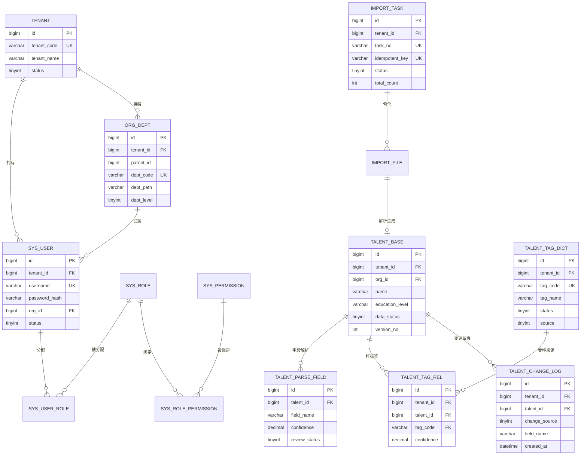

# 2026 顶配版 AI 数字化人才平台 · 数据库设计文档

| 项目 | 内容 |
| --- | --- |
| 文档名称 | 2026 顶配版 AI 数字化人才平台 — 数据库设计文档 |
| 版本 | v1.0 |
| 状态 | 与《需求分析文档》**v1.3**、《架构设计文档》**v1.0** 对齐 · 一期范围：F-3 档案与数字画像模块 |
| 上游依据 | 需求分析文档 v1.3 §9（数据模型）· 架构设计文档 v1.0（六层落位 §4、目录树 §5） |
| 编制角色 | AI 应用开发工程师 |
| 文档读者 | 后端工程师、DBA、测试、架构师 |
| 数据库 | MySQL 8.0.x（业务主库）· Milvus 2.4.x（向量）· Redis 7.x（缓存/队列）· MinIO（对象存储） |
| 编制日期 | 2026-09-21 |

### 修订记录

| 版本 | 日期 | 修订人 | 修订内容 |
| --- | --- | --- | --- |
| v1.0 | 2026-09-21 | AI 应用开发工程师 | 首版：一期 **28 张 MySQL 表**完整 DDL + 3 个 Milvus collection schema + 索引设计 + 字典枚举 + 迁移策略 + 容量估算 + 追踪矩阵 |

---

## 0. 设计原则（红线）

> 🔴 **唯一事实来源声明**：**以 ORM 模型（SQLAlchemy）+ Alembic 迁移为数据库结构的唯一事实来源**；本文档 DDL **仅作字段参考**。任何结构变更必须"改 ORM 模型 → 生成迁移 → Code Review → 发布"，**禁止手工改库**（对齐需求文档 §9.4 视图规范与 M-1 处置）。

| # | 原则 | 本项目约定 |
| :-: | --- | --- |
| 1 | 命名 | 表/字段 `snake_case`；表名不加前缀；关联表 `<a>_<b>`（如 `sys_user_role`、`talent_tag_rel`） |
| 2 | 主键 | **`id BIGINT NOT NULL`，雪花 ID（Snowflake），由应用生成**；不使用自增（详见 §0.1） |
| 3 | 时间 | `created_at` / `updated_at` 为 `DATETIME`，默认 `CURRENT_TIMESTAMP`；业务时间（如 `start_date`）用独立字段 |
| 4 | 软删除 | 业务表统一 `is_deleted TINYINT(1) DEFAULT 0` + `deleted_at DATETIME NULL`；查询默认过滤；唯一索引**必须带 `is_deleted`** |
| 5 | 多租户 | 业务表一律带 `tenant_id`（D-10），**所有查改删必须带租户条件**；联合索引最左列 = `tenant_id` |
| 6 | 金额/比率 | `DECIMAL`，**禁用 `FLOAT`/`DOUBLE`**（成本、相似度、置信度均用 DECIMAL） |
| 7 | 字符集 | 一律 `utf8mb4` / `utf8mb4_unicode_ci` |
| 8 | 枚举 | 固定少量值用 `TINYINT` + 文档注释 + 字典表（`dict_item`）映射；禁止裸字符串散落 |
| 9 | 外键 | **不建物理外键**，由应用层（Service）保证引用完整性 |
| 10 | 敏感字段 | 身份证/手机号/邮箱 **AES 加密存 `VARBINARY`**；另存 `*_hash` 供精确去重 |
| 11 | 日志表 | 审计 / AI 调用 / 变更留痕三类日志**只追加，不更新不软删**，按月分区 |
| 12 | 分区键 | 分区表主键必须含分区列（`PRIMARY KEY (id, created_at)`） |

### 0.1 主键策略说明（与通用模板的偏离）

| 项 | 通用模板 | 本项目 | 原因 |
| --- | --- | --- | --- |
| 主键生成 | `BIGINT UNSIGNED AUTO_INCREMENT` | **雪花 ID，应用生成，`BIGINT`（有符号）** | ① 便于后续多库/分库拆分；② 关联表可提前生成 ID；③ 避免自增暴露业务量 |
| ⚠️ 精度坑 | — | **API 层必须把 `id` 序列化为字符串** | 雪花 ID（int64）超出 JS `Number.MAX_SAFE_INTEGER`（9.007e15），前端 `Number` 会丢精度 → 需 JSON 序列化为 string（已在同类项目踩坑，见 ADR 备注） |
| 对外标识 | 另设 `code`/`uuid` | 业务表另设 `*_code`（如 `dept_code`、`tag_code`） | 对外/导入导出用业务码，防遍历与精度问题 |

---

## 1. 数据源清单

| 编号 | 数据源 | 存什么 | Base（SQLAlchemy） | 说明 |
| :-: | --- | --- | --- | --- |
| **DS-1** | MySQL `talent_platform` | 用户/租户/权限/字典/人才档案/标签/导入/Agent 状态/日志 | `PlatformBase` | **一期唯一关系库**（28 表）；ORM + Alembic 管理 |
| **DS-2** | Milvus `talent_vec` | `resume_vec` / `skill_vec` / `project_vec` 三个 collection | — | 非关系型，单列 schema（§7）；**仅存脱敏检索单元** |
| **DS-3** | Redis db0~db2 | `sess:*` 会话、`cache:*` 缓存、`rate:*` 限流、`agent_mem:*` 短期记忆、`queue:*` 任务队列 | — | 只存**可丢**数据；权威状态落 MySQL |
| **DS-4** | MinIO `talent-files`（或本地 FS） | 原始简历文件（pd/word/图片/扫描件/压缩包） | — | 路径入库 `import_file.storage_path`（ADR-10） |
| ~~DS-5~~ | ~~PgSQL 分析副本~~ | ⏸ 一期不建 | — | 随 F-5（NL2SQL）启用 |

> **一期只需一个物理关系库**（DS-1）：无跨库、无 CDC、无语义层视图（需求文档 §9.2.1）。

---

## 2. ER 图（核心 9 张表）



> 规则：只画核心表，避免糊成一团；其余表（履历明细 4 表、查重、Agent 状态 3 表、日志 3 表、字典 2 表）在 §3 表清单中说明。

---

## 3. 表清单

> 表名前带 `TBL-nn` 编号，供《接口设计文档》《类图与时序图》反向引用（如"写入 TBL-11"）。

### 3.1 MySQL（DS-1，一期 28 张）

| 编号 | 表名 | 类型 | 说明 | 预估行数 | 关联功能点 |
| :-: | --- | :-: | --- | :-: | --- |
| TBL-01 | `tenant` | 主表 | 租户（一期单行） | 10⁰ | D-10 |
| TBL-02 | `sys_user` | 主表 | 用户账号 | 10⁴ | F-1.1/F-1.2 |
| TBL-03 | `sys_role` | 主表 | 角色（7 预置 + 自定义） | 10¹ | F-1.3 |
| TBL-04 | `sys_permission` | 主表 | 权限点（菜单/按钮/接口） | 10² | F-1.3 |
| TBL-05 | `sys_user_role` | 关联表 | 用户-角色 | 10⁴ | F-1.3 |
| TBL-06 | `sys_role_permission` | 关联表 | 角色-权限 | 10³ | F-1.3 |
| TBL-07 | `org_dept` | 主表 | 组织架构（≥5 级） | 10³ | F-1.1 |
| TBL-08 | `position` | 主表 | 岗位 | 10³ | F-1.1 |
| TBL-09 | `dict_type` | 字典 | 字典类型 | 10¹ | F-1.7 |
| TBL-10 | `dict_item` | 字典 | 字典项 | 10² | F-1.7 |
| **TBL-11** | `talent_base` | 主表 | **人才主档**（核心） | 10⁵ | F-3.2 |
| TBL-12 | `talent_work_exp` | 明细 | 工作经历 | 10⁶ | F-3.2 |
| TBL-13 | `talent_project_exp` | 明细 | 项目经历 | 10⁶ | F-3.2 |
| TBL-14 | `talent_skill` | 明细 | 技能 | 10⁶ | F-3.2/F-3.4 |
| TBL-15 | `talent_cert` | 明细 | 证书 | 10⁵ | F-3.2 |
| **TBL-16** | `talent_parse_field` | 明细 | **字段级解析 + 置信度 + 复核状态** | 10⁷ | F-3.2/F-3.3 |
| TBL-17 | `talent_dup_pair` | 主表 | 重复档案候选 | 10⁴ | F-3.5 |
| **TBL-18** | `talent_tag_dict` | 主表 | **受控标签词表**（核心） | 10² | F-3.4.1 |
| TBL-19 | `talent_tag_rel` | 关联表 | 人才-标签关系 | 10⁶ | F-3.4/F-3.4.1 |
| **TBL-20** | `import_task` | 主表 | **导入任务**（核心） | 10⁴ | F-3.1/F-3.8 |
| TBL-21 | `import_file` | 明细 | 导入文件明细 | 10⁵ | F-3.1 |
| **TBL-22** | `talent_change_log` | 日志 | **档案变更留痕**（只追加） | 10⁷ | F-3.10 |
| TBL-23 | `prompt_template` | 主表 | Prompt 模板（版本化） | 10² | F-9.2 |
| TBL-24 | `ai_call_log` | 日志 | AI 调用日志（只追加，分区） | 10⁷ | F-9.5 |
| TBL-25 | `agent_task` | 主表 | Agent 任务（权威状态） | 10⁶ | F-A0 |
| TBL-26 | `agent_step` | 日志 | Agent 步骤（只追加） | 10⁷ | F-A0 |
| TBL-27 | `agent_interrupt` | 主表 | 人工介入待办 | 10⁵ | F-A0.3 |
| TBL-28 | `audit_log` | 日志 | 审计日志（只追加，分区） | 10⁷ | F-1.5 |

> **合计 28 张**（v1.3 新增 TBL-22，对应 F-3.10 档案变更留痕，D-16）。

### 3.2 Milvus（DS-2）与 Redis（DS-3）

| 编号 | 名称 | 说明 | 关联功能点 |
| :-: | --- | --- | --- |
| COL-01 | `resume_vec` | 简历全文（脱敏检索单元）向量 | F-3.4/F-3.6/F-3.7 |
| COL-02 | `skill_vec` | 技能向量 | F-3.4/F-3.6 |
| COL-03 | `project_vec` | 项目向量 | F-3.4/F-3.6 |
| — | Redis `sess:*` `cache:*` `rate:*` `agent_mem:*` `queue:*` | 会话/缓存/限流/记忆/队列 | F-1.6/F-A0 |

> 后续阶段：MySQL 增测评 3 表 / `kb_doc` `kb_chunk` 等；Milvus 增 `kb_vec` `jd_vec` `question_vec`；PgSQL 整体启用。

---

## 4. 建表 DDL（MySQL 8 语法）

> **通用列组**（下述 DDL 中以 `-- <通用>` 标注处一律展开为）：
>
> ```sql
>   `tenant_id`   BIGINT     NOT NULL DEFAULT 0   COMMENT '租户 ID（一期固定单租户值，D-10）',
>   `is_deleted`  TINYINT(1) NOT NULL DEFAULT 0   COMMENT '软删除 0 否 1 是',
>   `deleted_at`  DATETIME   NULL                 COMMENT '删除时间',
>   `created_at`  DATETIME   NOT NULL DEFAULT CURRENT_TIMESTAMP                              COMMENT '创建时间',
>   `updated_at`  DATETIME   NOT NULL DEFAULT CURRENT_TIMESTAMP ON UPDATE CURRENT_TIMESTAMP  COMMENT '更新时间',
> ```
> 主键统一为 `id BIGINT NOT NULL COMMENT '主键（雪花 ID，应用生成）'`。

### 4.1 租户与权限（TBL-01 ~ TBL-08）

```sql
-- TBL-01 租户（一期单行；本表自身无 tenant_id）
CREATE TABLE `tenant` (
  `id`          BIGINT       NOT NULL                 COMMENT '主键（雪花 ID）',
  `tenant_code` VARCHAR(64)  NOT NULL                 COMMENT '租户编码',
  `tenant_name` VARCHAR(128) NOT NULL                 COMMENT '单位名称',
  `status`      TINYINT      NOT NULL DEFAULT 1       COMMENT '状态 0 停用 1 启用',
  `config_json` JSON         NULL                     COMMENT '租户级配置：出网策略/阈值等',
  `created_at`  DATETIME     NOT NULL DEFAULT CURRENT_TIMESTAMP,
  `updated_at`  DATETIME     NOT NULL DEFAULT CURRENT_TIMESTAMP ON UPDATE CURRENT_TIMESTAMP,
  PRIMARY KEY (`id`),
  UNIQUE KEY `uk_tenant_code` (`tenant_code`)
) ENGINE=InnoDB DEFAULT CHARSET=utf8mb4 COLLATE=utf8mb4_unicode_ci COMMENT='租户（一期单行）';

-- TBL-02 用户账号
CREATE TABLE `sys_user` (
  `id`               BIGINT         NOT NULL                 COMMENT '主键（雪花 ID）',
  `tenant_id`        BIGINT         NOT NULL DEFAULT 0       COMMENT '租户 ID',
  `username`         VARCHAR(64)    NOT NULL                 COMMENT '登录名',
  `password_hash`    VARCHAR(100)   NOT NULL                 COMMENT '密码 bcrypt 哈希',
  `real_name`        VARCHAR(64)    NULL                      COMMENT '姓名',
  `org_id`           BIGINT         NULL                      COMMENT '归属组织（行级权限字段）',
  `position_id`      BIGINT         NULL                      COMMENT '岗位 ID',
  `phone_enc`        VARBINARY(256) NULL                      COMMENT '手机号（AES 加密）',
  `email_enc`        VARBINARY(256) NULL                      COMMENT '邮箱（AES 加密）',
  `status`           TINYINT        NOT NULL DEFAULT 1        COMMENT '状态 0 禁用 1 启用',
  `login_fail_count` INT            NOT NULL DEFAULT 0        COMMENT '连续登录失败次数',
  `locked_until`     DATETIME       NULL                      COMMENT '锁定截止时间（连错 5 次锁 10 分钟）',
  `last_login_at`    DATETIME       NULL                      COMMENT '最近登录时间',
  `is_deleted`       TINYINT(1)     NOT NULL DEFAULT 0        COMMENT '软删除',
  `deleted_at`       DATETIME       NULL,
  `created_at`       DATETIME       NOT NULL DEFAULT CURRENT_TIMESTAMP,
  `updated_at`       DATETIME       NOT NULL DEFAULT CURRENT_TIMESTAMP ON UPDATE CURRENT_TIMESTAMP,
  PRIMARY KEY (`id`),
  UNIQUE KEY `uk_tenant_username` (`tenant_id`,`username`,`is_deleted`),
  KEY `idx_tenant_org` (`tenant_id`,`org_id`)
) ENGINE=InnoDB DEFAULT CHARSET=utf8mb4 COLLATE=utf8mb4_unicode_ci COMMENT='用户账号';

-- TBL-03 角色
CREATE TABLE `sys_role` (
  `id`         BIGINT       NOT NULL              COMMENT '主键（雪花 ID）',
  `tenant_id`  BIGINT       NOT NULL DEFAULT 0    COMMENT '租户 ID',
  `role_code`  VARCHAR(32)  NOT NULL              COMMENT '角色码：ADM/EXEC/HR/MGR/EMP/AIOPS/AUDIT 或自定义',
  `role_name`  VARCHAR(64)  NOT NULL              COMMENT '角色名',
  `data_scope` TINYINT      NOT NULL DEFAULT 3    COMMENT '数据范围 1 全部 2 本部门 3 本人 4 仅统计值(不可见明细)',
  `is_builtin` TINYINT(1)   NOT NULL DEFAULT 0    COMMENT '是否预置角色 0 否 1 是',
  `status`     TINYINT      NOT NULL DEFAULT 1    COMMENT '状态 0 停用 1 启用',
  `is_deleted` TINYINT(1)   NOT NULL DEFAULT 0    COMMENT '软删除',
  `deleted_at` DATETIME     NULL,
  `created_at` DATETIME     NOT NULL DEFAULT CURRENT_TIMESTAMP,
  `updated_at` DATETIME     NOT NULL DEFAULT CURRENT_TIMESTAMP ON UPDATE CURRENT_TIMESTAMP,
  PRIMARY KEY (`id`),
  UNIQUE KEY `uk_tenant_role_code` (`tenant_id`,`role_code`,`is_deleted`)
) ENGINE=InnoDB DEFAULT CHARSET=utf8mb4 COLLATE=utf8mb4_unicode_ci COMMENT='角色';

-- TBL-04 权限点
CREATE TABLE `sys_permission` (
  `id`         BIGINT       NOT NULL              COMMENT '主键（雪花 ID）',
  `tenant_id`  BIGINT       NOT NULL DEFAULT 0    COMMENT '租户 ID',
  `perm_code`  VARCHAR(64)  NOT NULL              COMMENT '权限码，如 talent:view / talent:review',
  `perm_name`  VARCHAR(64)  NOT NULL              COMMENT '权限名',
  `perm_type`  TINYINT      NOT NULL DEFAULT 3    COMMENT '类型 1 菜单 2 按钮 3 接口',
  `parent_id`  BIGINT       NOT NULL DEFAULT 0    COMMENT '父权限 ID（0 为根）',
  `sort_no`    INT          NOT NULL DEFAULT 0    COMMENT '排序',
  `status`     TINYINT      NOT NULL DEFAULT 1    COMMENT '状态 0 停用 1 启用',
  `is_deleted` TINYINT(1)   NOT NULL DEFAULT 0    COMMENT '软删除',
  `deleted_at` DATETIME     NULL,
  `created_at` DATETIME     NOT NULL DEFAULT CURRENT_TIMESTAMP,
  `updated_at` DATETIME     NOT NULL DEFAULT CURRENT_TIMESTAMP ON UPDATE CURRENT_TIMESTAMP,
  PRIMARY KEY (`id`),
  UNIQUE KEY `uk_tenant_perm_code` (`tenant_id`,`perm_code`,`is_deleted`),
  KEY `idx_tenant_parent` (`tenant_id`,`parent_id`)
) ENGINE=InnoDB DEFAULT CHARSET=utf8mb4 COLLATE=utf8mb4_unicode_ci COMMENT='权限点';

-- TBL-05 用户-角色
CREATE TABLE `sys_user_role` (
  `id`         BIGINT     NOT NULL              COMMENT '主键（雪花 ID）',
  `tenant_id`  BIGINT     NOT NULL DEFAULT 0    COMMENT '租户 ID',
  `user_id`    BIGINT     NOT NULL              COMMENT '用户 ID',
  `role_id`    BIGINT     NOT NULL              COMMENT '角色 ID',
  `created_at` DATETIME   NOT NULL DEFAULT CURRENT_TIMESTAMP,
  PRIMARY KEY (`id`),
  UNIQUE KEY `uk_tenant_user_role` (`tenant_id`,`user_id`,`role_id`),
  KEY `idx_tenant_role` (`tenant_id`,`role_id`)
) ENGINE=InnoDB DEFAULT CHARSET=utf8mb4 COLLATE=utf8mb4_unicode_ci COMMENT='用户-角色关联';

-- TBL-06 角色-权限
CREATE TABLE `sys_role_permission` (
  `id`         BIGINT     NOT NULL              COMMENT '主键（雪花 ID）',
  `tenant_id`  BIGINT     NOT NULL DEFAULT 0    COMMENT '租户 ID',
  `role_id`    BIGINT     NOT NULL              COMMENT '角色 ID',
  `perm_id`    BIGINT     NOT NULL              COMMENT '权限 ID',
  `created_at` DATETIME   NOT NULL DEFAULT CURRENT_TIMESTAMP,
  PRIMARY KEY (`id`),
  UNIQUE KEY `uk_tenant_role_perm` (`tenant_id`,`role_id`,`perm_id`),
  KEY `idx_tenant_perm` (`tenant_id`,`perm_id`)
) ENGINE=InnoDB DEFAULT CHARSET=utf8mb4 COLLATE=utf8mb4_unicode_ci COMMENT='角色-权限关联';

-- TBL-07 组织架构（支持 ≥5 级）
CREATE TABLE `org_dept` (
  `id`             BIGINT       NOT NULL              COMMENT '主键（雪花 ID）',
  `tenant_id`      BIGINT       NOT NULL DEFAULT 0    COMMENT '租户 ID',
  `parent_id`      BIGINT       NOT NULL DEFAULT 0    COMMENT '父组织 ID（0 为根）',
  `dept_code`      VARCHAR(64)  NOT NULL              COMMENT '组织编码',
  `dept_name`      VARCHAR(128) NOT NULL              COMMENT '组织名称',
  `dept_level`     TINYINT      NOT NULL DEFAULT 1    COMMENT '层级（1 起，支持 ≥5 级）',
  `dept_path`      VARCHAR(512) NULL                  COMMENT '祖级路径，如 /1/12/125/（子树查询用）',
  `leader_user_id` BIGINT       NULL                  COMMENT '负责人用户 ID',
  `sort_no`        INT          NOT NULL DEFAULT 0    COMMENT '排序',
  `status`         TINYINT      NOT NULL DEFAULT 1    COMMENT '状态 0 停用 1 启用',
  `is_deleted`     TINYINT(1)   NOT NULL DEFAULT 0    COMMENT '软删除',
  `deleted_at`     DATETIME     NULL,
  `created_at`     DATETIME     NOT NULL DEFAULT CURRENT_TIMESTAMP,
  `updated_at`     DATETIME     NOT NULL DEFAULT CURRENT_TIMESTAMP ON UPDATE CURRENT_TIMESTAMP,
  PRIMARY KEY (`id`),
  UNIQUE KEY `uk_tenant_dept_code` (`tenant_id`,`dept_code`,`is_deleted`),
  KEY `idx_tenant_parent` (`tenant_id`,`parent_id`),
  KEY `idx_tenant_path` (`tenant_id`,`dept_path`(191))
) ENGINE=InnoDB DEFAULT CHARSET=utf8mb4 COLLATE=utf8mb4_unicode_ci COMMENT='组织架构';

-- TBL-08 岗位
CREATE TABLE `position` (
  `id`             BIGINT       NOT NULL              COMMENT '主键（雪花 ID）',
  `tenant_id`      BIGINT       NOT NULL DEFAULT 0    COMMENT '租户 ID',
  `position_code`  VARCHAR(64)  NOT NULL              COMMENT '岗位编码',
  `position_name`  VARCHAR(128) NOT NULL              COMMENT '岗位名称',
  `dept_id`        BIGINT       NULL                  COMMENT '所属组织 ID',
  `position_level` TINYINT      NULL                  COMMENT '岗位层级',
  `status`         TINYINT      NOT NULL DEFAULT 1    COMMENT '状态 0 停用 1 启用',
  `is_deleted`     TINYINT(1)   NOT NULL DEFAULT 0    COMMENT '软删除',
  `deleted_at`     DATETIME     NULL,
  `created_at`     DATETIME     NOT NULL DEFAULT CURRENT_TIMESTAMP,
  `updated_at`     DATETIME     NOT NULL DEFAULT CURRENT_TIMESTAMP ON UPDATE CURRENT_TIMESTAMP,
  PRIMARY KEY (`id`),
  UNIQUE KEY `uk_tenant_position_code` (`tenant_id`,`position_code`,`is_deleted`),
  KEY `idx_tenant_dept` (`tenant_id`,`dept_id`)
) ENGINE=InnoDB DEFAULT CHARSET=utf8mb4 COLLATE=utf8mb4_unicode_ci COMMENT='岗位';
```

### 4.2 字典（TBL-09 ~ TBL-10）

```sql
-- TBL-09 字典类型（扁平枚举码表，区别于受控标签词表）
CREATE TABLE `dict_type` (
  `id`         BIGINT       NOT NULL              COMMENT '主键（雪花 ID）',
  `tenant_id`  BIGINT       NOT NULL DEFAULT 0    COMMENT '租户 ID',
  `type_code`  VARCHAR(64)  NOT NULL              COMMENT '类型编码，如 education_level',
  `type_name`  VARCHAR(128) NOT NULL              COMMENT '类型名',
  `remark`     VARCHAR(255) NULL                  COMMENT '备注',
  `status`     TINYINT      NOT NULL DEFAULT 1    COMMENT '状态 0 停用 1 启用',
  `is_deleted` TINYINT(1)   NOT NULL DEFAULT 0    COMMENT '软删除',
  `deleted_at` DATETIME     NULL,
  `created_at` DATETIME     NOT NULL DEFAULT CURRENT_TIMESTAMP,
  `updated_at` DATETIME     NOT NULL DEFAULT CURRENT_TIMESTAMP ON UPDATE CURRENT_TIMESTAMP,
  PRIMARY KEY (`id`),
  UNIQUE KEY `uk_tenant_type_code` (`tenant_id`,`type_code`,`is_deleted`)
) ENGINE=InnoDB DEFAULT CHARSET=utf8mb4 COLLATE=utf8mb4_unicode_ci COMMENT='字典类型';

-- TBL-10 字典项
CREATE TABLE `dict_item` (
  `id`          BIGINT       NOT NULL              COMMENT '主键（雪花 ID）',
  `tenant_id`   BIGINT       NOT NULL DEFAULT 0    COMMENT '租户 ID',
  `type_code`   VARCHAR(64)  NOT NULL              COMMENT '字典类型编码',
  `item_code`   VARCHAR(64)  NOT NULL              COMMENT '枚举值',
  `item_name`   VARCHAR(128) NOT NULL              COMMENT '显示名',
  `sort_no`     INT          NOT NULL DEFAULT 0    COMMENT '排序',
  `parent_code` VARCHAR(64)  NULL                  COMMENT '父项编码（支持多级）',
  `status`      TINYINT      NOT NULL DEFAULT 1    COMMENT '状态 0 停用 1 启用',
  `is_deleted`  TINYINT(1)   NOT NULL DEFAULT 0    COMMENT '软删除',
  `deleted_at`  DATETIME     NULL,
  `created_at`  DATETIME     NOT NULL DEFAULT CURRENT_TIMESTAMP,
  `updated_at`  DATETIME     NOT NULL DEFAULT CURRENT_TIMESTAMP ON UPDATE CURRENT_TIMESTAMP,
  PRIMARY KEY (`id`),
  UNIQUE KEY `uk_tenant_type_item` (`tenant_id`,`type_code`,`item_code`,`is_deleted`),
  KEY `idx_tenant_type` (`tenant_id`,`type_code`)
) ENGINE=InnoDB DEFAULT CHARSET=utf8mb4 COLLATE=utf8mb4_unicode_ci COMMENT='字典项';
```

### 4.3 人才档案与解析（TBL-11 ~ TBL-17）

```sql
-- TBL-11 人才主档（核心）
CREATE TABLE `talent_base` (
  `id`              BIGINT         NOT NULL              COMMENT '主键（雪花 ID）',
  `tenant_id`       BIGINT         NOT NULL DEFAULT 0    COMMENT '租户 ID',
  `user_id`         BIGINT         NULL                  COMMENT '关联用户（外部候选人可空）',
  `org_id`          BIGINT         NULL                  COMMENT '归属组织（行级权限字段）',
  `name`            VARCHAR(64)    NOT NULL              COMMENT '姓名（出网前替换占位符，F-3.9）',
  `gender`          TINYINT        NULL                  COMMENT '性别 0 未知 1 男 2 女',
  `birth_date`      DATE           NULL                  COMMENT '出生年月',
  `id_card_enc`     VARBINARY(256) NULL                  COMMENT '身份证（AES 加密）',
  `id_card_hash`    CHAR(64)       NULL                  COMMENT '身份证 SHA256（精确去重/唯一）',
  `phone_enc`       VARBINARY(256) NULL                  COMMENT '手机号（AES 加密）',
  `phone_hash`      CHAR(64)       NULL                  COMMENT '手机号 SHA256（精确去重）',
  `email_enc`       VARBINARY(256) NULL                  COMMENT '邮箱（AES 加密）',
  `education_level` VARCHAR(32)    NULL                  COMMENT '学历（dict_item 码）',
  `school`          VARCHAR(128)   NULL                  COMMENT '院校',
  `major`           VARCHAR(128)   NULL                  COMMENT '专业',
  `work_years`      INT            NULL                  COMMENT '工作年限',
  `profile_vec_id`  VARCHAR(64)    NULL                  COMMENT 'Milvus 向量主键',
  `data_status`     TINYINT        NOT NULL DEFAULT 0    COMMENT '数据状态 0 待复核 1 有效 2 已合并 3 已归档 4 已删除',
  `merged_into_id`  BIGINT         NULL                  COMMENT '合并去向（被合并档案指向主档案；F-3.5 回滚依据）',
  `parse_task_id`   BIGINT         NULL                  COMMENT '来源导入任务 ID',
  `version_no`      INT            NOT NULL DEFAULT 1    COMMENT '当前版本号（F-3.10 自增）',
  `is_deleted`      TINYINT(1)     NOT NULL DEFAULT 0    COMMENT '软删除',
  `deleted_at`      DATETIME       NULL,
  `created_at`      DATETIME       NOT NULL DEFAULT CURRENT_TIMESTAMP,
  `updated_at`      DATETIME       NOT NULL DEFAULT CURRENT_TIMESTAMP ON UPDATE CURRENT_TIMESTAMP,
  PRIMARY KEY (`id`),
  UNIQUE KEY `uk_tenant_idcard` (`tenant_id`,`id_card_hash`,`is_deleted`),
  KEY `idx_tenant_org` (`tenant_id`,`org_id`),
  KEY `idx_tenant_status` (`tenant_id`,`data_status`),
  KEY `idx_tenant_created` (`tenant_id`,`created_at`),
  KEY `idx_tenant_phone` (`tenant_id`,`phone_hash`),
  KEY `idx_parse_task` (`parse_task_id`)
) ENGINE=InnoDB DEFAULT CHARSET=utf8mb4 COLLATE=utf8mb4_unicode_ci COMMENT='人才主档';

-- TBL-12 工作经历
CREATE TABLE `talent_work_exp` (
  `id`            BIGINT       NOT NULL              COMMENT '主键（雪花 ID）',
  `tenant_id`     BIGINT       NOT NULL DEFAULT 0    COMMENT '租户 ID',
  `talent_id`     BIGINT       NOT NULL              COMMENT '人才 ID',
  `seq_no`        INT          NOT NULL DEFAULT 0    COMMENT '序号（时间倒序）',
  `company`       VARCHAR(128) NOT NULL              COMMENT '公司名称',
  `dept_name`     VARCHAR(128) NULL                  COMMENT '部门',
  `position_name` VARCHAR(128) NULL                  COMMENT '职位',
  `start_date`    DATE         NULL                  COMMENT '开始日期',
  `end_date`      DATE         NULL                  COMMENT '结束日期',
  `is_current`    TINYINT(1)   NOT NULL DEFAULT 0    COMMENT '是否在职',
  `description`   TEXT         NULL                  COMMENT '工作描述',
  `source`        TINYINT      NOT NULL DEFAULT 0    COMMENT '来源 0 AI 解析 1 人工',
  `is_deleted`    TINYINT(1)   NOT NULL DEFAULT 0    COMMENT '软删除',
  `deleted_at`    DATETIME     NULL,
  `created_at`    DATETIME     NOT NULL DEFAULT CURRENT_TIMESTAMP,
  `updated_at`    DATETIME     NOT NULL DEFAULT CURRENT_TIMESTAMP ON UPDATE CURRENT_TIMESTAMP,
  PRIMARY KEY (`id`),
  KEY `idx_tenant_talent` (`tenant_id`,`talent_id`,`seq_no`)
) ENGINE=InnoDB DEFAULT CHARSET=utf8mb4 COLLATE=utf8mb4_unicode_ci COMMENT='工作经历';

-- TBL-13 项目经历
CREATE TABLE `talent_project_exp` (
  `id`           BIGINT       NOT NULL              COMMENT '主键（雪花 ID）',
  `tenant_id`    BIGINT       NOT NULL DEFAULT 0    COMMENT '租户 ID',
  `talent_id`    BIGINT       NOT NULL              COMMENT '人才 ID',
  `seq_no`       INT          NOT NULL DEFAULT 0    COMMENT '序号',
  `project_name` VARCHAR(128) NOT NULL              COMMENT '项目名称',
  `role_name`    VARCHAR(64)  NULL                  COMMENT '担任角色',
  `start_date`   DATE         NULL                  COMMENT '开始日期',
  `end_date`     DATE         NULL                  COMMENT '结束日期',
  `description`  TEXT         NULL                  COMMENT '项目描述',
  `tech_stack`   JSON         NULL                  COMMENT '技术栈数组',
  `source`       TINYINT      NOT NULL DEFAULT 0    COMMENT '来源 0 AI 1 人工',
  `is_deleted`   TINYINT(1)   NOT NULL DEFAULT 0    COMMENT '软删除',
  `deleted_at`   DATETIME     NULL,
  `created_at`   DATETIME     NOT NULL DEFAULT CURRENT_TIMESTAMP,
  `updated_at`   DATETIME     NOT NULL DEFAULT CURRENT_TIMESTAMP ON UPDATE CURRENT_TIMESTAMP,
  PRIMARY KEY (`id`),
  KEY `idx_tenant_talent` (`tenant_id`,`talent_id`,`seq_no`)
) ENGINE=InnoDB DEFAULT CHARSET=utf8mb4 COLLATE=utf8mb4_unicode_ci COMMENT='项目经历';

-- TBL-14 技能
CREATE TABLE `talent_skill` (
  `id`          BIGINT       NOT NULL              COMMENT '主键（雪花 ID）',
  `tenant_id`   BIGINT       NOT NULL DEFAULT 0    COMMENT '租户 ID',
  `talent_id`   BIGINT       NOT NULL              COMMENT '人才 ID',
  `skill_name`  VARCHAR(64)  NOT NULL              COMMENT '技能名',
  `skill_level` TINYINT      NULL                  COMMENT '熟练度 0~5',
  `years`       DECIMAL(4,1) NULL                  COMMENT '使用年限',
  `source`      TINYINT      NOT NULL DEFAULT 0    COMMENT '来源 0 AI 1 人工',
  `is_deleted`  TINYINT(1)   NOT NULL DEFAULT 0    COMMENT '软删除',
  `deleted_at`  DATETIME     NULL,
  `created_at`  DATETIME     NOT NULL DEFAULT CURRENT_TIMESTAMP,
  `updated_at`  DATETIME     NOT NULL DEFAULT CURRENT_TIMESTAMP ON UPDATE CURRENT_TIMESTAMP,
  PRIMARY KEY (`id`),
  KEY `idx_tenant_talent` (`tenant_id`,`talent_id`),
  KEY `idx_tenant_skill` (`tenant_id`,`skill_name`)
) ENGINE=InnoDB DEFAULT CHARSET=utf8mb4 COLLATE=utf8mb4_unicode_ci COMMENT='技能';

-- TBL-15 证书
CREATE TABLE `talent_cert` (
  `id`          BIGINT       NOT NULL              COMMENT '主键（雪花 ID）',
  `tenant_id`   BIGINT       NOT NULL DEFAULT 0    COMMENT '租户 ID',
  `talent_id`   BIGINT       NOT NULL              COMMENT '人才 ID',
  `cert_name`   VARCHAR(128) NOT NULL              COMMENT '证书名称',
  `cert_no`     VARCHAR(64)  NULL                  COMMENT '证书编号',
  `issue_org`   VARCHAR(128) NULL                  COMMENT '发证机构',
  `issue_date`  DATE         NULL                  COMMENT '发证日期',
  `expire_date` DATE         NULL                  COMMENT '有效期至',
  `is_deleted`  TINYINT(1)   NOT NULL DEFAULT 0    COMMENT '软删除',
  `deleted_at`  DATETIME     NULL,
  `created_at`  DATETIME     NOT NULL DEFAULT CURRENT_TIMESTAMP,
  `updated_at`  DATETIME     NOT NULL DEFAULT CURRENT_TIMESTAMP ON UPDATE CURRENT_TIMESTAMP,
  PRIMARY KEY (`id`),
  KEY `idx_tenant_talent` (`tenant_id`,`talent_id`)
) ENGINE=InnoDB DEFAULT CHARSET=utf8mb4 COLLATE=utf8mb4_unicode_ci COMMENT='证书';

-- TBL-16 字段级解析与复核（核心）
CREATE TABLE `talent_parse_field` (
  `id`            BIGINT       NOT NULL              COMMENT '主键（雪花 ID）',
  `tenant_id`     BIGINT       NOT NULL DEFAULT 0    COMMENT '租户 ID',
  `talent_id`     BIGINT       NOT NULL              COMMENT '人才 ID',
  `field_name`    VARCHAR(64)  NOT NULL              COMMENT '字段名',
  `raw_text`      TEXT         NULL                  COMMENT '原文片段',
  `parsed_value`  TEXT         NULL                  COMMENT '抽取值',
  `confidence`    DECIMAL(4,3) NULL                  COMMENT '置信度 0.000~1.000',
  `extract_model` VARCHAR(64)  NULL                  COMMENT '抽取模型与版本',
  `review_status` TINYINT      NOT NULL DEFAULT 0    COMMENT '复核状态 0 待复核 1 已确认 2 已修正 3 免复核(低影响)',
  `reviewed_by`   BIGINT       NULL                  COMMENT '复核人',
  `reviewed_at`   DATETIME     NULL                  COMMENT '复核时间',
  `is_deleted`    TINYINT(1)   NOT NULL DEFAULT 0    COMMENT '软删除',
  `deleted_at`    DATETIME     NULL,
  `created_at`    DATETIME     NOT NULL DEFAULT CURRENT_TIMESTAMP,
  `updated_at`    DATETIME     NOT NULL DEFAULT CURRENT_TIMESTAMP ON UPDATE CURRENT_TIMESTAMP,
  PRIMARY KEY (`id`),
  KEY `idx_tenant_talent_field` (`tenant_id`,`talent_id`,`field_name`),
  KEY `idx_tenant_review` (`tenant_id`,`review_status`),
  KEY `idx_tenant_talent_conf` (`tenant_id`,`talent_id`,`confidence`)
) ENGINE=InnoDB DEFAULT CHARSET=utf8mb4 COLLATE=utf8mb4_unicode_ci COMMENT='字段级解析与复核';

-- TBL-17 重复档案候选
CREATE TABLE `talent_dup_pair` (
  `id`           BIGINT       NOT NULL              COMMENT '主键（雪花 ID）',
  `tenant_id`    BIGINT       NOT NULL DEFAULT 0    COMMENT '租户 ID',
  `talent_id_a`  BIGINT       NOT NULL              COMMENT '档案 A（约定 a < b 防重）',
  `talent_id_b`  BIGINT       NOT NULL              COMMENT '档案 B',
  `similarity`   DECIMAL(5,4) NOT NULL              COMMENT '向量相似度 0.0000~1.0000',
  `match_fields` JSON         NULL                  COMMENT '命中比对字段（姓名/学历/手机号等）',
  `status`       TINYINT      NOT NULL DEFAULT 0    COMMENT '状态 0 待处理 1 已合并 2 已忽略',
  `merged_by`    BIGINT       NULL                  COMMENT '合并操作人',
  `merged_at`    DATETIME     NULL                  COMMENT '合并时间（回滚指向 talent_change_log 快照）',
  `is_deleted`   TINYINT(1)   NOT NULL DEFAULT 0    COMMENT '软删除',
  `deleted_at`   DATETIME     NULL,
  `created_at`   DATETIME     NOT NULL DEFAULT CURRENT_TIMESTAMP,
  `updated_at`   DATETIME     NOT NULL DEFAULT CURRENT_TIMESTAMP ON UPDATE CURRENT_TIMESTAMP,
  PRIMARY KEY (`id`),
  UNIQUE KEY `uk_tenant_pair` (`tenant_id`,`talent_id_a`,`talent_id_b`),
  KEY `idx_tenant_status` (`tenant_id`,`status`)
) ENGINE=InnoDB DEFAULT CHARSET=utf8mb4 COLLATE=utf8mb4_unicode_ci COMMENT='重复档案候选';
```

### 4.4 标签体系（TBL-18 ~ TBL-19）

```sql
-- TBL-18 受控标签词表（核心）
CREATE TABLE `talent_tag_dict` (
  `id`           BIGINT       NOT NULL              COMMENT '主键（雪花 ID）',
  `tenant_id`    BIGINT       NOT NULL DEFAULT 0    COMMENT '租户 ID',
  `tag_code`     VARCHAR(64)  NOT NULL              COMMENT '标签编码',
  `tag_name`     VARCHAR(64)  NOT NULL              COMMENT '标签名',
  `category_l1`  VARCHAR(64)  NULL                  COMMENT '一级分类',
  `category_l2`  VARCHAR(64)  NULL                  COMMENT '二级分类',
  `category_l3`  VARCHAR(64)  NULL                  COMMENT '三级分类',
  `synonyms`     JSON         NULL                  COMMENT '同义词数组（AI 选词/检索归一）',
  `status`       TINYINT      NOT NULL DEFAULT 0    COMMENT '状态 0 待审核(AI建议) 1 启用 2 停用',
  `source`       TINYINT      NOT NULL DEFAULT 0    COMMENT '来源 0 人工创建 1 AI 建议',
  `suggested_by` BIGINT       NULL                  COMMENT '建议人（AI 触发为空/系统号）',
  `approved_by`  BIGINT       NULL                  COMMENT '审核人',
  `approved_at`  DATETIME     NULL                  COMMENT '审核通过时间（未过审不得被引用）',
  `is_deleted`   TINYINT(1)   NOT NULL DEFAULT 0    COMMENT '软删除',
  `deleted_at`   DATETIME     NULL,
  `created_at`   DATETIME     NOT NULL DEFAULT CURRENT_TIMESTAMP,
  `updated_at`   DATETIME     NOT NULL DEFAULT CURRENT_TIMESTAMP ON UPDATE CURRENT_TIMESTAMP,
  PRIMARY KEY (`id`),
  UNIQUE KEY `uk_tenant_tag_code` (`tenant_id`,`tag_code`,`is_deleted`),
  KEY `idx_tenant_status` (`tenant_id`,`status`),
  KEY `idx_tenant_category` (`tenant_id`,`category_l1`,`category_l2`)
) ENGINE=InnoDB DEFAULT CHARSET=utf8mb4 COLLATE=utf8mb4_unicode_ci COMMENT='受控标签词表';

-- TBL-19 人才-标签关系
CREATE TABLE `talent_tag_rel` (
  `id`         BIGINT       NOT NULL              COMMENT '主键（雪花 ID）',
  `tenant_id`  BIGINT       NOT NULL DEFAULT 0    COMMENT '租户 ID',
  `talent_id`  BIGINT       NOT NULL              COMMENT '人才 ID',
  `tag_code`   VARCHAR(64)  NOT NULL              COMMENT '标签编码（必须取自 talent_tag_dict 已启用项）',
  `confidence` DECIMAL(4,3) NULL                  COMMENT '打标置信度',
  `source`     TINYINT      NOT NULL DEFAULT 0    COMMENT '来源 0 AI 解析 1 人工指定',
  `is_deleted` TINYINT(1)   NOT NULL DEFAULT 0    COMMENT '软删除',
  `deleted_at` DATETIME     NULL,
  `created_at` DATETIME     NOT NULL DEFAULT CURRENT_TIMESTAMP,
  `updated_at` DATETIME     NOT NULL DEFAULT CURRENT_TIMESTAMP ON UPDATE CURRENT_TIMESTAMP,
  PRIMARY KEY (`id`),
  UNIQUE KEY `uk_tenant_talent_tag` (`tenant_id`,`talent_id`,`tag_code`,`is_deleted`),
  KEY `idx_tenant_tag` (`tenant_id`,`tag_code`)
) ENGINE=InnoDB DEFAULT CHARSET=utf8mb4 COLLATE=utf8mb4_unicode_ci COMMENT='人才-标签关系';

-- 应用层硬约束（不建物理外键，由 Service 保证）：
--   talent_tag_rel.tag_code 必须存在于 talent_tag_dict 且 status=1（受控词表，F-3.4.1）
--   talent_base.merged_into_id 必须指向 data_status IN (1,2) 的档案
--   import_file.talent_id 必须指向由本任务解析出的档案
```

### 4.5 导入与变更留痕（TBL-20 ~ TBL-22）

```sql
-- TBL-20 导入任务（核心）
CREATE TABLE `import_task` (
  `id`             BIGINT      NOT NULL              COMMENT '主键（雪花 ID）',
  `tenant_id`      BIGINT      NOT NULL DEFAULT 0    COMMENT '租户 ID',
  `task_no`        VARCHAR(64) NOT NULL              COMMENT '任务号',
  `source`         TINYINT     NOT NULL DEFAULT 0    COMMENT '来源 0 Web 上传 1 离线目录 2 API',
  `total_count`    INT         NOT NULL DEFAULT 0    COMMENT '文件总数',
  `success_count`  INT         NOT NULL DEFAULT 0    COMMENT '成功数',
  `fail_count`     INT         NOT NULL DEFAULT 0    COMMENT '失败数',
  `status`         TINYINT     NOT NULL DEFAULT 0    COMMENT '状态 0 待处理 1 解析中 2 已完成 3 部分失败 4 失败',
  `idempotent_key` VARCHAR(64) NULL                  COMMENT '幂等键（防重复导入）',
  `created_by`     BIGINT      NULL                  COMMENT '发起人',
  `started_at`     DATETIME    NULL                  COMMENT '开始时间',
  `finished_at`    DATETIME    NULL                  COMMENT '完成时间',
  `error_msg`      TEXT        NULL                  COMMENT '整体失败原因',
  `is_deleted`     TINYINT(1)  NOT NULL DEFAULT 0    COMMENT '软删除',
  `deleted_at`     DATETIME    NULL,
  `created_at`     DATETIME    NOT NULL DEFAULT CURRENT_TIMESTAMP,
  `updated_at`     DATETIME    NOT NULL DEFAULT CURRENT_TIMESTAMP ON UPDATE CURRENT_TIMESTAMP,
  PRIMARY KEY (`id`),
  UNIQUE KEY `uk_tenant_task_no` (`tenant_id`,`task_no`),
  UNIQUE KEY `uk_tenant_idem` (`tenant_id`,`idempotent_key`),
  KEY `idx_tenant_status` (`tenant_id`,`status`)
) ENGINE=InnoDB DEFAULT CHARSET=utf8mb4 COLLATE=utf8mb4_unicode_ci COMMENT='导入任务';

-- TBL-21 导入文件明细
CREATE TABLE `import_file` (
  `id`           BIGINT       NOT NULL              COMMENT '主键（雪花 ID）',
  `tenant_id`    BIGINT       NOT NULL DEFAULT 0    COMMENT '租户 ID',
  `task_id`      BIGINT       NOT NULL              COMMENT '导入任务 ID',
  `file_name`    VARCHAR(255) NOT NULL              COMMENT '文件名',
  `file_ext`     VARCHAR(16)  NULL                  COMMENT '扩展名',
  `file_size`    BIGINT       NOT NULL DEFAULT 0    COMMENT '文件大小（字节）',
  `file_hash`    CHAR(64)     NULL                  COMMENT '文件 SHA256 指纹（去重/幂等）',
  `storage_path` VARCHAR(512) NULL                  COMMENT '存储路径（MinIO/本地）',
  `parse_status` TINYINT      NOT NULL DEFAULT 0    COMMENT '解析状态 0 待解析 1 成功 2 失败',
  `parse_error`  TEXT         NULL                  COMMENT '单文件失败原因',
  `talent_id`    BIGINT       NULL                  COMMENT '解析生成的档案 ID',
  `ocr_used`     TINYINT(1)   NOT NULL DEFAULT 0    COMMENT '是否走 OCR（图片/扫描件）',
  `is_deleted`   TINYINT(1)   NOT NULL DEFAULT 0    COMMENT '软删除',
  `deleted_at`   DATETIME     NULL,
  `created_at`   DATETIME     NOT NULL DEFAULT CURRENT_TIMESTAMP,
  `updated_at`   DATETIME     NOT NULL DEFAULT CURRENT_TIMESTAMP ON UPDATE CURRENT_TIMESTAMP,
  PRIMARY KEY (`id`),
  UNIQUE KEY `uk_tenant_task_hash` (`tenant_id`,`task_id`,`file_hash`),
  KEY `idx_tenant_task` (`tenant_id`,`task_id`,`parse_status`),
  KEY `idx_talent` (`talent_id`)
) ENGINE=InnoDB DEFAULT CHARSET=utf8mb4 COLLATE=utf8mb4_unicode_ci COMMENT='导入文件明细';

-- TBL-22 档案变更留痕（只追加，不更新不软删，留存 ≥12 个月）
CREATE TABLE `talent_change_log` (
  `id`            BIGINT       NOT NULL              COMMENT '主键（雪花 ID）',
  `tenant_id`     BIGINT       NOT NULL DEFAULT 0    COMMENT '租户 ID',
  `talent_id`     BIGINT       NOT NULL              COMMENT '人才 ID',
  `change_source` TINYINT      NOT NULL              COMMENT '来源 0 AI 解析 1 人工复核 2 合并 3 重解析',
  `field_name`    VARCHAR(64)  NULL                  COMMENT '变更字段（合并/删除等整体变更可为空）',
  `before_value`  TEXT         NULL                  COMMENT '变更前值',
  `after_value`   TEXT         NULL                  COMMENT '变更后值',
  `snapshot_ref`  VARCHAR(512) NULL                  COMMENT '完整快照引用（合并/删除等大范围变更）',
  `operator_id`   BIGINT       NULL                  COMMENT '操作人（AI 触发记系统账号）',
  `task_id`       BIGINT       NULL                  COMMENT '关联 Agent 任务或导入任务 ID',
  `created_at`    DATETIME     NOT NULL DEFAULT CURRENT_TIMESTAMP COMMENT '变更时间',
  PRIMARY KEY (`id`),
  KEY `idx_tenant_talent_time` (`tenant_id`,`talent_id`,`created_at`),
  KEY `idx_tenant_source` (`tenant_id`,`change_source`)
) ENGINE=InnoDB DEFAULT CHARSET=utf8mb4 COLLATE=utf8mb4_unicode_ci COMMENT='档案变更留痕';
```

### 4.6 AI 中台与 Agent（TBL-23 ~ TBL-27）

```sql
-- TBL-23 Prompt 模板（版本化，只追加新版本）
CREATE TABLE `prompt_template` (
  `id`          BIGINT       NOT NULL              COMMENT '主键（雪花 ID）',
  `tenant_id`   BIGINT       NOT NULL DEFAULT 0    COMMENT '租户 ID',
  `prompt_code` VARCHAR(64)  NOT NULL              COMMENT '模板编码',
  `scene`       VARCHAR(32)  NOT NULL              COMMENT '场景：extract/rewrite/ask/judge',
  `version`     INT          NOT NULL DEFAULT 1    COMMENT '版本号（只追加新版本）',
  `content`     TEXT         NOT NULL              COMMENT '模板正文（含变量占位）',
  `status`      TINYINT      NOT NULL DEFAULT 0    COMMENT '状态 0 草稿 1 启用 2 停用',
  `created_by`  BIGINT       NULL                  COMMENT '维护人',
  `is_deleted`  TINYINT(1)   NOT NULL DEFAULT 0    COMMENT '软删除',
  `deleted_at`  DATETIME     NULL,
  `created_at`  DATETIME     NOT NULL DEFAULT CURRENT_TIMESTAMP,
  `updated_at`  DATETIME     NOT NULL DEFAULT CURRENT_TIMESTAMP ON UPDATE CURRENT_TIMESTAMP,
  PRIMARY KEY (`id`),
  UNIQUE KEY `uk_tenant_code_ver` (`tenant_id`,`prompt_code`,`version`,`is_deleted`),
  KEY `idx_tenant_scene` (`tenant_id`,`scene`,`status`)
) ENGINE=InnoDB DEFAULT CHARSET=utf8mb4 COLLATE=utf8mb4_unicode_ci COMMENT='Prompt 模板';

-- TBL-24 AI 调用日志（只追加，按月分区）
CREATE TABLE `ai_call_log` (
  `id`                BIGINT        NOT NULL              COMMENT '主键（雪花 ID）',
  `tenant_id`         BIGINT        NOT NULL DEFAULT 0    COMMENT '租户 ID',
  `trace_id`          VARCHAR(64)   NULL                  COMMENT '链路 ID',
  `user_id`           BIGINT        NULL                  COMMENT '调用用户',
  `scene`             VARCHAR(32)   NULL                  COMMENT '场景',
  `provider`          VARCHAR(32)   NULL                  COMMENT '提供方',
  `model`             VARCHAR(64)   NULL                  COMMENT '模型',
  `model_version`     VARCHAR(64)   NULL                  COMMENT '模型版本',
  `prompt_id`         BIGINT        NULL                  COMMENT 'Prompt ID',
  `prompt_version`    INT           NULL                  COMMENT 'Prompt 版本',
  `prompt_tokens`     INT           NOT NULL DEFAULT 0    COMMENT '输入 token',
  `completion_tokens` INT           NOT NULL DEFAULT 0    COMMENT '输出 token',
  `cost`              DECIMAL(12,6) NOT NULL DEFAULT 0    COMMENT '成本核算',
  `latency_ms`        INT           NULL                  COMMENT '总耗时 ms',
  `first_token_ms`    INT           NULL                  COMMENT '首 token 耗时 ms',
  `cache_hit`         TINYINT(1)    NOT NULL DEFAULT 0    COMMENT '是否命中缓存',
  `fallback_used`     TINYINT(1)    NOT NULL DEFAULT 0    COMMENT '是否走降级',
  `mask_applied`      TINYINT(1)    NOT NULL DEFAULT 0    COMMENT '是否经脱敏出网（F-3.9 审计点）',
  `status`            TINYINT       NOT NULL DEFAULT 1    COMMENT '状态 0 失败 1 成功',
  `error_code`        VARCHAR(64)   NULL                  COMMENT '错误码',
  `error_msg`         VARCHAR(512)  NULL                  COMMENT '错误信息',
  `created_at`        DATETIME      NOT NULL DEFAULT CURRENT_TIMESTAMP COMMENT '调用时间',
  PRIMARY KEY (`id`,`created_at`),
  KEY `idx_tenant_time` (`tenant_id`,`created_at`),
  KEY `idx_trace` (`trace_id`),
  KEY `idx_tenant_scene` (`tenant_id`,`scene`)
) ENGINE=InnoDB DEFAULT CHARSET=utf8mb4 COLLATE=utf8mb4_unicode_ci COMMENT='AI 调用日志'
PARTITION BY RANGE (TO_DAYS(`created_at`)) (
  PARTITION p202609 VALUES LESS THAN (TO_DAYS('2026-10-01')),
  PARTITION p202610 VALUES LESS THAN (TO_DAYS('2026-11-01')),
  PARTITION pmax    VALUES LESS THAN MAXVALUE
);

-- TBL-25 Agent 任务（权威状态，落 MySQL 非 Redis）
CREATE TABLE `agent_task` (
  `id`             BIGINT      NOT NULL              COMMENT '主键（雪花 ID）',
  `tenant_id`      BIGINT      NOT NULL DEFAULT 0    COMMENT '租户 ID',
  `task_type`      VARCHAR(32) NOT NULL              COMMENT '任务类型：parse/ask/merge/...',
  `biz_id`         BIGINT      NULL                  COMMENT '业务 ID（如 talent_id / import_task_id）',
  `status`         TINYINT     NOT NULL DEFAULT 0    COMMENT '状态 0 pending 1 running 2 waiting_human 3 success 4 failed',
  `graph_state`    LONGTEXT    NULL                  COMMENT 'LangGraph 图状态（JSON）',
  `retry_count`    INT         NOT NULL DEFAULT 0    COMMENT '重试次数',
  `current_node`   VARCHAR(64) NULL                  COMMENT '当前节点',
  `idempotent_key` VARCHAR(64) NULL                  COMMENT '幂等键',
  `is_deleted`     TINYINT(1)  NOT NULL DEFAULT 0    COMMENT '软删除',
  `deleted_at`     DATETIME    NULL,
  `created_at`     DATETIME    NOT NULL DEFAULT CURRENT_TIMESTAMP,
  `updated_at`     DATETIME    NOT NULL DEFAULT CURRENT_TIMESTAMP ON UPDATE CURRENT_TIMESTAMP,
  PRIMARY KEY (`id`),
  UNIQUE KEY `uk_tenant_idem` (`tenant_id`,`idempotent_key`),
  KEY `idx_tenant_status` (`tenant_id`,`status`),
  KEY `idx_biz` (`biz_id`)
) ENGINE=InnoDB DEFAULT CHARSET=utf8mb4 COLLATE=utf8mb4_unicode_ci COMMENT='Agent 任务';

-- TBL-26 Agent 步骤（只追加）
CREATE TABLE `agent_step` (
  `id`          BIGINT       NOT NULL              COMMENT '主键（雪花 ID）',
  `tenant_id`   BIGINT       NOT NULL DEFAULT 0    COMMENT '租户 ID',
  `task_id`     BIGINT       NOT NULL              COMMENT 'Agent 任务 ID',
  `node_name`   VARCHAR(64)  NOT NULL              COMMENT '节点名',
  `step_index`  INT          NOT NULL DEFAULT 0    COMMENT '步骤序号',
  `input_json`  MEDIUMTEXT   NULL                  COMMENT '输入（JSON）',
  `output_json` MEDIUMTEXT   NULL                  COMMENT '输出（JSON）',
  `latency_ms`  INT          NULL                  COMMENT '耗时 ms',
  `status`      TINYINT      NOT NULL DEFAULT 0    COMMENT '状态 0 失败 1 成功',
  `error_msg`   VARCHAR(512) NULL                  COMMENT '错误信息',
  `created_at`  DATETIME     NOT NULL DEFAULT CURRENT_TIMESTAMP,
  PRIMARY KEY (`id`),
  KEY `idx_task_step` (`task_id`,`step_index`)
) ENGINE=InnoDB DEFAULT CHARSET=utf8mb4 COLLATE=utf8mb4_unicode_ci COMMENT='Agent 步骤';

-- TBL-27 人工介入待办
CREATE TABLE `agent_interrupt` (
  `id`            BIGINT       NOT NULL              COMMENT '主键（雪花 ID）',
  `tenant_id`     BIGINT       NOT NULL DEFAULT 0    COMMENT '租户 ID',
  `task_id`       BIGINT       NOT NULL              COMMENT 'Agent 任务 ID',
  `node_name`     VARCHAR(64)  NOT NULL              COMMENT '中断节点名',
  `payload_json`  MEDIUMTEXT   NULL                  COMMENT '待办载荷（JSON）',
  `assignee_role` VARCHAR(32)  NULL                  COMMENT '指派角色',
  `status`        TINYINT      NOT NULL DEFAULT 0    COMMENT '状态 0 pending 1 approved 2 rejected',
  `decided_by`    BIGINT       NULL                  COMMENT '处理人',
  `decided_at`    DATETIME     NULL                  COMMENT '处理时间',
  `comment`       VARCHAR(512) NULL                  COMMENT '处理意见',
  `is_deleted`    TINYINT(1)   NOT NULL DEFAULT 0    COMMENT '软删除',
  `deleted_at`    DATETIME     NULL,
  `created_at`    DATETIME     NOT NULL DEFAULT CURRENT_TIMESTAMP,
  `updated_at`    DATETIME     NOT NULL DEFAULT CURRENT_TIMESTAMP ON UPDATE CURRENT_TIMESTAMP,
  PRIMARY KEY (`id`),
  KEY `idx_tenant_status` (`tenant_id`,`status`),
  KEY `idx_task` (`task_id`)
) ENGINE=InnoDB DEFAULT CHARSET=utf8mb4 COLLATE=utf8mb4_unicode_ci COMMENT='人工介入待办';
```

### 4.7 审计日志（TBL-28）

```sql
-- TBL-28 审计日志（只追加，按月分区，留存 ≥12 个月）
CREATE TABLE `audit_log` (
  `id`          BIGINT       NOT NULL              COMMENT '主键（雪花 ID）',
  `tenant_id`   BIGINT       NOT NULL DEFAULT 0    COMMENT '租户 ID',
  `user_id`     BIGINT       NULL                  COMMENT '操作人',
  `action`      VARCHAR(64)  NOT NULL              COMMENT '动作：login/export/perm_change/ai_call/search/delete/...',
  `target_type` VARCHAR(32)  NULL                  COMMENT '对象类型',
  `target_id`   VARCHAR(64)  NULL                  COMMENT '对象 ID',
  `before_json` MEDIUMTEXT   NULL                  COMMENT '改前快照（权限变更加密留痕）',
  `after_json`  MEDIUMTEXT   NULL                  COMMENT '改后快照',
  `ip`          VARCHAR(64)  NULL                  COMMENT '来源 IP',
  `ua`          VARCHAR(255) NULL                  COMMENT 'User-Agent',
  `trace_id`    VARCHAR(64)  NULL                  COMMENT '链路 ID',
  `created_at`  DATETIME     NOT NULL DEFAULT CURRENT_TIMESTAMP COMMENT '操作时间',
  PRIMARY KEY (`id`,`created_at`),
  KEY `idx_tenant_time` (`tenant_id`,`created_at`),
  KEY `idx_tenant_user` (`tenant_id`,`user_id`),
  KEY `idx_action` (`action`)
) ENGINE=InnoDB DEFAULT CHARSET=utf8mb4 COLLATE=utf8mb4_unicode_ci COMMENT='审计日志'
PARTITION BY RANGE (TO_DAYS(`created_at`)) (
  PARTITION p202609 VALUES LESS THAN (TO_DAYS('2026-10-01')),
  PARTITION p202610 VALUES LESS THAN (TO_DAYS('2026-11-01')),
  PARTITION pmax    VALUES LESS THAN MAXVALUE
);
```

---

## 5. 索引设计

| 表 | 索引名 | 字段 | 类型 | 支撑的查询 |
| --- | --- | --- | --- | --- |
| `talent_base` | `uk_tenant_idcard` | tenant_id, id_card_hash, is_deleted | 唯一 | 同租户身份证去重（空值可多条） |
| `talent_base` | `idx_tenant_org` | tenant_id, org_id | 普通 | 行级权限列表（本部门） |
| `talent_base` | `idx_tenant_status` | tenant_id, data_status | 普通 | 有效档案筛选 / 待复核筛选 |
| `talent_base` | `idx_tenant_created` | tenant_id, created_at | 普通 | 档案列表时间倒序分页 |
| `talent_base` | `idx_tenant_phone` | tenant_id, phone_hash | 普通 | 手机号精确查重 |
| `talent_parse_field` | `idx_tenant_talent_field` | tenant_id, talent_id, field_name | 普通 | 档案详情字段回溯 |
| `talent_parse_field` | `idx_tenant_review` | tenant_id, review_status | 普通 | 复核队列（待复核列表） |
| `talent_parse_field` | `idx_tenant_talent_conf` | tenant_id, talent_id, confidence | 普通 | 按置信度排序取低置信字段 |
| `talent_tag_dict` | `uk_tenant_tag_code` | tenant_id, tag_code, is_deleted | 唯一 | 标签编码唯一 |
| `talent_tag_rel` | `uk_tenant_talent_tag` | tenant_id, talent_id, tag_code, is_deleted | 唯一 | 防重复打标 |
| `talent_tag_rel` | `idx_tenant_tag` | tenant_id, tag_code | 普通 | 按标签统计/反查人才 |
| `import_task` | `uk_tenant_idem` | tenant_id, idempotent_key | 唯一 | 幂等导入 |
| `import_file` | `uk_tenant_task_hash` | tenant_id, task_id, file_hash | 唯一 | 同任务内文件去重 |
| `talent_change_log` | `idx_tenant_talent_time` | tenant_id, talent_id, created_at | 普通 | 字段变更链 / 时间点回溯 |
| `agent_task` | `uk_tenant_idem` | tenant_id, idempotent_key | 唯一 | Agent 幂等 |
| `ai_call_log` | `idx_tenant_time` | tenant_id, created_at | 普通 | 成本看板按时间聚合（分区裁剪） |
| `audit_log` | `idx_tenant_time` | tenant_id, created_at | 普通 | 审计检索按时间（分区裁剪） |
| `audit_log` | `idx_tenant_user` | tenant_id, user_id | 普通 | 按操作人检索 |

> **规则**：多租户项目**联合索引最左列必须是 `tenant_id`**；不为低选择性字段单独建索引；单表索引 ≤ 5 个；日志表靠**分区裁剪**而非索引扫描历史。

---

## 6. 字典表 / 枚举映射

> 🔴 **枚举值必须与需求文档状态机、接口响应示例中的取值完全一致**（最常见的跨文档不一致点）。

### 6.1 内建枚举（写入 DDL 注释，与代码枚举一一对应）

| type_code | 适用字段 | item_code → 含义 |
| --- | --- | --- |
| `sys_user_status` | `sys_user.status` | 0 禁用；1 启用 |
| `role_data_scope` | `sys_role.data_scope` | 1 全部；2 本部门；3 本人；4 仅统计值 |
| `perm_type` | `sys_permission.perm_type` | 1 菜单；2 按钮；3 接口 |
| `gender` | `talent_base.gender` | 0 未知；1 男；2 女 |
| `education_level` | `talent_base.education_level` | 见 §6.2（业务字典，可维护） |
| `talent_data_status` | `talent_base.data_status` | 0 待复核；1 有效；2 已合并；3 已归档；4 已删除 |
| `parse_review_status` | `talent_parse_field.review_status` | 0 待复核；1 已确认；2 已修正；3 免复核 |
| `dup_pair_status` | `talent_dup_pair.status` | 0 待处理；1 已合并；2 已忽略 |
| `tag_dict_status` | `talent_tag_dict.status` | 0 待审核；1 启用；2 停用 |
| `tag_source` | `talent_tag_dict.source` / `talent_tag_rel.source` | 0 人工；1 AI |
| `import_task_status` | `import_task.status` | 0 待处理；1 解析中；2 已完成；3 部分失败；4 失败 |
| `import_file_parse_status` | `import_file.parse_status` | 0 待解析；1 成功；2 失败 |
| `change_source` | `talent_change_log.change_source` | 0 AI 解析；1 人工复核；2 合并；3 重解析 |
| `prompt_status` | `prompt_template.status` | 0 草稿；1 启用；2 停用 |
| `agent_task_status` | `agent_task.status` | 0 pending；1 running；2 waiting_human；3 success；4 failed |
| `agent_interrupt_status` | `agent_interrupt.status` | 0 pending；1 approved；2 rejected |
| `ai_call_status` | `ai_call_log.status` | 0 失败；1 成功 |

### 6.2 业务字典示例（`dict_item` 初始化数据）

| type_code | item_code | item_name |
| --- | --- | --- |
| `education_level` | `01` | 高中及以下 |
| `education_level` | `02` | 大专 |
| `education_level` | `03` | 本科 |
| `education_level` | `04` | 硕士 |
| `education_level` | `05` | 博士 |

### 6.3 预置角色（`sys_role` 初始化，对齐需求文档 §3.1）

| role_code | role_name | data_scope | 说明 |
| --- | --- | --- | --- |
| `ADM` | 超级管理员 | 1 全部 | 系统配置、账号与权限分配 |
| `EXEC` | 高层管理者 | 4 仅统计值 | 全局统计与画像（不可见身份敏感明细） |
| `HR` | HR 管理员 | 1 全部 | 简历、复核、标签、问答 |
| `MGR` | 业务经理 | 2 本部门 | 本部门人才查看与检索 |
| `EMP` | 普通员工 | 3 本人 | 个人画像与个人权利响应 |
| `AIOPS` | AI 运维 | 4 仅统计值 | 模型/Prompt/调用日志 |
| `AUDIT` | 审计员 | 4 仅统计值 | 审计日志与变更留痕查看 |

---

## 7. Milvus Collection Schema（DS-2）

> **关键约定**：向量库内**只存脱敏检索单元**（姓名→`{{CANDIDATE}}` 等），**不得存在明文身份信息**（ADR-4 / F-3.9）。`tenant_id` 与 `org_id` 为**标量字段**，用于**检索前置过滤**（`expr`），禁止先召回全量再过滤（B-8）。

### 7.1 通用结构（三个 collection 同构）

| 字段 | 类型 | 说明 |
| --- | --- | --- |
| `pk` | VARCHAR(64) **主键** | 分块 ID，约定 `<talent_id>:<field>:<seq>` |
| `talent_id` | INT64 | 人才 ID |
| `tenant_id` | INT64 | 租户 ID（**过滤字段**） |
| `org_id` | INT64 | 归属组织（**过滤字段**，行级权限） |
| `field_name` | VARCHAR(64) | 来源字段（如 `resume_summary` / `skill` / `project`） |
| `chunk_text` | VARCHAR(8192) | **脱敏后**的分块文本 |
| `vec` | FLOAT_VECTOR(**dim=1024**) | `bge-m3` 向量 |
| `created_at` | INT64 | 写入时间戳（秒） |

### 7.2 索引与检索参数

```python
# 索引（HNSW，与需求文档 §10.2 基线一致）
index_params = {
    "index_type": "HNSW",
    "metric_type": "COSINE",   # 需求文档 §10.2：COSINE 相似度
    "params": {"M": 16, "efConstruction": 200},
}
search_params = {"metric_type": "COSINE", "params": {"ef": 64}}

# 🔴 检索必须携带权限前置表达式（禁止先召回全量再过滤）
expr = f"tenant_id == {tenant_id} and org_id in [{org_id_list}]"
```

| collection | 承载内容 | 预估规模 |
| --- | --- | --- |
| `resume_vec` | 简历全文分块（脱敏） | 11.4 万 → 设计 100 万 |
| `skill_vec` | 技能分块（脱敏） | 数十万 |
| `project_vec` | 项目经历分块（脱敏） | 数十万 |

> **删除一致性**：档案删除（F-3.11 软删）时**必须同步删除 Milvus 对应向量**，避免检索到已删档案（§QA-11）。
> **重建能力**：提供 `scripts/rebuild_index.py`，可从 MySQL（`talent_base` + 明细表）全量重建索引（§4.4 `RetrievalProvider` 数据自有要求）。

### 7.3 Redis 键规范（DS-3）

| 前缀 | 用途 | TTL | 可否丢 |
| --- | --- | :-: | :-: |
| `sess:<uid>` | 会话上下文 | 2h | ✅ |
| `cache:talent:<id>` | 档案详情缓存 | 10m | ✅ |
| `cache:tag:dict` | 标签字典缓存 | 30m | ✅ |
| `rate:<uid>:<api>` | 限流计数 | 窗口期 | ✅ |
| `agent_mem:<task_id>` | Agent 短期热记忆 | 2h | ✅ |
| `queue:import` / `queue:vector` | 异步任务队列 | — | ⚠️ 需持久化 |
| 🔴 禁止 | Agent **权威状态**、唯一数据源 | — | ❌ 必落 MySQL |

---

## 8. 迁移策略（Alembic）

> 一期**单一物理库**，只需一套 Alembic 配置（对比通用模板的多库场景更简单）。

```bash
# 生成迁移（autogenerate 对比 ORM 模型）
python -m alembic revision --autogenerate -m "init phase1 schema"
# 应用迁移
python -m alembic upgrade head
# 回滚一版
python -m alembic downgrade -1
```

| 坑 | 现象 | 正解 |
| --- | --- | --- |
| `env.py` 运行时改 `version_locations` | 迁移文件落进 `versions/` 根目录 | 写进 `alembic.ini` |
| ini 含中文注释 | `UnicodeDecodeError: 'gbk' codec` | **ini 保持纯 ASCII**，中文放 `env.py` |
| 离线 `--sql` 模式 | `Connection, url, or dialect_name is required` | 显式 `dialect_name="mysql"` |
| 分区表 autogenerate | 分区子句被忽略 | 分区表用**手写迁移脚本**（`op.execute`） |
| 雪花 ID 主键 | autogenerate 误加 `AUTO_INCREMENT` | 模型显式 `primary_key=True, autoincrement=False` |
| 加密列类型 | `VARBINARY` 与 ORM `LargeBinary` 类型不匹配告警 | 模型统一 `LargeBinary(256)` |

> **发布顺序（红线）**：先执行迁移 → 再发布新版本应用；回滚时先回滚应用 → 再回滚迁移（禁止"新应用 + 旧库"）。

---

## 9. 容量与保留

按需求文档 §9.2.2（政企单位 1 万员工为基数）：

| 表 | 3 年推导量 | 设计容量 | 单行估算 | 保留策略 |
| --- | :-: | :-: | :-: | --- |
| `talent_base` | 3.8 万 | 10 万 | ~1 KB | 长期（软删保留） |
| 履历明细 4 表 | 80 万 | 200 万 | ~0.5 KB | 随档案 |
| `talent_parse_field` | 342 万 | 1000 万 | ~1.5 KB | 保留 3 年，超期归档 |
| `talent_tag_rel` | ~200 万 | 500 万 | ~0.2 KB | 随档案 |
| `import_file` | ~15 万 | 50 万 | ~1 KB | 文件本体按 3 年保留 |
| `talent_change_log` | ~500 万 | 1500 万 | ~0.5 KB | **≥12 个月**，分区归档 |
| `ai_call_log` | 547 万 | 2000 万 | ~0.4 KB | **≥12 个月**，按月分区 |
| `audit_log` | 219 万 | 1000 万 | ~0.5 KB | **≥12 个月**，按月分区 |
| `agent_step` | ~1000 万 | 3000 万 | ~1 KB | 保留 6 个月，超期清理 |
| Milvus `resume_vec` | 11.4 万 | 100 万 | 1024 dim × 4B ≈ 4 KB + 文本 | 随档案同步删除 |

| 项 | 口径 |
| --- | --- |
| 备份 | 每日全备 + 增量；RPO ≤ 24h、RTO ≤ 4h（NFR-13），每季度演练 |
| 分区维护 | 日志表按月建分区；提供滚动建/删分区的定时脚本 |
| 大字段 | `graph_state` / `input_json` / `output_json` 用 LONGTEXT/MEDIUMTEXT；**禁止把大文本写入状态字段**（用引用） |
| 归档 | 超期数据导出至冷存储后按分区 `DROP PARTITION`（比 DELETE 快得多） |

---

## 10. 追踪矩阵（F-x.y → TBL-nn）

| 功能点 | 主要表 | 说明 |
| --- | --- | --- |
| F-1.1 组织与用户 | TBL-02, TBL-07, TBL-08 | 组织树 + 用户 |
| F-1.2 认证登录 | TBL-02 | 密码/锁定字段 |
| F-1.3 RBAC 三层权限 | TBL-03, TBL-04, TBL-05, TBL-06 | 角色/权限/关联 |
| F-1.5 审计日志 | TBL-28 | 只追加 |
| F-1.7 数据字典 | TBL-09, TBL-10 | 字典类型/项 |
| F-3.1 简历批量导入 | TBL-20, TBL-21 | 任务/文件 |
| F-3.2 字段抽取与标准化 | TBL-11 ~ TBL-15, TBL-16 | 主档 + 明细 + 字段解析 |
| F-3.3 分层复核漏斗 | TBL-16 | `review_status` / `confidence` |
| F-3.4 向量画像与标签 | TBL-11(`profile_vec_id`), TBL-14, TBL-19, COL-01~03 | 画像 + 向量 |
| F-3.4.1 受控标签词表 | TBL-18, TBL-19 | 词表 + 关系（硬约束） |
| F-3.5 查重与合并 | TBL-17, TBL-11(`merged_into_id`) | 候选对 + 合并去向 |
| F-3.6 语义化人才检索 | TBL-11, COL-01~03 | 向量 + 权限 expr |
| F-3.7 档案 RAG 问答 | COL-01~03, TBL-23, TBL-24 | 检索 + Prompt + 日志 |
| F-3.8 数据质量报告 | TBL-20, TBL-21, TBL-16 | 任务与解析统计 |
| F-3.9 脱敏与回填 | TBL-24(`mask_applied`), COL-01~03(`chunk_text` 已脱敏) | 脱敏审计点 |
| F-3.10 变更留痕与回溯 | TBL-22 | 只追加 |
| F-3.11 个人权利响应 | TBL-11(`data_status=4`), TBL-22, COL-01~03(同步删除) | 软删 + 向量清理 + 留痕 |
| F-9.1/9.2 模型与 Prompt | TBL-23 | Prompt 版本化 |
| F-9.5 AI 调用日志 | TBL-24 | 成本/脱敏标记 |
| F-A0 Agent 通用能力 | TBL-25, TBL-26, TBL-27 | 任务/步骤/介入（幂等键） |

---

## 11. 自检清单

- [ ] 每张业务表都有 `tenant_id`、`is_deleted`、`deleted_at`、`created_at`、`updated_at`（日志表例外，仅 `created_at`）
- [ ] 唯一索引**包含 `is_deleted`**（软删后可重建同名记录）
- [ ] 联合索引**最左列是 `tenant_id`**
- [ ] 无 `FLOAT`/`DOUBLE`（成本/相似度/置信度均 `DECIMAL`）
- [ ] 无物理外键；引用完整性由 Service 保证
- [ ] 全库 `utf8mb4` / `utf8mb4_unicode_ci`，无 `utf8`、无 `latin1`
- [ ] 敏感字段（身份证/手机号/邮箱）`VARBINARY` 加密存储 + `*_hash` 供去重
- [ ] 日志表（TBL-22/24/26/28）**只追加**，主键含分区列，已配按月分区
- [ ] 枚举值与 §6 字典、需求文档状态机、接口示例**逐一核对一致**
- [ ] Milvus 三个 collection 含 `tenant_id`/`org_id` 标量字段（支撑权限前置过滤）
- [ ] 档案删除路径包含**向量同步清理**（QA-11 / F-3.11）
- [ ] 文档开头已声明「**ORM + Alembic 为唯一事实来源，本文档 DDL 仅作参考**」
- [ ] 雪花 ID 已在模型层 `autoincrement=False`，且 API 序列化为 string（JS 精度坑）
- [ ] 表计数与需求文档一致（**28 张 MySQL 表**）

---

**文档结束（v1.0）** · 下一步：《接口设计文档》——按本文档 TBL-nn 与架构文档 §4.1 模块切片，产出 `API-nn` 清单 + 请求/响应报文示例 + 错误码表 + 鉴权说明 + 分页约定。
