# 2026 顶配版 AI 数字化人才平台 · 数据流图、类图与时序图

| 项目 | 内容 |
| --- | --- |
| 文档名称 | 2026 顶配版 AI 数字化人才平台 — 数据流图、类图与时序图 |
| 版本 | v1.0 |
| 状态 | 与《需求分析文档》**v1.3**、《架构设计文档》**v1.0**、《数据库设计文档》**v1.0**、《接口设计文档》**v1.0** 对齐 · 一期范围：F-3 档案与数字画像模块 |
| 上游依据 | 需求分析文档 v1.3（§4 功能点 / §10.1 确定性边界 / §10.2 RAG 参数 / §10.4 Agent 契约 / §3.3 数据权限）· 架构设计文档 v1.0（§4 六层落位 / §5 目录树 / §6 SQ-1~SQ-3 / §10 ADR-1~12）· 数据库设计文档 v1.0（§3 TBL-01~28 / COL-01~03 / DS-1~DS-4）· 接口设计文档 v1.0（API-01~95） |
| 编制角色 | AI 应用开发工程师 |
| 文档读者 | 后端工程师、前端工程师、测试、架构师 |
| 图表形式 | **Mermaid 源码**（写进 Markdown 代码块，可版本管理；Typora / VSCode / 语雀 / GitHub 直接渲染） |
| 编制日期 | 2026-09-21 |

### 修订记录

| 版本 | 日期 | 修订人 | 修订内容 |
| --- | --- | --- | --- |
| v1.0 | 2026-09-21 | AI 应用开发工程师 | 首版：**5 张数据流图（DF-0~DF-4）** + **7 张类图（CL-1~CL-7）** + **5 张时序图（SQ-4~SQ-8，承接架构文档 SQ-1~SQ-3）** + 附录 3 张状态机（SM-1~SM-3）· 全部图表附数据字典与追踪矩阵 |

---

## 0. 文档说明

### 0.1 本文档解决什么

前三份文档分别回答了「做什么」「怎么分层」「存什么/怎么调」。本文档回答**第四个问题：系统内部的数据怎么流、类怎么组织、关键链路怎么跑**——

| 问题 | 用哪种图 | 给谁看 |
| --- | --- | --- |
| 数据从哪来、经过哪些加工、落到哪里？ | **数据流图（DFD）** | 评审专家、架构师、测试（设计测试用例的依据） |
| 代码里有哪些类、谁依赖谁、边界在哪？ | **类图（classDiagram）** | 后端工程师（照着建目录与骨架） |
| 一次请求按什么顺序穿过哪些组件、失败怎么办？ | **时序图（sequenceDiagram）** | 前后端（联调依据）、测试（异常路径用例） |

> 🔴 **本文档的一条铁律**：**图里出现的类名、方法名、表名、接口路径，必须能在代码目录树或上游文档里查到。** 凭空发明的类名会在评审时被追问到崩，也会让开发照着建出不存在的骨架。

### 0.2 统一编号字典（全套文档共用）

| 前缀 | 含义 | 已用编号 | 本文档 |
| --- | --- | --- | --- |
| `F-x.y` | 功能点 | F-1 / F-3 / F-9 / F-A0 | 引用 |
| `TBL-nn` | MySQL 表 | TBL-01 ~ TBL-28 | 引用 |
| `COL-nn` | Milvus collection | COL-01 ~ COL-03 | 引用 |
| `DS-n` | 数据源 | DS-1 ~ DS-4 | 引用（DFD 数据存储沿用） |
| `API-nn` | 接口 | API-01 ~ API-95 | 引用 |
| `P-n` | 原型页面 | P-1 ~ P-19 | 引用 |
| `ADR-n` | 架构决策 | ADR-1 ~ ADR-12 | 引用 |
| `SQ-n` | 时序图 | SQ-1 ~ SQ-3（架构文档 v1.0 §6） | ✅ **新增 SQ-4 ~ SQ-8** |
| **`DF-n`** | **数据流图** | — | ✅ **首次分配 DF-0 ~ DF-4** |
| **`CL-n`** | **类图** | — | ✅ **首次分配 CL-1 ~ CL-7** |
| **`Pn`** | **DFD 加工（Process）** | — | ✅ **首次分配 P1 ~ P9**（与页面编号 `P-n` 区分：加工写 `Pn`，页面写 `P-n`） |
| **`SM-n`** | **状态机** | — | ✅ 附录 SM-1 ~ SM-3 |
| `Q-n` | 待确认问题 | Q-1 ~ Q-12 | 引用 |

> **编号一经分配永不复用。**

### 0.3 追踪链（本文档在图上的落点）

```text
F-x.y（功能点） → TBL-nn（表） → API-nn（接口） → P-n（页面） → CL-n（类） → SQ-n（时序） → T-x.y（任务）
     需求文档         数据库设计      接口设计       原型图        本文档        本文档       开发计划
```

每张图末尾都标注了它覆盖的 **F-x.y / API-nn / TBL-nn**，可直接反查。

### 0.4 图表清单（20 张）

| 编号 | 图种 | 标题 | 对应章节 | 主要覆盖 |
| :-: | --- | --- | :-: | --- |
| DF-0 | DFD 上下文图 | 系统上下文（Level 0） | §1.2 | 系统边界 / 出网边界 |
| DF-1 | DFD 一级分解 | 主要加工与数据存储（Level 1） | §1.3 | F-1 / F-3 / F-9 / F-A0 |
| DF-2 | DFD 二级分解 | 档案导入与解析链路（Level 2） | §1.4 | F-3.1 / F-3.2 / F-3.3 |
| DF-3 | DFD 二级分解 | 检索与问答链路（Level 2） | §1.5 | F-3.6 / F-3.7 / F-3.9 |
| DF-4 | 数据边界图 | 确定性 / 生成式 / 出网 三重边界 | §1.6 | §10.1 红线 |
| CL-1 | 类图 | 领域模型类图（业务视角） | §2.1 | TBL-01~22 |
| CL-2 | 类图 | 分层类图（档案域竖向切片） | §2.2 | 六层架构 |
| CL-3 | 类图 | 检索抽象与降级类图 | §2.3 | ADR-3 / H-3 |
| CL-4 | 类图 | 脱敏与回填类图 | §2.4 | F-3.9 / D-15 / ADR-4 |
| CL-5 | 类图 | Agent 图与状态类图 | §2.5 | F-A0 / D-16 |
| CL-6 | 类图 | 权限与横切关注点类图 | §2.6 | F-1.3 / §3.3 |
| CL-7 | 类图 | 确定性边界类图 | §2.7 | §10.1 三条一期确定性约束 |
| SQ-4 | 时序图 | 档案合并与回滚 | §3.1 | F-3.5 / F-3.10 |
| SQ-5 | 时序图 | 个人权利响应：删除申请审批（跨库一致性） | §3.2 | F-3.11 |
| SQ-6 | 时序图 | 字段复核漏斗：批量确认与变更留痕 | §3.3 | F-3.3 / F-3.3.1 |
| SQ-7 | 时序图 | Agent 人工介入恢复（interrupt → resolve → 续跑） | §3.4 | F-A0.1 / F-A0.3 |
| SQ-8 | 时序图 | 受控标签词表闭环（AI 建议 → 审核 → 打标） | §3.5 | F-3.4.1 |
| SM-1 | 状态机 | 档案数据状态 | 附录 A.1 | TBL-11 |
| SM-2 | 状态机 | 导入任务状态 | 附录 A.2 | TBL-20 |
| SM-3 | 状态机 | 个人权利请求状态 | 附录 A.3 | F-3.11 |

---

## 1. 数据流图（DFD）

### 1.1 图例与约定

DFD 用四种符号，Mermaid 中的对应写法如下（**全篇统一，不得混用**）：

| DFD 符号 | 含义 | Mermaid 写法 | 本项目实例 |
| --- | --- | --- | --- |
| 矩形 | **外部实体** | `E["名称"]` | 用户、云端大模型服务 |
| 双圆 / 圆角矩形 | **加工（Process）** | `P1(("Pn 名称"))` | 认证与权限判定 |
| 开口矩形 / 圆柱 | **数据存储** | `S[("DS-n 名称")]` | DS-1 MySQL |
| 箭头 | **数据流**（必须命名） | `A -->|"名称"| B` | 「脱敏片段 + Prompt」 |

**层级约定**

| 层 | 名称 | 加工编号 | 说明 |
| :-: | --- | :-: | --- |
| Level 0 | 上下文图 | `P0` | 整个系统视为一个加工，只画与外部实体的数据流 |
| Level 1 | 一级分解 | `P1` ~ `P9` | 拆出主要加工与全部数据存储 |
| Level 2 | 二级分解 | `P3.1` ~ 等 | 只对**关键且复杂**的加工再分解（本文档只做 2 个） |

**数据存储编号沿用《数据库设计文档》§1 的数据源清单**，不另起编号：DS-1 MySQL / DS-2 Milvus / DS-3 Redis / DS-4 MinIO（+ COL-01~03 为 Milvus 内的 collection）。

🔴 **DFD 的三条绘图红线**

1. **数据流必须有名字**，且名字用**名词短语**（「脱敏片段 + Prompt」✅ /「处理数据」❌）；
2. **加工不能只有输入没有输出**（黑洞），也不能只有输出没有输入（奇迹）；
3. **不允许「外部实体 → 外部实体」的直接数据流** —— 必须经过加工。这条直接对应架构红线「分层禁跨层」。

---

### 1.2 DF-0 · 系统上下文图（Level 0）

**图 1-1　系统上下文图（DF-0）**

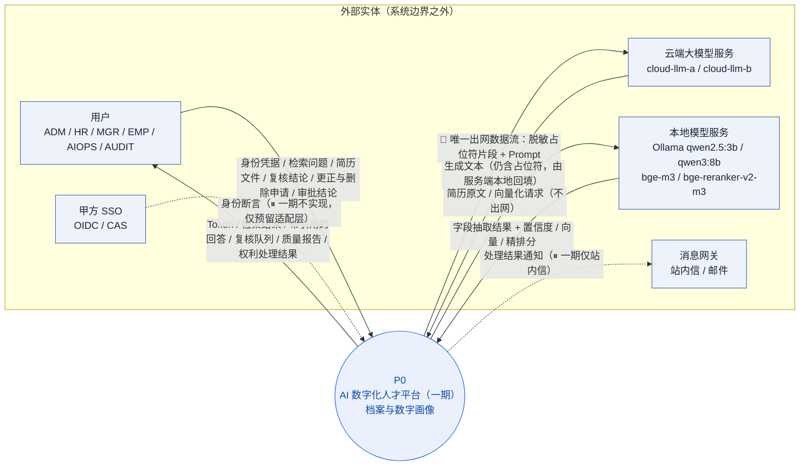

**本图的三个关键信息（评审时会被追问）**

| # | 信息 | 为什么重要 |
| :-: | --- | --- |
| 1 | **系统只有一个出网数据流**（到云端大模型服务），且内容是**脱敏占位符片段** | 这是 D-15「检索单元脱敏 + 占位符本地回填」在数据流层面的表达。任何第二条通往云端的箭头都意味着数据泄露（§10.5 出网边界） |
| 2 | **本地模型服务承载全部隐私相关加工**（字段抽取 / 向量化 / 问题改写 / NER 脱敏） | 对应 §10.5 混合算力路由表（D-4）。本地模型是「隐私加工区」，不是可选优化 |
| 3 | **SSO 与消息网关为一期虚线（不实现）** | 避免评审误以为一期要交付这两个集成。SSO 在 F-1.2 中只要求「预留适配层」 |

**覆盖**：F-1.2 · 一期全部模块边界

---

### 1.3 DF-1 · 一级分解（Level 1）

**图 1-2　主要加工与数据存储（DF-1）**

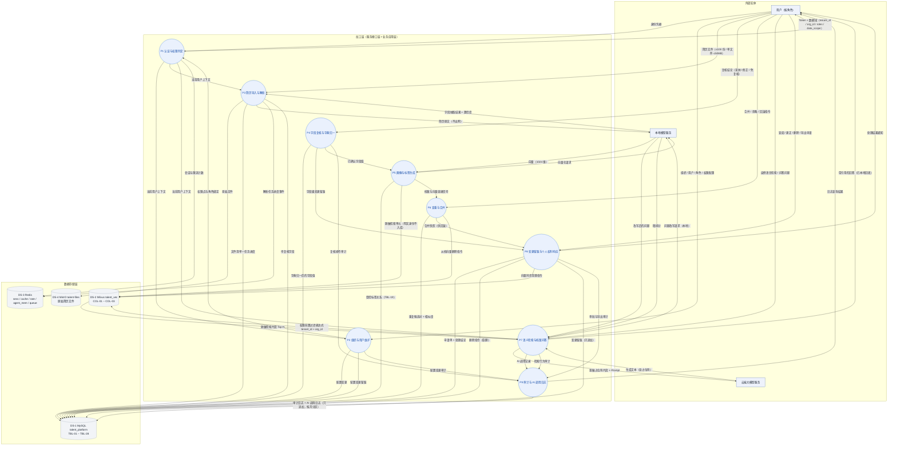

**加工清单**

| 加工 | 名称 | 承载功能点 | 主要接口 | 输入流 | 输出流 |
| :-: | --- | --- | --- | --- | --- |
| P0 | AI 数字化人才平台（一期） | 全部 | — | 见 DF-0 | 见 DF-0 |
| P1 | 认证与权限判定 | F-1.2 / F-1.3 | API-01~06 | 身份凭据、权限点绑定 | Token + 数据域、当前用户上下文 |
| P2 | 组织与用户维护 | F-1.1 / F-1.7 | API-07~17 / API-23~27 | 组织 / 用户 / 角色 / 字典配置 | 配置变更、权限绑定、字典值 |
| P3 | 简历导入与解析 | F-3.1 / F-3.2 / F-3.8 | API-36~43 | 简历文件、格式与策略参数 | 原始文件、任务进度、待复核字段、字段抽取结果 |
| P4 | 字段复核与字典归一 | F-3.2 / F-3.3 / F-3.3.1 | API-44~49 | 待复核字段、复核结论 | 归一后的字段值、字段级变更留痕 |
| P5 | 画像与标签生成 | F-3.4 / F-3.4.1 | API-50~56 | 已确认字段值、受控词表 | 标签关系、脱敏检索单元、向量 |
| P6 | 查重与合并 | F-3.5 | API-57~61 | 档案与向量、合并指令 | 重复候选对、合并快照、从档向量删除指令 |
| P7 | 语义检索与档案问答 | F-3.6 / F-3.7 / F-3.9 | API-62 / API-63 | 自然语言问题、脱敏片段 | 带引用的回答、AI 调用记录 |
| P8 | 变更留痕与个人权利响应 | F-3.10 / F-3.11 | API-67~70 / API-71~80 | 各类变更事件、权利申请 | 留痕记录、申请处理结论、软删与向量清理指令 |
| P9 | 审计与 AI 调用日志 | F-1.5 / F-9.5 | API-28 / API-29 / API-88 / API-89 | 各加工的操作事件、AI 调用事件 | 审计日志、AI 调用日志、日志查询结果 |

**数据存储清单**

| 存储 | 名称 | 存什么 | 不存什么 |
| :-: | --- | --- | --- |
| DS-1 | MySQL `talent_platform` | TBL-01~28：用户 / 租户 / 权限 / 字典 / 档案 / 标签 / 导入 / Agent 状态 / 三类日志 | 向量、大文本、原始文件 |
| DS-2 | Milvus `talent_vec` | COL-01~03：`resume_vec` / `skill_vec` / `project_vec`，**仅脱敏检索单元** | 🔴 **明文身份信息**（姓名 / 手机 / 身份证 / 邮箱） |
| DS-3 | Redis | `sess:*` 会话、`cache:*` 缓存、`rate:*` 限流、`agent_mem:*` 短期记忆、`queue:*` 队列 | 🔴 **Agent 权威状态**（必须落 DS-1） |
| DS-4 | MinIO `talent-files` | 原始简历文件（PDF / Word / 图片 / 压缩包） | 解析结果（落 DS-1） |

> 🔴 **DF-1 上最容易被忽略的三条**：
> ① **P5 是唯一向 DS-2 写入的加工，且写入前必须脱敏** —— 向量库里的东西不能再洗；
> ② **P7 是唯一通往 CLOUD 的加工** —— 如果将来出现第二个，就是架构违规；
> ③ **P9 只被写入、不被 P1~P8 读回**（除日志查询）—— 三类日志只追加，任何"读日志改业务"都是设计错误。

**覆盖**：F-1 全部 · F-3 全部 · F-9.1/9.2/9.5 · F-A0 全部

---

### 1.4 DF-2 · 档案导入与解析链路（Level 2，P3 分解）

**图 1-3　档案导入与解析链路（DF-2）**

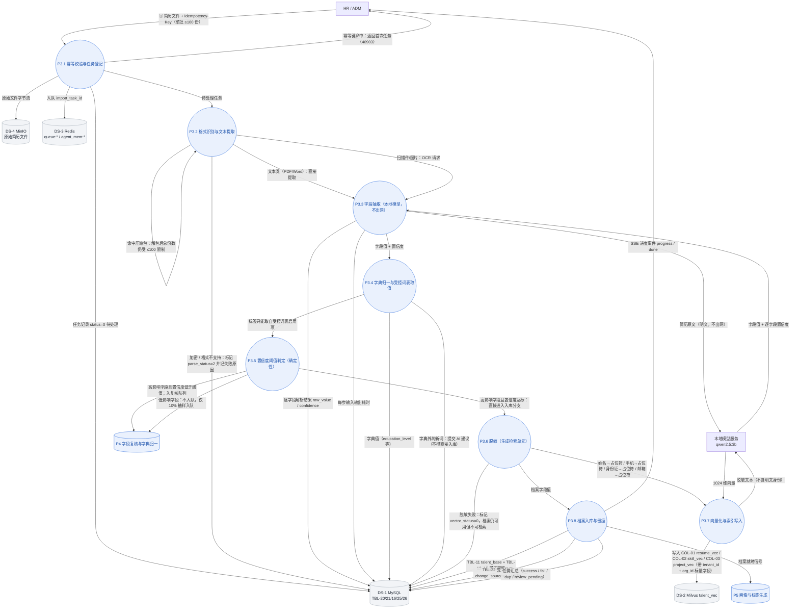

**本图的四条实现要点**

| # | 要点 | 依据 |
| :-: | --- | --- |
| 1 | **P3.5 是确定性加工**：置信度与阈值比对决定是否入队，**不由模型"感觉"决定** | §10.1（置信度阈值判定）· F-3.3 D-8 |
| 2 | **P3.6 脱敏在向量化之前**：先脱敏再入向量库 —— 顺序反了则向量库存在明文，且**无法事后修复**（只能全量重建） | F-3.9 / ADR-4 |
| 3 | **失败不阻塞整批**：单个文件失败标记 `parse_status=2` 并记原因，整批继续 | F-3.1 / API-40 |
| 4 | **P3.8 写留痕的 change_source=0（AI 解析）**，与人工复核（=1）、合并（=2）、重解析（=3）区分 | F-3.10 / TBL-22 |

**覆盖**：F-3.1 / F-3.2 / F-3.3 / F-3.4 / F-3.4.1 / F-3.8 · API-36~43 / API-44~49 · TBL-11~16 / TBL-20~22 · DS-2/3/4

---

### 1.5 DF-3 · 检索与问答链路（Level 2，P7 分解）

**图 1-4　检索与问答链路（DF-3）**

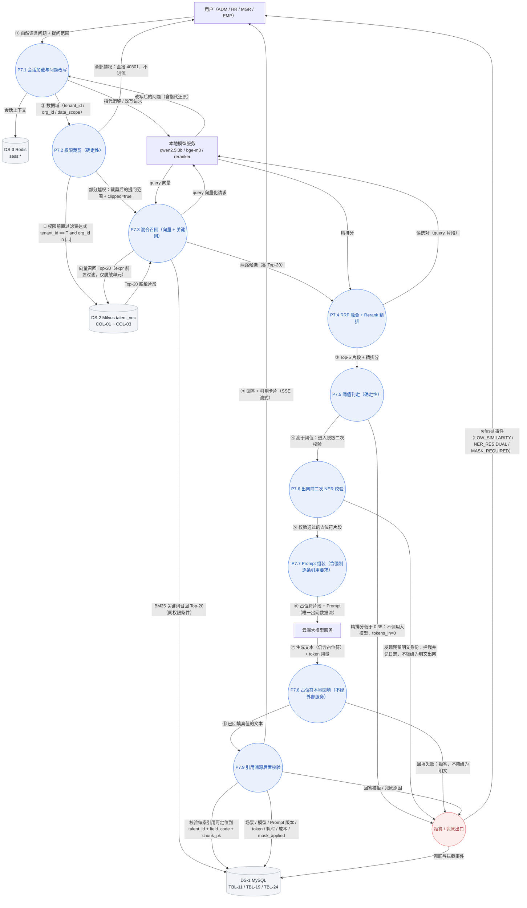

**本图的五条红线（与 §3 的 SQ 图互为对照）**

| # | 红线 | 落在哪个加工 |
| :-: | --- | --- |
| 1 | **权限前置**：过滤表达式在检索**前**下发，不允许「先召回全量再应用层过滤」 | P7.2 → DS-2 的箭头方向即证据 |
| 2 | **阈值判定是确定性的**：精排分与阈值比对，不交大模型判断"有没有依据" | P7.5 |
| 3 | **二次 NER 校验**：即使入库时已脱敏，出网前仍要再扫一遍 | P7.6 |
| 4 | **本地回填**：回填在服务端完成，**不经任何外部服务**；失败即拒答 | P7.8 |
| 5 | **无依据不编造**：低于阈值直接兜底，`tokens_in = 0` 可直接验证未调用模型 | P7.5 → REFUSE |

> **与架构文档 SQ-3 的关系**：SQ-3 是**业务链路视角**（谁调用谁、时序如何），DF-3 是**数据流视角**（数据从哪来到哪去、在哪个点变形）。两者必须能对上：SQ-3 的每一步都能在 DF-3 找到对应的加工与数据流。

**覆盖**：F-3.6 / F-3.7 / F-3.9 · API-62 / API-63 / API-64 · COL-01~03 / TBL-11 / TBL-24 · DS-2/3

---

### 1.6 DF-4 · 三重边界图（确定性 / 生成式 / 出网）

需求文档 §10.1 与 §10.5 是两条最容易被实现时违反的红线。下面这张图把它们画成**物理边界**：数据一旦跨过某条边界，就必须满足该边界的所有约束。

**图 1-5　确定性 / 生成式 / 出网 三重边界（DF-4）**

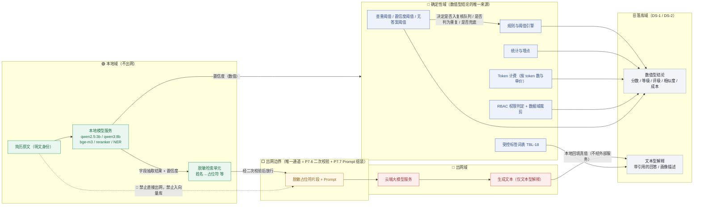

**三条边界的判定口诀**

| 数据要过哪条边界 | 判定口诀 | 违反后果 |
| --- | --- | --- |
| 🟢 **本地 → ⬜ 出网边界** | 「出网内容里的身份信息**是否已全部占位符化**，且经过二次 NER 校验？」 | 数据泄露（不可逆，姓名无法追回） |
| 🔴 **出网域 → 🗄 落库域** | 「这个值是不是**数值型结论**？」是 → **不能来自大模型**，必须回到确定性域取 | 分数 / 相似度 / 成本失真，审计无法问责 |
| 🟢 **原文 → DS-2 向量库** | 「这段文本里还有明文身份吗？」 | 向量库污染，**只能全量重建**，且检索越权 |

> 🔴 **本项目的 4 条确定性约束（一期）** —— 见 §10.1，实现时落在 **CL-7** 的类上：
> ① **标签取值**只能取自 `talent_tag_dict` 启用项；② **查重阈值判定**由规则比对相似度；③ **置信度阈值判定**决定是否入复核队列；④ **Token 成本统计**按 token 数与单价计费。
> **红线**：任何进入数据库的**数值型结论**（分数、等级、评级）必须有确定性来源；大模型只能产出**文本型解释**。

**覆盖**：§10.1 全部 · §10.5 出网边界 · F-3.3 / F-3.4.1 / F-3.5 / F-3.9 / F-9.5

---

### 1.7 DFD 完整性自检

| 检查项 | 结论 |
| --- | --- |
| 每条数据流都有名字，且用名词短语 | ✅（无「处理数据」「发送信息」类虚词） |
| 无「外部实体 → 外部实体」直接数据流 | ✅（DF-0 中所有流都经过 P0；DF-1~DF-3 中所有流都经过加工） |
| 无黑洞加工（只有输入无输出） | ✅（P1~P9、P3.1~P3.8、P7.1~P7.9 均有输出；仅 REFUSE 为终止出口，属显式兜底） |
| 无奇迹加工（只有输出无输入） | ✅ |
| 数据存储不直接连外部实体 | ✅（DS-1~DS-4 只与加工相连） |
| 每张 Level 2 图能平衡 Level 1（输入输出一致） | ✅（DF-2 的 P3 输入=简历文件，输出=档案+向量+进度；DF-3 的 P7 输入=问题，输出=回答+日志） |
| 与上游文档的表 / 接口 / 功能点编号可反查 | ✅（见各图末尾的「覆盖」行） |

---

## 2. 类图（Class Diagram）

### 2.0 画法约定

| 约定 | 说明 |
| --- | --- |
| **类名 = 代码类名，文件名 = 目录树文件名** | ORM 类用大驼峰（`TalentBase`），文件用小写下划线（`models/talent.py`）；每张图末尾给「类 → 文件」对照表，可直接照此建骨架 |
| **依赖只向下** | `Router → Service → DAO → Model` 单向；❌ 任何反向或跨层的箭头都不画（画出来就是违反《架构设计》§3.3 红线） |
| **接口与实现** | 抽象用 `<<interface>>`；实现关系用 `..|>`（虚线空心三角） |
| **组合 / 聚合** | `*--` 强生命周期（删主档必删明细）；`o--` 弱引用（可独立存在） |
| **不出现代码里没有的类** | 每张图的类都能在《架构设计》§5 目录树里找到文件（基座实体的归并见 §2.1 注） |
| **一图一事** | 领域关系 / 分层骨架 / 检索抽象 / 脱敏链路 / Agent 状态 / 权限横切 / 确定性边界，各一张，不混画 |

---

### 2.1 CL-1 · 领域模型类图（业务视角）

> 面向**评审与业务方**：先讲清楚「档案由哪些东西构成」，再看代码怎么分层。本图对应《数据库设计》§4.3 ~ §4.5 的 12 张核心表，**类的字段与 TBL 列一一对应**。

**图 2-1　领域模型类图（CL-1）**

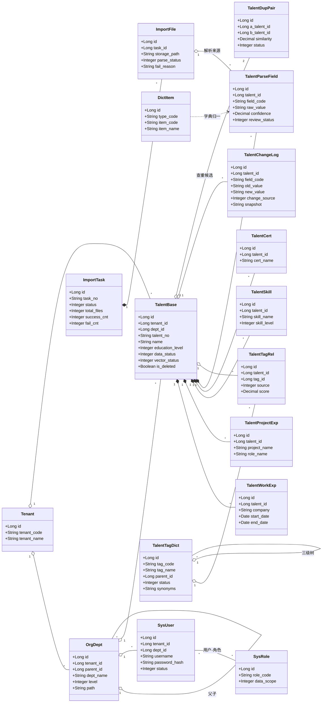

**类 → 文件对照表**

| 类 | 表 | 文件 | 备注 |
| --- | :-: | --- | --- |
| `Tenant` | TBL-01 | `models/tenant.py` | 一期单行 |
| `OrgDept` | TBL-07 | `models/tenant.py`（基座实体，见注） | ≥5 级树 |
| `SysUser` / `SysRole` | TBL-02 / TBL-03 | `models/user.py` | 权限基座 |
| `DictItem` | TBL-10 | `models/dict.py` | 字典项 |
| `TalentBase` | **TBL-11** | `models/talent.py` | 🔴 核心主档 |
| `TalentWorkExp` ~ `TalentCert` | TBL-12 ~ TBL-15 | `models/talent.py` | 四类履历明细 |
| `TalentParseField` | **TBL-16** | `models/parse_field.py` | 字段级置信度与复核态 |
| `TalentTagDict` | **TBL-18** | `models/tag_dict.py` | 🔴 受控标签词表 |
| `TalentTagRel` | TBL-19 | `models/tag_dict.py` | 人才-标签关系 |
| `TalentDupPair` | TBL-17 | `models/dup_pair.py` | 查重候选对 |
| `ImportTask` / `ImportFile` | TBL-20 / TBL-21 | `models/import_task.py` | 导入任务与文件 |
| `TalentChangeLog` | **TBL-22** | `models/change_log.py` | 🔴 只追加，含合并快照 |

> **注（基座实体的归并）**：《架构设计》§5 目录树把基座实体（TBL-01~10）合并写在 `models/tenant.py` / `models/user.py` / `models/dict.py` 三个文件里，未单列 `org.py` / `role.py`。本图按「一表一实体类」画，**类名保持不变，文件归属以上表为准**；若实施时选择拆分，则相应新增 `models/org.py`，并在架构文档补记（属目录树细化，不构成架构变更）。

**本图的四条关系要点**

| # | 关系 | 为什么这样画 |
| :-: | --- | --- |
| 1 | `TalentBase *-- TalentParseField`（**组合**） | 字段解析记录**随档案存在**，档案软删后仅保留留痕，不再有解析态 |
| 2 | `TalentBase --* TalentChangeLog` 用**聚合** | 留痕**只追加、不被档案生命周期回收**（F-3.10），故不能画成组合 |
| 3 | `TalentDupPair` 基数写 `"2"` | 一对候选**恒为两条**档案（A 档 / B 档），不是 1:N —— 写错会导致开发建出「多对多中间表」的错误结构 |
| 4 | `ImportFile o-- TalentParseField`（**弱引用**） | 解析字段的**事实来源是档案**，文件只是溯源线索；删除文件不得级联删字段 |

**覆盖**：F-3.2 / F-3.4 / F-3.4.1 / F-3.5 / F-3.10 · TBL-01~22

---

### 2.2 CL-2 · 分层类图（档案域竖向切片）

> 面向**后端工程师**：这是照着建目录、写骨架的图。用 `namespace` 把**六层物理分开**，箭头只允许从上往下穿过层边界。

**图 2-2　分层类图 · 档案域竖向切片（CL-2）**

```mermaid
classDiagram
    direction TB

    %% 命名空间用 ASCII 标识符（保证 Mermaid 渲染稳健）；中文层名见紧随其后的「分层清单」表
    namespace L5_Router {
        class TalentRouter
        class ImportRouter
        class ParseRouter
        class DedupRouter
        class SearchRouter
        class AskRouter
        class PrivacyRouter
    }
    namespace L5_Service {
        class TalentService
        class ImportService
        class ParseService
        class DedupService
        class SearchService
        class AskService
        class PrivacyService
        class MaskService
        class ChangeService
    }
    namespace L5_DAO {
        class TalentDao
        class ImportDao
        class ParseFieldDao
        class DupPairDao
        class ChangeLogDao
    }
    namespace L5_Model {
        class TalentBase
        class ImportTask
        class TalentParseField
        class TalentDupPair
        class TalentChangeLog
    }
    namespace L5_Schema {
        class TalentOut
        class ImportTaskOut
        class ReviewConfirmIn
        class SearchIn
        class AskOut
        class CommonResp
    }
    namespace L4_Agent {
        class ParseGraph
        class AskGraph
    }
    namespace L4_Retrieval {
        class RetrievalProvider
    }
    namespace L4_Clients {
        class ModelGateway
        class OllamaClient
        class RerankerClient
        class StorageClient
    }

    TalentRouter --> TalentService
    ImportRouter --> ImportService
    ParseRouter --> ParseService
    DedupRouter --> DedupService
    SearchRouter --> SearchService
    AskRouter --> AskService
    PrivacyRouter --> PrivacyService

    TalentService --> TalentDao
    ImportService --> ImportDao
    ParseService --> ParseFieldDao
    DedupService --> DupPairDao
    PrivacyService --> ChangeLogDao
    ChangeService --> ChangeLogDao

    TalentDao --> TalentBase
    ImportDao --> ImportTask
    ParseFieldDao --> TalentParseField
    DupPairDao --> TalentDupPair
    ChangeLogDao --> TalentChangeLog

    TalentRouter ..> TalentOut : 组装
    ImportRouter ..> ImportTaskOut : 组装
    ParseRouter ..> ReviewConfirmIn : 校验
    SearchRouter ..> SearchIn : 校验
    AskRouter ..> AskOut : 组装
    TalentRouter ..> CommonResp : 统一响应

    ImportService --> ParseGraph : 编排
    AskService --> AskGraph : 编排
    SearchService --> RetrievalProvider : 🔴 只依赖协议
    AskService --> MaskService : 出网前必过
    ParseService --> MaskService
    ImportService --> ChangeService : 写留痕
    ParseService --> ChangeService
    DedupService --> ChangeService
    PrivacyService --> ChangeService

    ParseGraph --> OllamaClient
    AskGraph --> ModelGateway
    AskGraph --> RetrievalProvider
    SearchService --> RerankerClient
    ImportService --> StorageClient
    DedupService --> RetrievalProvider
```

**分层清单**

| 层 | 命名空间（图中） | 中文层名 | 文件目录 | 职责红线 |
| :-: | --- | --- | --- | --- |
| ⑤ 接口层 | `L5_Router` | 服务接口层 | `routers/` | ❌ 不写业务逻辑，只做 Pydantic 校验 + 组装响应 + 鉴权依赖 |
| ⑤ 业务层 | `L5_Service` | 业务编排层 | `services/` | 承载事务 / 权限注入 / 调用 Provider；❌ 不直连 Milvus SDK |
| ⑤ 数据层 | `L5_DAO` | 数据访问层 | `dao/` | 纯 CRUD；**强制 `tenant_id` 条件**；❌ 不写业务规则、不拼 SQL |
| ⑤ 实体层 | `L5_Model` | ORM 实体层 | `models/` | 数据结构唯一事实来源（DDL 由 Alembic 从模型生成） |
| ⑤ 契约层 | `L5_Schema` | 契约层 | `schemas/` | 入参/出参/统一响应 `{code, message, data, trace_id}` |
| ④ 智能层 | `L4_Agent` | 智能编排层 | `agents/` | LangGraph 图；状态持久化落 MySQL |
| ④ 检索层 | `L4_Retrieval` | 检索抽象层 | `retrieval/` | 业务只依赖 `RetrievalProvider` 协议 |
| ④ 集成层 | `L4_Clients` | 外部集成层 | `clients/` | 统一超时 / 重试 / 降级 |

**本图的三条硬约束（评审必问）**

| # | 约束 | 图上证据 |
| :-: | --- | --- |
| 1 | **Router 不得直连 DAO** | 图中 `*Router` 只指向 `*Service`，无一条直连 `*Dao` 的箭头 |
| 2 | **Service 不得直接调用 Milvus SDK** | `SearchService` / `AskService` / `DedupService` 只指向 `RetrievalProvider` 协议，**没有指向 Milvus** |
| 3 | **出网调用不得绕过脱敏层** | 通往 `ModelGateway`（云端）的箭头由 `AskGraph` 发出，而 `AskService --> MaskService` 在编排侧强制前置；`MaskService` 是唯一回填方 |

> **与 CL-1 的关系**：CL-1 讲「有什么」，CL-2 讲「放在哪」。两张图里的 `TalentBase` / `TalentParseField` 等类名必须**完全一致**，否则开发会在两个文件里各建一个模型。

**覆盖**：架构 §3.3 分层红线 / §4.1 六层落位 / §5 目录树 · F-3 全部 · F-3.9

---

### 2.3 CL-3 · 检索抽象与降级类图

> 面向**评审关注点 H-3（RAG 单点依赖）**：一期就建立抽象，使后续接入 Dify 知识库或替换检索后端时**业务代码零改动**（架构 §4.4）。

**图 2-3　检索抽象与降级类图（CL-3）**

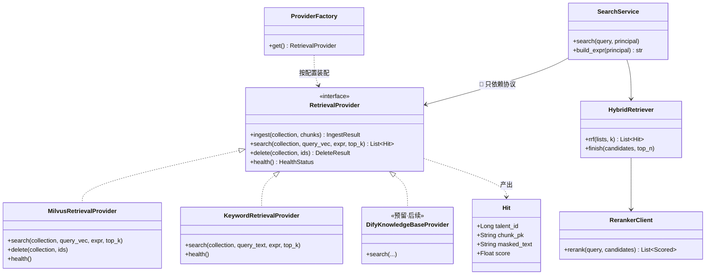

**降级规则（与架构 §4.4 逐条对应）**

| 场景 | 表现 | 实现落点 |
| --- | --- | --- |
| 正常 | 向量召回 + BM25 召回 → RRF(k=60) → 精排 Top-5 | `HybridRetriever.rrf` |
| Milvus 健康检查失败 | `ProviderFactory` 切到 `KeywordRetrievalProvider`，**检索 → 引用溯源两步仍能独立完成** | `health()` + 工厂装配 |
| 模式开关 | 支持「向量 / 关键词 / 混合」三模式（配置项，非改代码） | `settings.retrieval_mode` |
| 未来扩展 | `DifyKnowledgeBaseProvider` 一期**只留位置不实现** | 虚线实现关系 |

> 🔴 **红线**：`SearchService` / `AskService` / `DedupService` 中出现 `from pymilvus import ...` 即为架构违规 —— 一切 Milvus SDK 调用只能存在于 `milvus_provider.py` 内部。

**覆盖**：ADR-3 / H-3 · 架构 §4.4 · F-3.6 / F-3.7 / F-3.5 · COL-01~03

---

### 2.4 CL-4 · 脱敏与回填类图

> 面向**安全评审（ADR-4 / D-15）**：这是全项目**风险最高**的一段代码。本图讲清「明文在哪一步消失、真值在哪一步回来」。

**图 2-4　脱敏与回填类图（CL-4）**

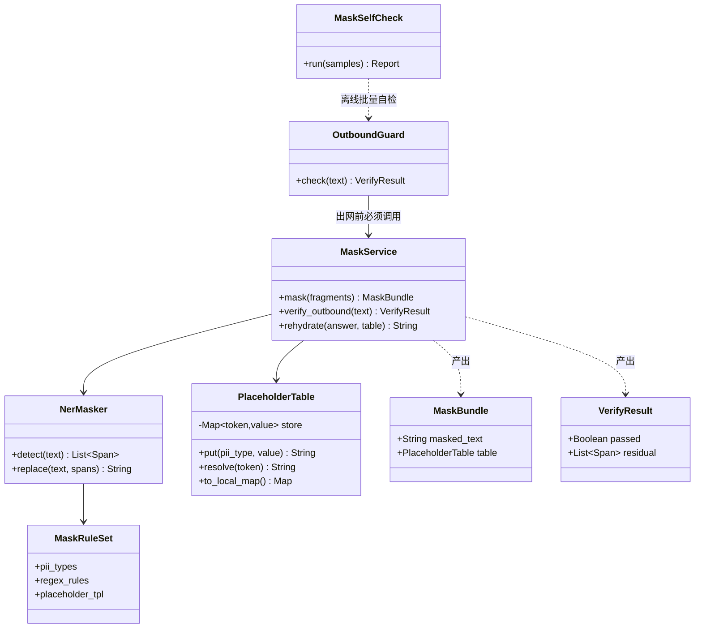

**四条不可动摇的行为约定**

| # | 约定 | 落点 | 违反后果 |
| :-: | --- | --- | --- |
| 1 | **先脱敏再向量化** | `MaskService.mask` 在 `RetrievalProvider.ingest` **之前**调用 | 向量库残留明文，**只能全量重建** |
| 2 | **出网前必过二次扫描** | `OutboundGuard.check` 在 `AskGraph` 送云前强制调用 | 数据泄露（不可逆） |
| 3 | **回填只发生在服务端** | `rehydrate` 的 `PlaceholderTable` 源自**本次请求内存**，不经任何外部服务 | 真值外流 |
| 4 | **任一步失败即拒答** | 二次扫描发现残留 → 直接返回「涉及敏感信息，未作答」，**绝不降级为明文出网** | 泄露 |

> **`PlaceholderTable` 为什么不落库**：占位符与真值的映射是**本次请求的临时映射**，落库等于把「明文-占位符字典」也存下来了，反而扩大暴露面。真值回填走 `ParseFieldDao`/`TalentDao` **按 `talent_id` 现查**。

**覆盖**：F-3.9 / D-15 / ADR-4 · 架构 §4.3 · API-66（脱敏自检）

---

### 2.5 CL-5 · Agent 图与状态类图

> 面向**F-A0 / ADR-11（人工介入）**：LangGraph 的图、状态、持久化与待办表四者的关系。

**图 2-5　Agent 图与状态类图（CL-5）**

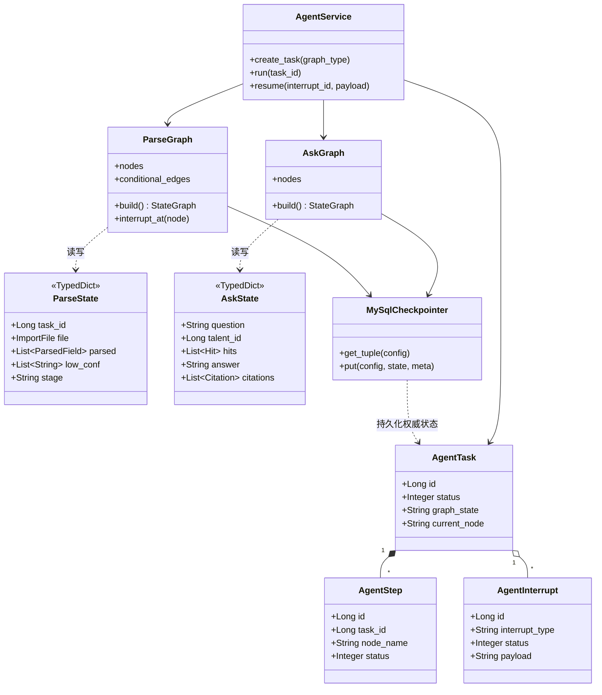

**状态三元组的分工（最容易搞混的地方）**

| 存哪 | 存什么 | 谁写 | 权威性 |
| --- | --- | --- | --- |
| **`agent_task.graph_state`（TBL-25）** | 图状态的**权威副本** | `MySqlCheckpointer` | 🔴 **权威**：进程重启后从这里恢复 |
| `agent_step`（TBL-26） | 每步输入/输出/耗时（**只追加**） | `ParseGraph` / `AskGraph` 每步 | 审计用，不可用于恢复 |
| Redis `agent_mem:*` | 短期记忆 / 中间变量 | 图内部 | ❌ **非权威**：丢了可重算，不能作为恢复依据 |
| `agent_interrupt`（TBL-27） | 人工待办（`pending/approved/rejected`） | `AgentService.resolve` | 待办事实来源 |

> 🔴 **红线**：`agent_task` 的 `status=2 waiting_human` 是**任务级**状态；`agent_interrupt.status` 是**待办级**状态。两者不能混用一个字段 —— 一个任务可能产生多个待办。把 Agent 权威状态放 Redis 会导致「重启后任务凭空消失」。

**覆盖**：F-A0 / F-A0.1 / F-A0.3 · ADR-11 · TBL-25 / TBL-26 / TBL-27 · API-93 / API-94

---

### 2.6 CL-6 · 权限与横切关注点类图

> 面向**F-1.3 / 需求 §3.3 数据权限**：权限不是某个接口里的 `if`，而是横切在所有查询上的一层。**检索侧与数据库侧必须用同一份数据域**，否则会出现「列表看不到、检索却搜得到」。

**图 2-6　权限与横切关注点类图（CL-6）**

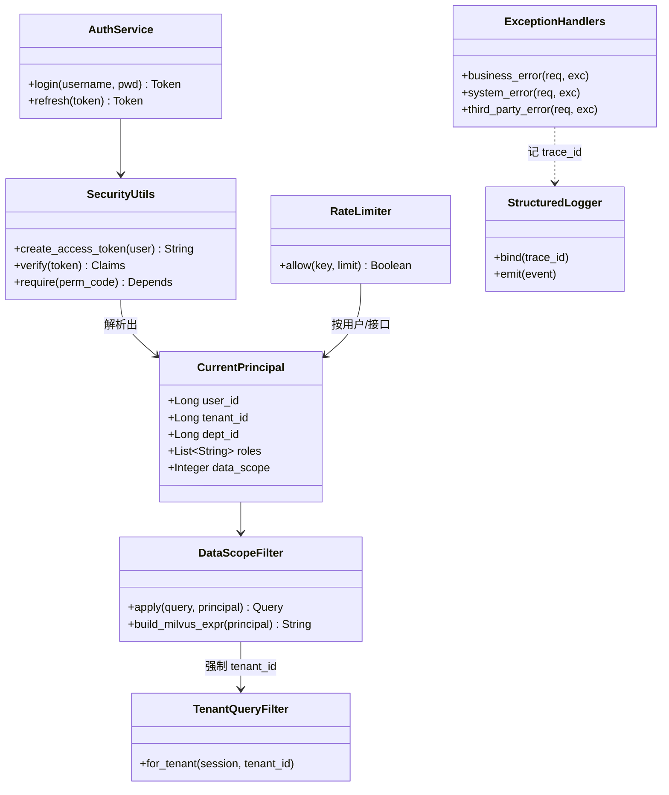

**`data_scope` 三处必须一致（本项目最常见的越权来源）**

| 取值 | 含义 | MySQL 侧 | Milvus 侧 |
| :-: | --- | --- | --- |
| 1 | 全部 | 无部门限制 | `tenant_id == T` |
| 2 | 本部门 | `dept_id IN (本部门及子部门)` | `tenant_id == T AND org_id IN [...]` |
| 3 | 本人 | `talent_id == 本人` | `tenant_id == T AND org_id == 本人部门` |
| 4 | 仅统计值 | 明细查询直接 **40301** | 不进入检索链路 |

> 🔴 **红线**：`DataScopeFilter` 必须同时产出 **MySQL 条件** 与 **Milvus 表达式**，且两者由**同一个 `principal`** 推导。❌ 不允许「列表接口查 MySQL 过滤、检索接口忘了加 expr」——这正是 DF-3 里 P7.2 存在的意义。

**覆盖**：F-1.3 · 需求 §3.2 / §3.3 权限矩阵 · ADR-8（多租户预留）· 架构 §8 横切关注点

---

### 2.7 CL-7 · 确定性边界类图

> 面向**需求 §10.1 红线**：把「数值型结论只能来自确定性来源」这条抽象原则，落到**具名的类**上。评审问「你怎么保证分数不是模型编的？」——指着这张图回答。

**图 2-7　确定性边界类图（CL-7）**

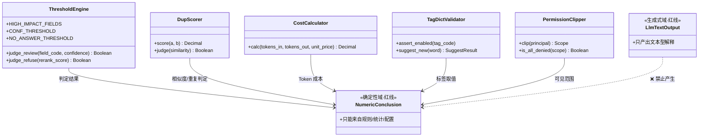

**四条一期确定性约束的落点（需求 §10.1 逐条对应）**

| # | 约束 | 落点类 | 常量 / 参数 | 为什么必须确定性 |
| :-: | --- | --- | --- | --- |
| 1 | **标签取值**只能取自受控词表启用项 | `TagDictValidator.assert_enabled` | `talent_tag_dict.status=1` | AI 造词会导致标签体系失控、统计口径崩坏 |
| 2 | **查重阈值判定**由规则比对相似度 | `DupScorer.judge` | 相似度阈值（配置项） | 合并是高风险写操作，不能由模型「感觉像」决定 |
| 3 | **置信度阈值判定**决定是否入复核队列 | `ThresholdEngine.judge_review` | `CONF_THRESHOLD` + 高影响字段清单 | 复核工作量与质量口径必须可复现、可追溯 |
| 4 | **Token 成本统计**按 token 数与单价计费 | `CostCalculator.calc` | 各模型 `unit_price` | 成本报表必须能被财务核对，不能是模型估算 |

> 🔴 **本条边界的一句话表述**：**数值型结论（分数 / 等级 / 评级 / 相似度 / 成本）必须有确定性来源；大模型只能产出文本型解释。** 两条数据流在 DF-4（§1.6）里已经画成两条互不相交的边。
> **可验证性**：无依据兜底时 `tokens_in = 0`（`ThresholdEngine.judge_refuse` 在**调用前**判定），这是「模型没被调用」的**机器可验证证据**。

**覆盖**：需求 §10.1 全部 · §10.2 RAG 参数基线 · F-3.3 / F-3.4.1 / F-3.5 / F-9.5

---

### 2.8 类图完整性自检

| 检查项 | 结论 |
| --- | --- |
| 图中每个类都能在《架构设计》§5 目录树找到文件 | ✅（基座实体归并见 §2.1 注，已在表内标注） |
| 依赖方向只向下（Router→Service→DAO→Model） | ✅（CL-2 无反向箭头；CL-3/CL-4 的 Service 只依赖协议与 `MaskService`） |
| 业务层不出现 Milvus / Dify SDK 直调 | ✅（CL-3 中 `SearchService` 仅依赖 `RetrievalProvider`） |
| 出网调用必过脱敏层 | ✅（CL-4 `OutboundGuard` 唯一出口） |
| Agent 权威状态落 MySQL 而非 Redis | ✅（CL-5 `MySqlCheckpointer → agent_task`） |
| 数值型结论均有确定性类承载 | ✅（CL-7 四个类一一对应 §10.1 四条约束） |
| 类名与 CL-1 / CL-2 前后一致 | ✅（`TalentBase` / `TalentParseField` / `ChangeLogDao` 等全篇统一） |
| 每张图末尾「覆盖」行可反查 F-x.y / API-nn / TBL-nn | ✅（7 张图均已标注） |

---

## 3. 时序图（Sequence Diagram）

### 3.0 承接关系与画法约定

《架构设计》§6 已给出三条**主干链路**（SQ-1 批量导入解析 / SQ-2 语义检索 / SQ-3 RAG 问答）。本章补齐**四条高风险支路 + 一条闭环**，编号续 **SQ-4 ~ SQ-8**：

| 编号 | 场景 | 为什么单独画 |
| :-: | --- | --- |
| SQ-1 ~ SQ-3 | 批量导入解析 / 语义检索 / RAG 问答 | 架构文档已画（主干） |
| **SQ-4** | 档案合并与回滚 | **跨库写 + 可回滚**，失败补偿路径最复杂（F-3.5 / F-3.10） |
| **SQ-5** | 删除申请审批 | **无分布式事务的跨库一致性**，顺序错一步就是泄露（F-3.11） |
| **SQ-6** | 字段复核漏斗 | 批量确认 + 变更留痕，AI 与人协作的核心（F-3.3 / F-3.3.1） |
| **SQ-7** | Agent 人工介入恢复 | LangGraph `interrupt → resume` 的状态持久化（F-A0.1 / F-A0.3） |
| **SQ-8** | 受控标签词表闭环 | AI 建议 → 审核 → 打标，**AI 不得造词**（F-3.4.1） |

**画法约定（全篇统一）**

| 约定 | 说明 |
| --- | --- |
| `participant` 用**英文类名 + 中文备注** | `participant S as DedupService`，与 CL-2 类名一致，便于对代码 |
| 参与者 ≤ 7 个 | 超过 7 个就把**外部系统**（Milvus / 队列）并入同一参与者，避免图变窄面条 |
| `autonumber` 一律开启 | 评审与测试用例直接引用步骤号 |
| **异常路径必须画** | 用 `alt / else` 明确写出失败分支与**补偿动作**，不留「省略号」 |
| 🔴 标注 = 红线 | 图中 `🔴` 表示该步是架构/安全红线，实现时不可省略 |
| `Note over` 用中文 | 关键约束写进注释块，不写进箭头名（箭头名保持短） |

---

### 3.1 SQ-4 · 档案合并与回滚

> **场景**：HR 在查重工作台判定两条档案为同一人，合并后又要撤销。
> **难点**：合并要同时动 **MySQL 三处**（明细迁移 / 主档字段 / 从档软删）+ **两个库**（Milvus 向量删除 + 主档重索引），并且**必须可回滚**。

**图 3-1　档案合并与回滚（SQ-4）**

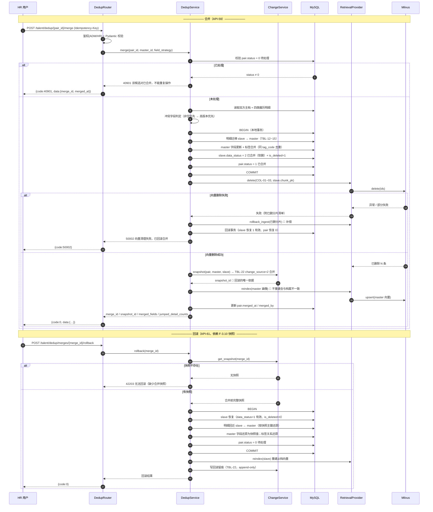

**本图的四条关键决策**

| # | 决策 | 理由 |
| :-: | --- | --- |
| 1 | **先 MySQL 事务，再向量删除**，向量失败则**整体回滚** | 与 SQ-5「先向量后 MySQL」顺序**相反**。合并不是「不可逆」操作：`snapshot_id` 使 MySQL 侧可还原，所以可以让事务先落地；而删除（SQ-5）没有还原依据，必须让向量先删。**两张图的顺序差异是刻意的，不是笔误**。 |
| 2 | **`snapshot_id` 是回滚的唯一依据** | F-3.5 要求「合并可回滚」，F-3.10 ④ 明确依赖此机制。❌ 没有快照就返回 `42203`，绝不做「尽力还原」 |
| 3 | **从档软删（`data_status=2`）而非物理删** | 保留可追溯性；物理删除由 DBA 按留存策略执行 |
| 4 | **主档必须重索引**（`vector_reindexed`） | 合并改变了画像内容，不重建会导致**检索结果与档案不一致**（搜到旧画像） |

> **Agent 触发时的差异**：本图由**人主动触发**，视为已确认。若合并建议由 Agent 自动产出，则**必须走 SQ-7 的 `interrupt` 待办**（ADR-11 关键决策点红线），不能自动执行。

**覆盖**：F-3.5 / F-3.10 · API-57~61 · TBL-11~17 / TBL-22 · COL-01~03

---

### 3.2 SQ-5 · 个人权利响应：删除申请审批（跨库一致性）

> **场景**：员工（EMP）申请删除本人档案，ADM 审批。
> **难点**：**软删 MySQL + 删 Milvus 向量是两个库的写操作，没有分布式事务**。顺序错一步，就会出现「库删了、向量还在」——已删档案仍被检索命中。

**图 3-2　删除申请审批 · 跨库一致性（SQ-5）**

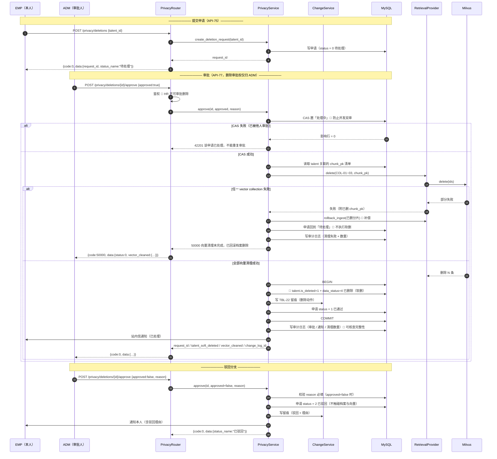

**跨库一致性编排（5 步，顺序不可调换）**

| 步 | 动作 | 为什么在这个位置 |
| :-: | --- | --- |
| 1 | 申请标记**「处理中」**（CAS） | 状态位防并发双审；避免两个管理员同时审批造成重复删除 |
| 2 | **先删 Milvus 向量**，记录已删 `chunk_pk` | 向量删除**不可逆**且没有还原依据，必须在「还没破坏主数据」时先做 |
| 3 | 任一分片失败 → **不执行软删**，回滚已删分片，返回 50000，申请**保持待处理** | 宁可回滚重来，也不能留脏数据 |
| 4 | 全部向量成功 → **再软删 MySQL** + 写 `talent_change_log` | 此时 MySQL 侧动作可逆（软删），风险已降到最低 |
| 5 | 最后才把申请置为**已通过** + 通知本人 | 「申请已通过」必须等价于「数据真的删干净了」 |

> 🔴 **本图的一句话红线**：**绝不允许「库删了、向量没删」** —— 既是个人权利响应失效，也是数据泄露。宁可回滚重来。
> 🔴 **顺序为什么与 SQ-4 相反**：SQ-4 有 `snapshot_id` 可还原，所以 MySQL 先落地；SQ-5 没有还原依据，所以向量先删。**判据只有一条：谁是「不可逆且无还原依据」的一方，谁先做。**

**覆盖**：F-3.11 · API-71~80（重点 API-75 / API-77）· TBL-11 / TBL-22 / TBL-28 · COL-01~03

---

### 3.3 SQ-6 · 字段复核漏斗：批量确认与变更留痕

> **场景**：解析入库后，低置信度字段进入复核队列，HR 在工作台批量确认 / 修正 / 免复核。
> **难点**：入队判定必须**确定性**（§10.1 约束③），且每一次人工动作都要**留痕**（F-3.10）。

**图 3-3　字段复核漏斗（SQ-6）**

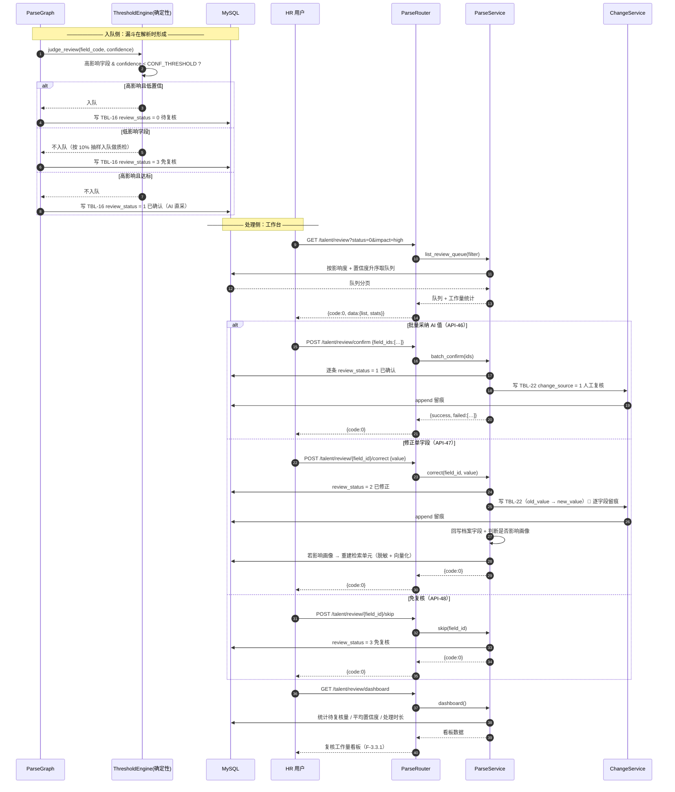

**复核状态机（`parse_review_status` 四态）**

| 值 | 名称 | 由谁置位 | 是否留痕 |
| :-: | --- | --- | --- |
| 0 | 待复核 | `ParseGraph`（入队） | 否（AI 解析留痕已在 P3.8 记过） |
| 1 | 已确认 | AI 直采（达标）或 HR 批量确认 | ✅ 人工确认时留痕（`change_source=1`） |
| 2 | 已修正 | HR 单字段修正 | ✅ **必须留痕**（old → new） |
| 3 | 免复核 | 低影响自动放行 / HR 主动跳过 | 人工跳过时留痕 |

> 🔴 **两条红线**：
> ① **入队判定是确定性的**（`ThresholdEngine`），不由模型「觉得自己不确定」决定 —— 否则复核工作量与质量口径不可复现；
> ② **批量确认是"确认"，不是"改动"**：`API-46` 不得写入 `new_value`，需要改值必须走 `API-47`（否则留痕里分不清「采纳」与「修改」，F-3.10 的变更链就失去意义）。

**覆盖**：F-3.3 / F-3.3.1 / F-3.10 · API-44~49 · TBL-16 / TBL-22

---

### 3.4 SQ-7 · Agent 人工介入恢复（interrupt → resolve → 续跑）

> **场景**：解析 Agent 跑到复核节点，遇到低置信字段挂起，等 HR 处理后再从**断点续跑**。
> **难点**：`interrupt` 之后进程可能重启，图状态必须**落 MySQL 而不是 Redis**。

**图 3-4　Agent 人工介入恢复（SQ-7）**

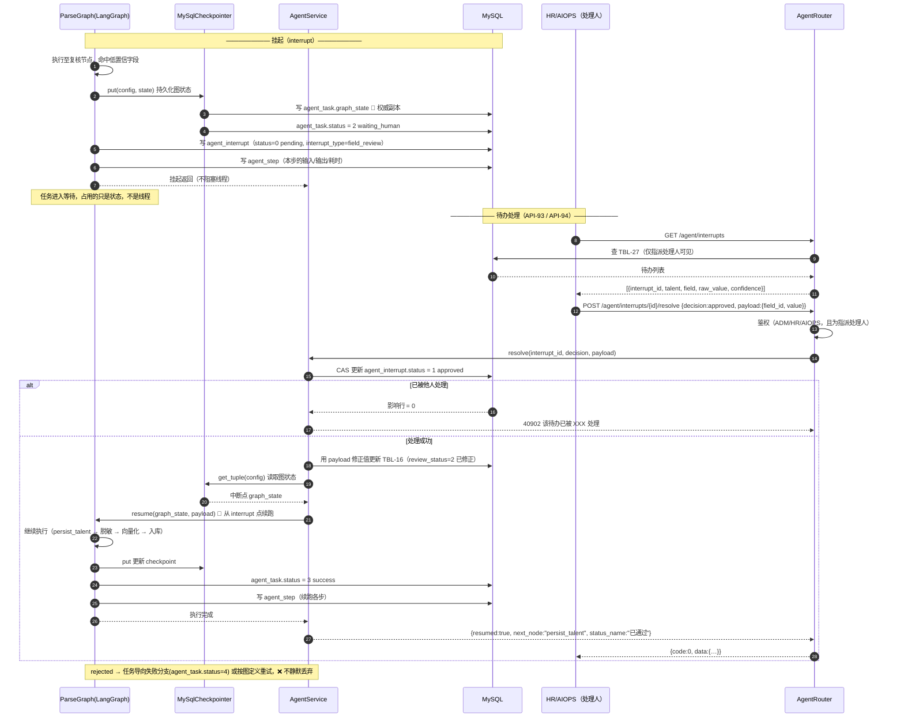

**人工介入的四个状态与恢复契约**

| 项 | 约定 |
| --- | --- |
| 任务级状态 | `agent_task.status`：0 pending / 1 running / **2 waiting_human** / 3 success / 4 failed |
| 待办级状态 | `agent_interrupt.status`：0 pending / **1 approved** / 2 rejected |
| 关系 | 一个任务（`agent_task`）**可产生多个待办**（`agent_interrupt` 1:N）—— ❌ 两者不能共用一个字段 |
| 恢复依据 | 只认 `agent_task.graph_state`（MySQL）；Redis `agent_mem:*` 只能做加速，❌ 不可作恢复依据 |
| 必走本接口的决策点 | 测评结论 / 能力评级 / **档案合并** / 高成本查询（F-A0.3 红线） |

> **一期边界提示**：本接口**属一期**（架构 SQ-1 的档案解析复核环节依赖它）。需求 §10.4 中的「Dify ⟷ LangGraph 回调契约」属 ⏸ F-2 阶段，**两者不要混淆**。
> **并发语义**：同一 `interrupt_id` 重复提交返回首次结果（`40903`，幂等）；**不同人并发提交，后者 `40902`** —— 由 `agent_interrupt.status` 的 CAS 保证。

**覆盖**：F-A0 / F-A0.1 / F-A0.3 · ADR-11 · TBL-25 / TBL-26 / TBL-27 · API-90~95（重点 API-93 / API-94）

---

### 3.5 SQ-8 · 受控标签词表闭环（AI 建议 → 审核 → 打标）

> **场景**：画像生成时模型给出一个词表里没有的新词。**AI 不得直接造标签**，必须走「建议 → 审核 → 启用 → 打标」闭环（§10.1 约束①）。

**图 3-5　受控标签词表闭环（SQ-8）**

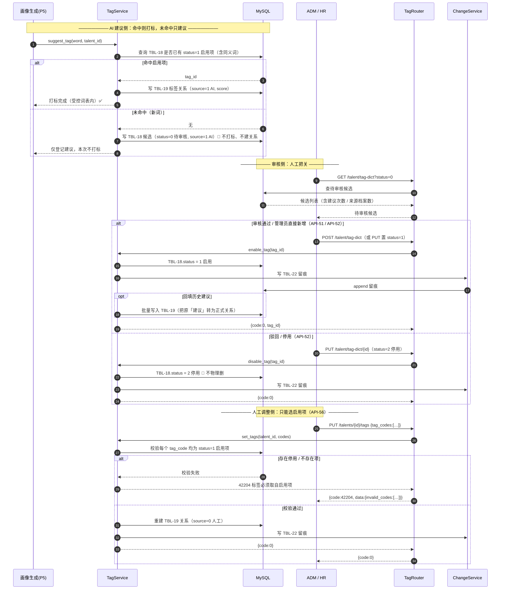

**闭环的四条规则**

| # | 规则 | 依据 |
| :-: | --- | --- |
| 1 | **AI 只能"建议"，不能"造词"** | 未命中词表时写 `status=0` 候选，**不打标、不建关系** —— 否则标签体系会被模型自由发挥撑爆 |
| 2 | **停用而非物理删** | `status=2` 停用（API-52 / API-27 同规则），保留历史关系的可解释性 |
| 3 | **人工调整只能选启用项** | API-56 校验 `status=1`；`42204` 拒绝并回传非法 code 列表 |
| 4 | **词表变更必留痕** | 启用 / 停用均写 TBL-22（F-3.4.1 要求词表变更可追溯） |

> 🔴 **与 CL-7 的呼应**：本图是 §10.1 约束①（**标签取值只能取自受控词表启用项**）在时序上的展开；约束的**判定类**是 `TagDictValidator.assert_enabled`。
> **AI 建议的"次数"字段很重要**：多个档案反复提出同一个新词，是运营决定是否开新标签的**客观依据**（而不是拍脑袋）。

**覆盖**：F-3.4 / F-3.4.1 · API-50~56 · TBL-18 / TBL-19 / TBL-22

---

### 3.6 时序图完整性自检

| 检查项 | 结论 |
| --- | --- |
| 每条链路有明确的**发起者与终点** | ✅（SQ-4 HR / SQ-5 EMP+ADM / SQ-6 HR / SQ-7 处理人 / SQ-8 系统+ADM·HR） |
| **异常路径与补偿动作**均已画出 | ✅（SQ-4 向量失败回滚 / SQ-5 分片失败回滚 / SQ-7 并发 40902 / SQ-8 校验失败 42204） |
| 参与者 ≤ 7 | ✅（SQ-4 与 SQ-5 各 7 个，其余 6 个以内） |
| 图中方法名 / 接口路径可在上游文档反查 | ✅（`API-nn` 与《接口设计》§2.2 一致；类名与 CL-2 一致） |
| 错误码与《接口设计》§1.5 一致 | ✅（40901 / 40902 / 40903 / 42201 / 42203 / 42204 / 50000 / 50002） |
| 🔴 红线步进均以 `Note` 或注释明确标出 | ✅ |
| 与 DFD 能对上（同一条链路的两个视角） | ✅（SQ-4→P6 / SQ-5→P8 / SQ-6→P4 / SQ-7→F-A0 / SQ-8→P5） |
| 跨库写顺序在两图间的差异已显式说明 | ✅（SQ-4 §本图决策 #1 与 SQ-5 编排表均有说明，避免被误读为笔误） |

---

## 附录 A. 状态机（State Diagram）

> 状态机的**取值必须与《数据库设计》§6.1 内建枚举逐字一致**（这是跨文档最常见的翻车点）。下面三张图只画**一期真实可达**的状态与迁移。

### A.1 SM-1 · 档案数据状态

**枚举**：`talent_data_status` → `talent_base.data_status`：**0 待复核 / 1 有效 / 2 已合并 / 3 已归档 / 4 已删除**

**图 A-1　档案数据状态（SM-1）**

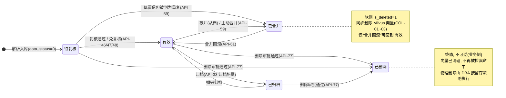

| 迁移 | 触发接口 | 是否写留痕（TBL-22） | 备注 |
| --- | --- | --- | --- |
| 待复核 → 有效 | API-46 / 47 / 48 | ✅（人工动作时） | AI 直采不写人工留痕 |
| 有效 → 已合并 | API-59 | ✅ `change_source=2 合并` | 需先生成 `snapshot_id` |
| 已合并 → 有效 | API-61 | ✅（回滚留痕） | **唯一可逆的"删除类"迁移** |
| 有效 → 已删除 | API-77 | ✅ | 先删向量后软删（SQ-5） |
| 已删除 | — | — | 🔴 **业务侧终态**，无出边 |

> 🔴 **红线**：`已删除` 是**业务侧终态**。任何「把已删档案改回有效」的接口都是设计错误；误删只能靠物理备份恢复，不能靠业务接口。

---

### A.2 SM-2 · 导入任务状态

**枚举**：`import_task_status` → `import_task.status`：**0 待处理 / 1 解析中 / 2 已完成 / 3 部分失败 / 4 失败**

**图 A-2　导入任务状态（SM-2）**

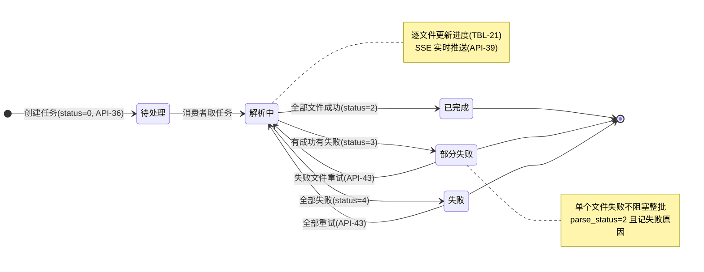

| 状态 | SSE 事件（API-39） | 前端表现 |
| --- | --- | --- |
| 0 待处理 | `queued` | 进度条 0%，显示"排队中" |
| 1 解析中 | `progress`（逐文件） | 进度条按 `success+fail / total` 推进 |
| 2 已完成 | `done` | 绿色完成态 + 质量报告入口（API-41） |
| 3 部分失败 | `done`（带 `failed>0`） | 橙色警示 + **失败文件列表 + 重试按钮** |
| 4 失败 | `done`（带 `failed=total`） | 红色 + 重试按钮 |

> 🔴 **红线**：`部分失败` **不是** `失败` 的中间态，两者**平级**且都从 `解析中` 直接到达。❌ 不允许把「有 1 个文件失败」判成整批失败 —— F-3.1 明确要求「单个文件失败不阻塞整批」。

---

### A.3 SM-3 · 个人权利请求状态

**枚举（对外可见）**：**0 待处理 / 1 已通过 / 2 已驳回**（对应 API-77 响应 `status` / `status_name`）
**内部临时态**：**「处理中」**（不对外暴露，由 `CAS` 标记实现，用于防并发双审）

**图 A-3　个人权利请求状态（SM-3）**

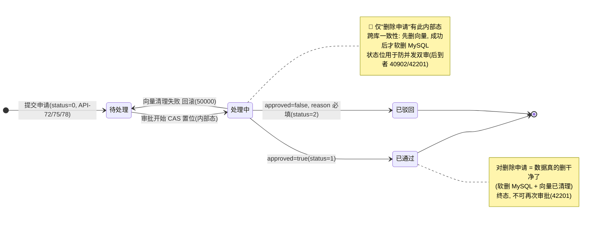

**四类请求的差异（同一状态机，不同"通过"的含义）**

| 请求类型 | 提交接口 | 审批接口 | "已通过"意味着 |
| --- | :-: | :-: | --- |
| **删除** | API-75 | API-77（**仅 ADM**） | 软删档案 + 向量已清理（🔴 跨库一致性，见 SQ-5） |
| 更正 | API-72 | API-74（ADM/HR） | 字段已更正 + 已通知本人 |
| 导出 | API-78 | API-79 下载（**留痕**） | 数据包已生成，本人可下载 |
| 查阅 | API-71 | —（直接返回） | 不产生请求单 |

> 🔴 **两条红线**：
> ① **处理时限可统计**（API-80 返回处理时限统计）—— 状态机必须记录提交/处理时间戳，否则合规报告无法出具；
> ② **驳回必须告知理由**：`approved=false` 时 `reason` 必填，且状态终态为 `已驳回`（**不是**回到 `待处理`）—— 否则会产生"无限重提"的死循环。

---

## 附录 B. 全局追踪矩阵（F-x.y → 本文档图表）

> 用途：评审时按**功能点**抽查，快速定位该功能点在哪张图上被描述、又在哪张图里被约束。

| 功能点 | 数据流图 | 类图 | 时序图 | 状态机 |
| --- | --- | --- | --- | --- |
| F-1.1 组织与用户 | DF-1（P2） | CL-1 / CL-6 | — | — |
| F-1.2 认证 | DF-0 / DF-1（P1） | CL-6 | — | — |
| F-1.3 角色权限 | DF-1（P1/P2） | CL-6（`DataScopeFilter`） | — | A.1（数据域） |
| F-1.5 审计 | DF-1（P9） | CL-2 | — | — |
| F-1.7 字典配置 | DF-1（P2）/ DF-2（P3.4） | CL-1（`DictItem`） | SQ-8 | — |
| F-3.1 批量导入 | DF-1（P3）/ **DF-2** | CL-2 / CL-5 | 架构 SQ-1 | **A.2** |
| F-3.2 简历解析 | DF-2（P3.1~3.3） | CL-1 / CL-2 | 架构 SQ-1 | A.2 |
| F-3.3 字段复核 | DF-2（P3.5） | **CL-7**（`ThresholdEngine`） | **SQ-6** | A.1（待复核） |
| F-3.3.1 复核工作量 | DF-2 | CL-2 | SQ-6 | — |
| F-3.4 数字画像 | DF-1（P5） | CL-1（`TalentTagRel`） | SQ-8 | A.1 |
| F-3.4.1 受控标签 | DF-1（P5）/ **DF-4** | **CL-7**（`TagDictValidator`） | **SQ-8** | — |
| F-3.5 查重合并 | DF-1（P6）/ DF-4 | CL-1（`TalentDupPair`）/ CL-7 | **SQ-4** | **A.1** |
| F-3.6 语义检索 | DF-1（P7）/ **DF-3** | **CL-3** | 架构 SQ-2 | — |
| F-3.7 RAG 问答 | DF-1（P7）/ **DF-3** | **CL-3 / CL-4** | 架构 SQ-3 | — |
| F-3.8 质量报告 | DF-2（P3.8） | CL-2 | 架构 SQ-1 | A.2 |
| F-3.9 脱敏回填 | **DF-0 / DF-3 / DF-4** | **CL-4**（`MaskService`） | 架构 SQ-3 | — |
| F-3.10 变更留痕 | DF-1（P8） | CL-1（`TalentChangeLog`） | **SQ-4 / SQ-6** | A.1 |
| F-3.11 个人权利 | DF-1（P8） | CL-2（`PrivacyService`） | **SQ-5** | **A.3** |
| F-9.1 模型配置 | DF-1 | CL-2（`ModelGateway`） | — | — |
| F-9.2 Prompt 版本 | DF-1 | CL-2 | — | — |
| F-9.5 Token 成本 | DF-1（P9）/ **DF-4** | **CL-7**（`CostCalculator`） | — | — |
| F-A0 Agent 任务 | DF-1 | **CL-5** | 架构 SQ-1 / **SQ-7** | A.2 |
| F-A0.1 状态持久化 | DF-1 | **CL-5**（`MySqlCheckpointer`） | **SQ-7** | A.2 |
| F-A0.3 人工介入 | DF-1 | **CL-5**（`AgentInterrupt`） | **SQ-7** | — |

---

## 附录 C. 全文档自检清单

| # | 检查项 | 结论 |
| :-: | --- | --- |
| 1 | 20 张图全部完成（DF-0~4 / CL-1~7 / SQ-4~8 / SM-1~3） | ✅ |
| 2 | 每张图都能反查上游（F-x.y / TBL-nn / API-nn / COL-nn / DS-n） | ✅（各图末尾「覆盖」行 + 附录 B 矩阵） |
| 3 | 图里出现的类名 / 方法名 / 表名 / 接口路径均可在上游文档或目录树查到 | ✅（CL-2 与架构 §5 目录树逐一对齐；基座实体归并已注明） |
| 4 | 分层红线在类图中可视化（Router→Service→DAO→Model 单向） | ✅（CL-2） |
| 5 | DFD 三条绘图红线（流有名字 / 无黑洞奇迹 / 无实体直连） | ✅（§1.7） |
| 6 | 出网边界唯一（只有一条通往云端的数据流） | ✅（DF-0 / DF-3 / DF-4） |
| 7 | 确定性边界落到具名类（§10.1 四条约束） | ✅（CL-7 + DF-4） |
| 8 | 跨库写一致性顺序有明确说明（且解释了两种相反顺序的判据） | ✅（SQ-4 / SQ-5） |
| 9 | 状态机取值与数据库 §6.1 内建枚举逐字一致 | ✅（A.1~A.3，取值与 `talent_data_status` / `import_task_status` / 请求状态一致） |
| 10 | 异常路径与错误码与《接口设计》§1.5 一致 | ✅（40901/40902/40903/42201/42203/42204/50000/50002） |
| 11 | 时序图参与者 ≤ 7 | ✅ |
| 12 | 本文档不重复架构文档 SQ-1~SQ-3，仅做**承接与补齐**（SQ-4~SQ-8） | ✅ |

---

### 与套件其余文档的衔接

```text
①需求分析 v1.3  →  ②架构设计 v1.0  →  ③数据库设计 v1.0  →  ④接口设计 v1.0
                                                              ↓
                            ⑤⑥ 本文档（DFD + 类图 + 时序图 + 状态机）
                                                              ↓
                                                    ⑦原型（页面 P-1~P-19）
                                                              ↓
                                                    ⑧开发计划（任务 T-x.y）
```

**下一步（⑧ 开发计划）将直接引用本文档的编号**：任务拆解的输入即为本文档 CL-2 的分层清单与 SQ-4~SQ-8 的异常路径（每条 `alt` 分支都可直接转成一条测试用例）。

> **本文档的图与代码是双向约束**：代码可以改，图必须同步改；**图里没有的类，代码里不该出现；代码里新增的类，图里必须补上。**

---

*文档结束 · v1.0 · 2026-09-21*
