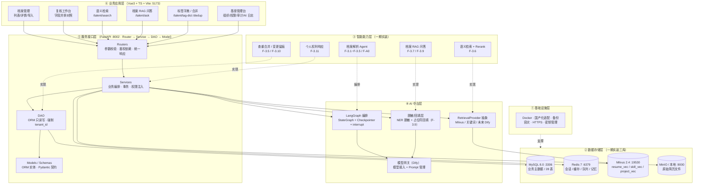
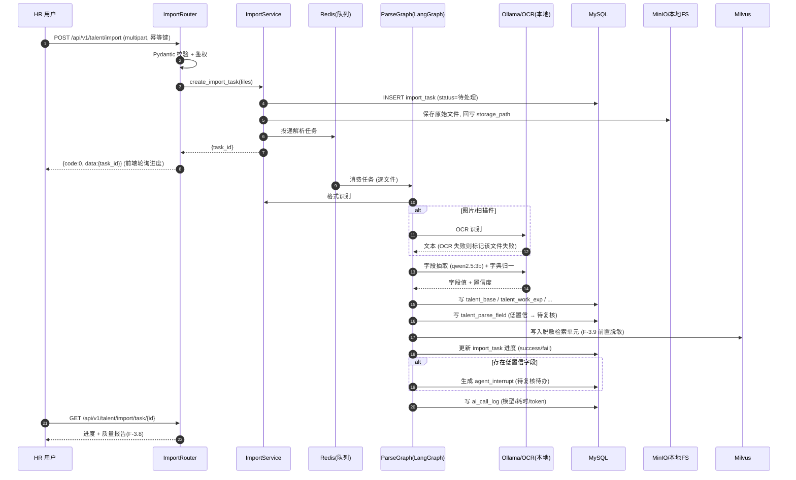
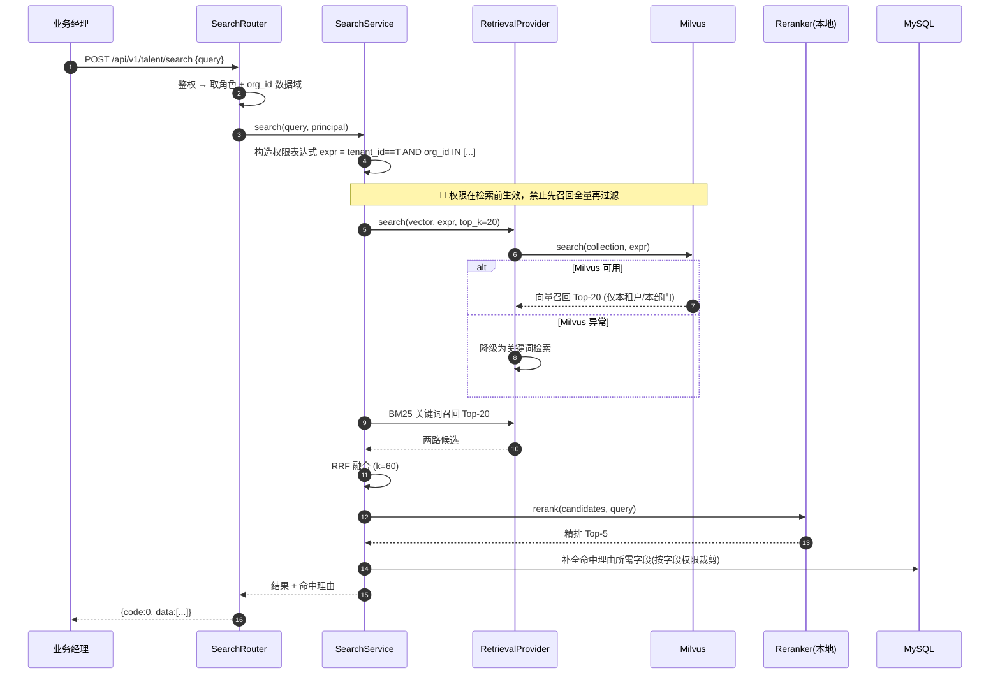
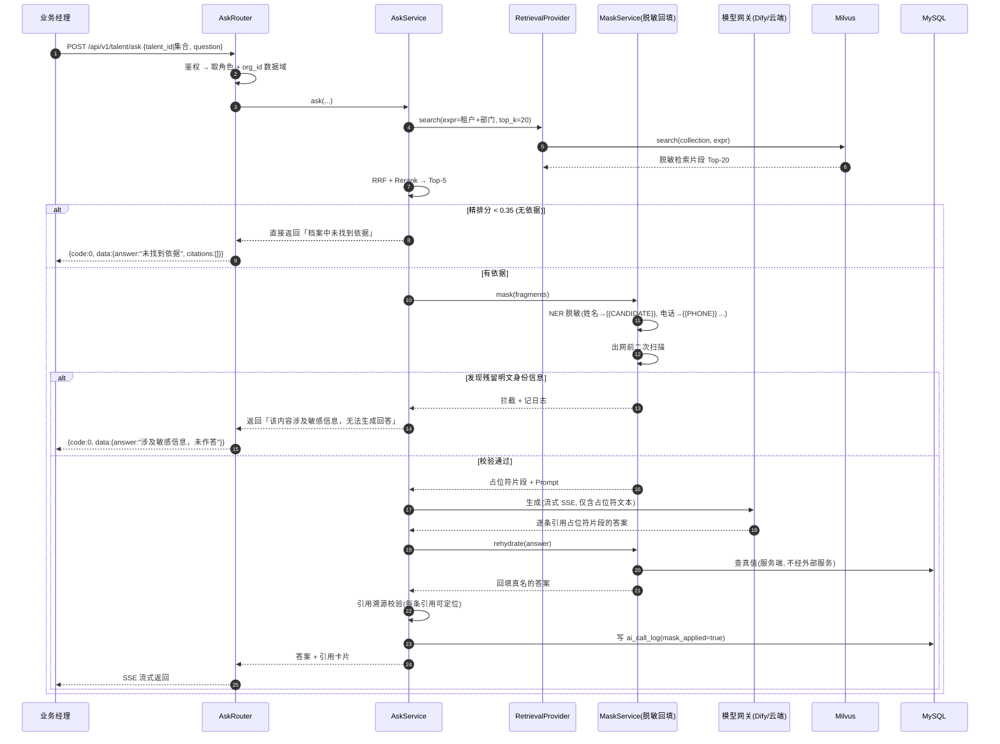
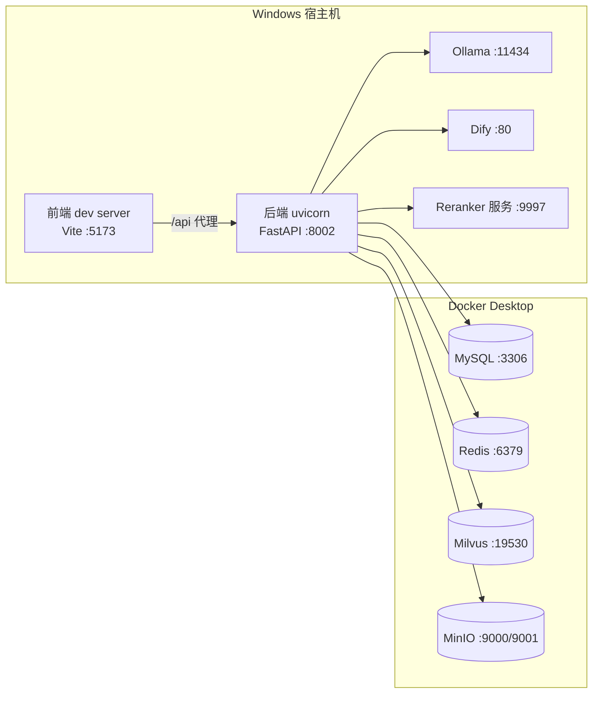

# 2026 顶配版 AI 数字化人才平台 · 系统架构设计文档

| 项目 | 内容 |
| --- | --- |
| 文档名称 | 2026 顶配版 AI 数字化人才平台 — 系统架构设计文档 |
| 版本 | v1.0 |
| 状态 | 与《需求分析文档》**v1.3** 对齐 · 一期范围：F-3 档案与数字画像模块 |
| 上游依据 | 《AI数字化人才平台-需求分析文档》v1.3（已过两轮评审，54 项问题全关闭） |
| 编制角色 | AI 应用开发工程师 |
| 文档读者 | 后端 / 前端 / AI 工程师、架构师、测试、运维、甲方技术评标 |
| 交付形态 | 面向政企客户的独立交付 / 招投标项目 |
| 编制日期 | 2026-09-21 |

### 修订记录

| 版本 | 日期 | 修订人 | 修订内容 |
| --- | --- | --- | --- |
| v1.0 | 2026-09-21 | AI 应用开发工程师 | 首版：依据需求分析文档 v1.3 生成系统架构设计，覆盖一期（F-3）六层落位、目录树、三条核心链路时序图、部署拓扑、横切关注点、外部集成降级、12 条 ADR |

---

## 0. 文档说明

### 0.1 文档定位与读者

本文档是**架构设计阶段的唯一事实来源**，把《需求分析文档》v1.3 中"要做什么"（F-x.y 功能点）翻译为"**怎么分层、怎么切片、怎么部署、怎么降级**"，目标是**让另一个工程师只看这一篇就能把工程骨架搭起来**。

本文档**不承担**：数据库表结构 DDL（见后续《数据库设计文档》）、接口报文清单（见后续《接口设计文档》）、类图与时序图细化（见后续《类图与时序图》）、排期甘特（见后续《开发计划》）。

### 0.2 编号字典

本套文档统一编号，**一经分配永不复用**。本文档涉及以下前缀：

| 前缀 | 用途 | 本文档中的使用 |
| --- | --- | --- |
| `F-x.y` | 功能点 | 直接沿用需求文档 v1.3，不改号 |
| `NFR-n` | 非功能需求 | 直接沿用需求文档 v1.3 |
| `D-n` | 决策项 | 直接沿用需求文档 v1.3（D-1~D-19 已闭合） |
| `ADR-n` | 架构决策记录 | **本文档新增**，ADR-1 ~ ADR-12 |
| `SQ-n` | 时序图 | **本文档新增**，SQ-1 ~ SQ-3 |
| `TBL-nn` | 数据表 | 表名沿用需求文档 §9.2；**正式 TBL 编号在《数据库设计文档》分配** |
| `API-nn` | 接口 | **正式 API 编号在《接口设计文档》分配**；本文档用时序图节点表示 |
| `P-n` | 页面 | 页面路由沿用需求文档 §8.2；**P 编号在《原型图》分配** |
| `Q-n` | 待确认问题 | 沿用需求文档 §14 |

> **追踪链**：`F-x.y → 六层落位（§4）→ 目录文件（§5）→ 时序图（§6）→ 部署组件（§7）→ ADR（§10）`。

### 0.3 需求 → 设计 映射表

一期全部功能点在本文档的设计落位：

| 功能点 | 功能名 | 分层落位（§4） | 时序图 | ADR |
| --- | --- | :-: | :-: | :-: |
| F-3.1 | 全格式简历批量导入 | 导入服务 + 文件存储 | SQ-1 | ADR-10 |
| F-3.2 | AI 字段抽取与标准化 | 解析 Agent（LangGraph）+ 本地模型 | SQ-1 | ADR-7 |
| F-3.3 | 分层复核漏斗 | 复核服务 + HITL | SQ-1 | ADR-11 |
| F-3.3.1 | 复核工作量看板 | 前端 + 统计服务 | — | — |
| F-3.4 | 向量画像与标签体系 | 画像服务 + Milvus | SQ-2 | ADR-3 |
| F-3.4.1 | 受控标签词表 | 标签字典服务 | — | ADR-12 |
| F-3.5 | 智能查重与合并 | 查重服务 + 变更留痕 | — | ADR-9 |
| F-3.6 | 语义化人才检索（权限前置） | 检索服务 + RetrievalProvider | SQ-2 | ADR-1/ADR-3 |
| F-3.7 | 档案 RAG 问答 | 问答链路 + 混算路由 | SQ-3 | ADR-3/ADR-6 |
| F-3.8 | 数据质量报告 | 统计服务 + 导出 | — | — |
| F-3.9 | 问答上下文脱敏与回填 | 脱敏回填层（应用层） | SQ-3 | ADR-4 |
| F-3.10 | 档案变更留痕与版本回溯 | 留痕服务 + talent_change_log | — | ADR-9 |
| F-3.11 | 个人信息权利响应 | 合规服务（查阅/更正/删除/导出） | — | ADR-9 |
| F-1.1~F-1.7 | 平台基础与权限（裁剪版） | 基座（鉴权/日志/限流/字典） | — | ADR-8 |
| F-9.1/9.2/9.5 | 模型接入 / Prompt 管理 / 调用日志 | AI 中台（模型网关） | SQ-3 | ADR-12 |
| F-A0.1~7 | Agent 通用能力 | Agent 编排层（LangGraph） | SQ-1 | ADR-11 |

### 0.4 一期范围声明

本文档默认以**需求文档 v1.3 的一期范围**（**F-3 档案与数字画像模块 + 裁剪版基座**）为设计基线：

- **实装组件**：MySQL + Redis + Milvus + Ollama + Dify（模型网关）+ MinIO/本地文件系统 + 本地 Reranker 服务。
- **不实装**：PgSQL / TimescaleDB / CDC 同步链路 / Vanna.ai / 语义层视图（全部随 F-5 后移）。
- 后续模块（F-2/F-4/F-5/F-6/F-7/F-8/F-10）在本文档**只保留扩展点**（见 §11 演进路线），不展开设计。

---

## 1. 架构目标与约束

### 1.1 架构目标

| 目标 | 说明 |
| :-: | --- |
| **可交付** | 一期在一个模块（档案与画像）把 **Agent 编排 + RAG 检索 + 向量语义匹配 + 人机协同复核** 四条 AI 主链路真正跑通跑稳 |
| **可审计** | 任何影响个人权益的结论必须可追溯（AI 调用日志 + 操作审计 + 档案变更留痕三类日志齐全） |
| **可合规** | 简历含敏感个人信息，**原始数据不出网**；出网内容必须经脱敏与回填（F-3.9 / D-15） |
| **可扩展** | 六层架构 + 无状态服务，后续模块（F-2/F-4/F-5）在基座上横向复制，不重复建设基础设施 |
| **可替换** | 模型、向量库、检索后端均经抽象层接入，替换不改业务代码 |

### 1.2 质量属性场景表（可量化）

> **架构设计的真正依据**：不写"高性能、高可用"，写成**可验证的场景**。数值口径全部对齐需求文档 §5 NFR 与 §6 硬指标应答表。

| 编号 | 场景 | 刺激 | 度量 | 应对手段 | 关联 NFR |
| :-: | --- | --- | --- | --- | :-: |
| QA-1 | 性能 · 向量检索 | 200 并发语义检索 @100 万向量 | P95 ≤ 500ms | HNSW 索引 + 元数据前置过滤 + 连接池 | NFR-2 / IDX-04 |
| QA-2 | 性能 · 接口 | 普通业务接口 | P95 ≤ 1s | 无状态服务 + Redis 缓存热点 + 异步非阻塞 | NFR-2 / IDX-05 |
| QA-3 | 性能 · 大模型首字 | 档案 RAG 问答流式输出 | 首 token P95 ≤ 3s | SSE 流式 + 云端模型 + Prompt 精简 | NFR-3 |
| QA-4 | 性能 · 批量导入 | 单批 ≥100 份简历解析 | 任务进度实时可见；不阻塞请求线程 | 异步任务队列（Redis）+ 进度轮询 | F-3.1 |
| QA-5 | 可用性 | 云端大模型不可用 | 服务不崩溃，返回兜底文案 | 模型网关降级链（云端 → 本地 → 模板应答） | NFR-5 / IDX-10 |
| QA-6 | 可用性 | Milvus 异常 | 检索功能不白屏 | RetrievalProvider 降级为关键词检索 | NFR-5 / §4.4 |
| QA-7 | 安全 · 越权 | 跨部门检索/提问 | 100% 拦截 | Milvus 检索前置 `tenant_id + org_id` expr；DAO 强制租户条件 | NFR-16 / F-3.6 |
| QA-8 | 安全 · 数据出网 | 档案片段送云端模型 | 明文身份信息零出网 | 检索单元脱敏 + 出网前二次 NER 校验 + 本地回填 | §10.5 / F-3.9 |
| QA-9 | 合规 · 可追溯 | 审计查询 | 三类日志齐全，留存 ≥12 个月 | ai_call_log + audit_log + talent_change_log；只追加 | NFR-8 |
| QA-10 | 可维护 | 新增一个业务模块 | ≤ 0.5 人日搭骨架 | 六层脚手架 + 目录切片 | §4 / §5 |
| QA-11 | 数据一致性 | 合并/删除操作 | 结构化数据与向量同步一致 | 事务 + 向量同步清理（删除档案必删向量） | F-3.5 / F-3.11 |
| QA-12 | 可移植 | 本地与云算力切换 | 不改业务代码 | 模型网关 OpenAI 兼容 + 配置外置 | NFR-14 |

### 1.3 关键约束

| 约束 | 来源 | 对架构的影响 |
| --- | --- | --- |
| 强制六层架构 | 需求文档 §8.1 / 项目《后端架构规范》 | 代码目录强制 `router → service → dao → model`，禁止跨层 |
| 写入路径禁止裸 SQL | 需求文档 §10.3（M-1 处置） | 写入全部经 ORM；仅后续 F-5 分析路径允许受控 NL2SQL |
| 本地无显存 | 需求文档 §15.4 / D-19 | Embedding（bge-m3）与 Reranker 全本地 CPU 推理，**吞吐为不确定项，须 N0 压测实测** |
| 原始简历不出网 | 需求文档 §10.5 / D-15 | 出网仅脱敏后占位符片段；脱敏回填层为**应用层强制组件** |
| 一期不新增中间件 | 需求文档 §0.3 / D-13 | 只用现有 MySQL/Redis/Milvus/Ollama/Dify；不引入 PgSQL/CDC/Vanna |
| 多租户预留 | 需求文档 §9.1.1 / D-10 | 全业务表带 `tenant_id`；权限逻辑统一以 `tenant_id + org_id` 为过滤基础 |

---

## 2. 技术选型

### 2.1 总体方案对比（AI 编排层归属）

核心分歧：**Dify 与 LangGraph 能力高度重叠，划不清会出现"两套编排互相打架"**。

| 维度 | 方案 A · Dify 主导 | 方案 B · LangGraph 主导 | 方案 C · 分层混合（✅ 采用） |
| --- | --- | --- | --- |
| 编排中枢 | Dify Workflow 编排全部流程 | LangGraph 编排全部流程 | Dify 管模型网关 / Prompt；LangGraph 管有状态 Agent |
| 一期 Milvus 对接 | 经 Dify 内置知识库 | 经 LangChain VectorStore 直连 | **档案检索与问答全部走 LangChain 直连**（D-14） |
| 有状态能力 | 弱（变量机制有限） | **强**（Checkpointer + interrupt） | **强**（关键路径用 LangGraph） |
| 人工介入 | 需自研 | 原生支持 | 原生支持（`interrupt` + `agent_interrupt`） |
| 可视化配置 | **强** | 弱 | 强（Prompt / 模型配置走 Dify） |
| 运维复杂度 | 低 | 中 | 中高 |
| 踩坑风险 | 复杂 Agent 跑不动；社区版许可受限 | 全部自研，交付期长 | **边界需严格定义**（本文档 §4.4 已定义） |
| 与一期范围匹配度 | 中 | 中 | **高** |
| 结论 | ⚪ 备选 | 🟡 备选 | ✅ **采用** |

> **决策依据**：见 **ADR-2 / ADR-3**。方案 C 的关键是**把边界写死**——一期 Dify 只做模型网关与 Prompt 管理，**不承担检索、不承担应用编排**。

### 2.2 关键组件选型表

| 层 | 组件 | 选型 | 版本建议 | 决策理由 |
| --- | --- | --- | --- | --- |
| 接入 | 前端框架 | Vue3 + TS + Vite | Vue 3.4+ / Vite 5+ | 团队既有栈，生态成熟 |
| 接入 | UI / 图表 / 状态 | Element Plus / ECharts / Pinia | — | 政企后台标准组合 |
| 服务 | Web 框架 | FastAPI（异步） | 0.11x | 异步原生，契合 AI 长任务；OpenAPI 自动文档 |
| 服务 | ORM / 迁移 | SQLAlchemy 2.x + Alembic | 2.0+ | ORM 为写入路径唯一事实来源；Alembic 管版本链 |
| 服务 | Agent 编排 | LangGraph | 0.2+ | 原生 Checkpointer + interrupt，支撑 HITL |
| 服务 | 工具封装 | LangChain | 0.3+ | Retriever / Document Loader 复用 |
| AI 中台 | 模型网关 | Dify（收窄职责） | 1.x | 统一模型入口 + Prompt 版本管理（F-9.1/F-9.2） |
| AI 中台 | 本地推理 | Ollama | 0.3+ | 承载抽取与 Embedding，数据不出网 |
| 数据 | 业务库 | MySQL | 8.0.x | 业务主数据（唯一写入源） |
| 数据 | 向量库 | Milvus | 2.4.x | HNSW + 元数据过滤，支撑权限前置 |
| 数据 | 缓存/队列 | Redis | 7.x | 会话、缓存、限流、Agent 短期记忆、任务队列 |
| 数据 | 文件存储 | MinIO / 本地文件系统 | latest | 原始简历留存（§ADR-10） |
| 模型 | Embedding | `bge-m3`（本地 Ollama） | — | 中文效果优，支持多粒度（D-19） |
| 模型 | Reranker | `bge-reranker-v2-m3`（本地服务） | — | 精排必备，本地部署（ADR-7） |
| 模型 | 轻抽取/改写 | `qwen2.5:3b` / `qwen3:8b`（本地） | — | 低资源、高吞吐 |
| 模型 | 复杂生成 | 云端通用大模型（OpenAI 兼容） | — | 质量要求高；**仅接收脱敏片段** |
| 模型 | OCR | PaddleOCR / 云 OCR | — | 图片/扫描件解析（本地优先） |

> **可替换性**：所有模型调用统一经 **Dify 模型网关 / OpenAI 兼容协议**接入，替换模型不改业务代码（ADR-12）。版本号标注"可随时推翻"，以 N0 压测结果定稿。

---

## 3. 总体架构

### 3.1 六层架构图（一期实装视图）



> **画图规则**：分层自上而下；**禁止跨层连线**（Router 直连 DAO 即架构违规，图上一眼可辨）；数据库用 `[()]`，外部服务用 `[]`，每个组件标端口。
> **虚线说明**：③ 智能能力层是**能力语义层**，其实现体分布在 ④ 与 ⑤ 中（如"档案解析 Agent"由 LangGraph 编排 + Service 落地），故用虚线表达映射关系，非调用关系。

### 3.2 一期实装范围（三库协同）

| 存储 | 一期是否实装 | 存什么 | 不存什么 | 关键配置 |
| --- | :-: | --- | --- | --- |
| **MySQL 8.0** | ✅ | 用户/角色/权限/组织、人才主档与履历、`talent_parse_field`、`talent_tag_*`、`import_*`、`talent_change_log`、Agent 状态、`ai_call_log`、`audit_log`、`prompt_template` | 向量、海量大文本 | 读写分离；utf8mb4；按月分区（日志类） |
| **Redis 7** | ✅ | 会话、缓存、Agent **短期热记忆**、限流计数、任务队列 | 持久化唯一数据源、Agent 权威状态 | AOF 持久化；Key 前缀规范 |
| **Milvus 2.4** | ✅ | `resume_vec` / `skill_vec` / `project_vec`（**均为脱敏检索单元**） | 业务结构化数据、明文身份信息 | HNSW；元数据含 `tenant_id` / `org_id` 供前置过滤 |
| **MinIO / 本地 FS** | ✅ | 原始简历文件（导入留档、可重解析） | — | 存储路径入库 `import_file.storage_path` |
| PgSQL + TimescaleDB | ⏸ 后移 | — | — | 随 F-5 启用 |
| CDC 同步链路 | ⏸ 后移 | — | — | 随 F-5 启用 |

> **有利结论**：一期"**MySQL 28 表 + Milvus 3 collection + Redis + MinIO**"，**无跨库、无 CDC、无语义层视图**，数据访问层复杂度大幅下降。

### 3.3 分层依赖红线

```text
Router  ──►  Service  ──►  DAO  ──►  Model
   │            │            │
   └─ 仅参数校验 └─ 业务编排   └─ 纯 CRUD
      与响应组装    与事务        强制 tenant_id
```

| 红线 | 说明 |
| --- | --- |
| ❌ Router 不得直连 DAO | 必须经 Service 编排 |
| ❌ DAO 不得包含业务规则 | DAO 只做持久化 |
| ❌ Model 不得依赖上层 | 依赖方向单向向下 |
| ❌ 业务代码不得拼接 SQL | 写入路径强制 ORM（M-1 处置） |
| ❌ Service 不得直接调用 Milvus SDK | 必须经 `RetrievalProvider` 抽象（§4.4） |
| ❌ 出网调用不得绕过脱敏层 | 送模型前必须过 F-3.9（ADR-4） |

---

## 4. 六层架构落位

### 4.1 后端六层落位（F-3 模块切片表）

> 依赖方向：`router → service → dao → model`，禁止反向或跨层。

| 模块 | Router | Service | DAO | Model | Schema |
| --- | --- | --- | --- | --- | --- |
| 人才档案 | `routers/talent_router.py` | `services/talent_service.py` | `dao/talent_dao.py` | `models/talent.py` | `schemas/talent.py` |
| 简历导入 | `routers/import_router.py` | `services/import_service.py` | `dao/import_dao.py` | `models/import_task.py` | `schemas/import_task.py` |
| 字段解析复核 | `routers/parse_router.py` | `services/parse_service.py` | `dao/parse_field_dao.py` | `models/parse_field.py` | `schemas/parse_field.py` |
| 标签字典 | `routers/tag_router.py` | `services/tag_service.py` | `dao/tag_dao.py` | `models/tag_dict.py` | `schemas/tag.py` |
| 查重合并 | `routers/dedup_router.py` | `services/dedup_service.py` | `dao/dup_pair_dao.py` | `models/dup_pair.py` | `schemas/dedup.py` |
| 语义检索 | `routers/search_router.py` | `services/search_service.py` | `dao/`（经 Provider） | `models/talent.py` | `schemas/search.py` |
| 档案问答 | `routers/ask_router.py` | `services/ask_service.py` | `dao/`（经 Provider） | — | `schemas/ask.py` |
| 脱敏回填 | —（内部模块） | `services/mask_service.py` | — | — | `schemas/mask.py` |
| 变更留痕 | `routers/change_router.py` | `services/change_service.py` | `dao/change_log_dao.py` | `models/change_log.py` | `schemas/change_log.py` |
| 个人权利 | `routers/privacy_router.py` | `services/privacy_service.py` | `dao/`（复用） | — | `schemas/privacy.py` |
| 数据质量 | `routers/quality_router.py` | `services/quality_service.py` | `dao/`（复用） | — | `schemas/quality.py` |
| 基座 · 权限 | `routers/auth_router.py` | `services/auth_service.py` | `dao/user_dao.py` | `models/user.py` | `schemas/auth.py` |
| 基座 · 审计 | `routers/audit_router.py` | `services/audit_service.py` | `dao/audit_dao.py` | `models/audit_log.py` | `schemas/audit.py` |
| 基座 · 字典配置 | `routers/dict_router.py` | `services/dict_service.py` | `dao/dict_dao.py` | `models/dict.py` | `schemas/dict.py` |
| AI 中台 · 模型/Prompt | `routers/ai_router.py` | `services/ai_gateway_service.py` | `dao/prompt_dao.py` | `models/prompt.py` | `schemas/ai.py` |
| AI 中台 · 调用日志 | `routers/ai_log_router.py` | `services/ai_log_service.py` | `dao/ai_call_log_dao.py` | `models/ai_call_log.py` | `schemas/ai_log.py` |
| Agent 任务 | `routers/agent_router.py` | `services/agent_service.py` | `dao/agent_dao.py` | `models/agent_task.py` | `schemas/agent.py` |

### 4.2 前端页面切片（一期约 18 个）

| # | 页面 | 路由 | 可见角色 | 功能点 |
| :-: | --- | --- | --- | --- |
| 1 | 登录 | `/login` | 全部 | F-1.2 |
| 2 | 工作台首页 | `/dashboard` | 全部 | — |
| 3 | 组织架构管理 | `/system/org` | ADM, HR | F-1.1 |
| 4 | 用户管理 | `/system/user` | ADM | F-1.1 |
| 5 | 角色与权限 | `/system/role` | ADM | F-1.3 |
| 6 | 数据字典与配置 | `/system/config` | ADM | F-1.7 |
| 7 | 审计日志 | `/system/audit-log` | ADM, AUDIT | F-1.5 |
| 8 | 人才档案列表 | `/talent/list` | ADM, HR, MGR(本部门) | F-3 |
| 9 | 人才档案详情 | `/talent/detail/:id` | ADM, HR, MGR, EMP(本人) | F-3.4 |
| 10 | 批量导入与任务进度 | `/talent/import` | ADM, HR | F-3.1 / F-3.8 |
| 11 | **字段复核工作台** | `/talent/review` | ADM, HR | F-3.3 / F-3.3.1 |
| 12 | 重复档案合并 | `/talent/dedup` | ADM, HR | F-3.5 |
| 13 | 语义人才检索 | `/talent/search` | ADM, HR, MGR | F-3.6 |
| 14 | **档案 RAG 问答** | `/talent/ask` | ADM, HR, MGR | F-3.7 / F-3.9 |
| 15 | 标签字典管理 | `/talent/tag-dict` | ADM, HR | F-3.4.1 |
| 16 | **档案变更历史** | `/talent/change-log` | ADM, HR, AUDIT | F-3.10 |
| 17 | **我的画像 / 个人权利** | `/my/profile` | EMP | F-3.4 / F-3.11 |
| 18 | 模型配置 / Prompt / AI 日志 | `/ai/model` `/ai/prompt` `/ai/call-log` | AIOPS, ADM | F-9.1/9.2/9.5 |
| 19 | Agent 任务与人工介入待办 | `/ai/agent-task` | ADM, HR, AIOPS | F-A0.3 |

> 页面权限双层：路由级（`meta.roles`）+ 按钮级（自定义指令 `v-perm`），与需求文档 §3.2 权限矩阵一一对应。
> `/api` 由 Vite（开发）/ Nginx（生产）代理至后端 8002；axios `baseURL = /api/v1`。

### 4.3 AI 中台与智能能力层落位

| 一期能力 | 承载组件 | 落位 | 关键实现 |
| --- | --- | --- | --- |
| 档案解析 Agent | LangGraph | `agents/parse_graph.py` | StateGraph（格式识别 → OCR → 抽取 → 归一 → 置信度 → 入库）；`interrupt` 触发复核 |
| 语义检索 | LangChain + Milvus | `retrieval/milvus_provider.py` | 向量 + BM25 召回 → RRF → Rerank；**检索表达式带 `tenant_id + org_id`** |
| 档案 RAG 问答 | LangChain + 混算路由 | `agents/ask_graph.py` | 检索 → 脱敏 → 云端生成 → 本地回填 → 引用校验 → 兜底 |
| 脱敏回填 | 自研应用层 | `services/mask_service.py` | NER 脱敏 + 占位符替换 + 出网二次校验 + 本地回填 |
| 查重合并 | 自研 + 向量 | `services/dedup_service.py` | 向量相似度 + 关键字段比对；阈值确定性判定 |
| 模型网关 | Dify | `clients/model_gateway.py` | OpenAI 兼容协议；模型与 Prompt 配置下发 |
| 调用日志 | 自研 | `services/ai_log_service.py` | 与业务 `trace_id` 打通；`mask_applied` 标记是否经脱敏出网 |

### 4.4 RetrievalProvider 抽象与降级路径 🔴

> **关闭 H-3（RAG 单点依赖）**：一期即建立检索能力抽象，使后续引入 Dify 知识库或替换检索后端时**业务代码零改动**。

| 层 | 措施 | 落地要求 | 阶段 |
| --- | --- | --- | :-: |
| **接口抽象** | 定义统一协议 `RetrievalProvider`（`ingest` / `search` / `delete` / `health`）；一期实现 `MilvusRetrievalProvider` | 业务代码只依赖协议，**不直接调用 Milvus SDK**；协议在 N1 交付 | ✅ 一期 |
| **数据自有** | 档案语料、分块结果与向量**全部落自有库**，可从本地数据**全量重建** | 禁止"外部组件是唯一数据源"；提供重建脚本，重建耗时纳入 N0 基线压测 | ✅ 一期 |
| **降级路径** | 支持"向量 / 关键词 / 混合"三模式开关；Milvus 异常时自动降级为关键词检索 | 降级链路须能独立完成"检索 → 引用溯源"两步 | ✅ 一期 |
| **未来扩展** | Dify 知识库作为另一种实现接入（`DifyKnowledgeBaseProvider`） | 一期不实现适配器，只预留协议 | ⏸ 后续 |

---

## 5. 工程目录树

```text
agents_contract_dev/                      # 或独立仓库：ai-talent-platform
├── backend/
│   ├── app/
│   │   ├── main.py                       # 应用入口：注册路由/异常/中间件，不写业务
│   │   ├── config.py                     # 全部配置经 settings 读取，禁止硬编码
│   │   ├── routers/                      # ⑤ 服务接口层：仅参数校验 + 组装响应
│   │   │   ├── talent_router.py
│   │   │   ├── import_router.py
│   │   │   ├── parse_router.py
│   │   │   ├── tag_router.py
│   │   │   ├── dedup_router.py
│   │   │   ├── search_router.py
│   │   │   ├── ask_router.py
│   │   │   ├── change_router.py
│   │   │   ├── privacy_router.py
│   │   │   ├── quality_router.py
│   │   │   ├── auth_router.py
│   │   │   ├── audit_router.py
│   │   │   ├── dict_router.py
│   │   │   ├── ai_router.py
│   │   │   ├── ai_log_router.py
│   │   │   └── agent_router.py
│   │   ├── services/                     # ⑤ 业务编排层：事务 / 权限注入 / 调用 Provider
│   │   │   ├── talent_service.py
│   │   │   ├── import_service.py
│   │   │   ├── parse_service.py
│   │   │   ├── tag_service.py
│   │   │   ├── dedup_service.py
│   │   │   ├── search_service.py
│   │   │   ├── ask_service.py
│   │   │   ├── mask_service.py           # F-3.9 脱敏与回填（一期强制）
│   │   │   ├── change_service.py         # F-3.10 变更留痕
│   │   │   ├── privacy_service.py        # F-3.11 个人权利响应
│   │   │   ├── quality_service.py
│   │   │   ├── auth_service.py
│   │   │   ├── audit_service.py
│   │   │   ├── dict_service.py
│   │   │   ├── ai_gateway_service.py
│   │   │   ├── ai_log_service.py
│   │   │   └── agent_service.py
│   │   ├── dao/                          # ⑤ 数据访问层：纯 CRUD + 强制 tenant_id
│   │   │   ├── talent_dao.py
│   │   │   ├── import_dao.py
│   │   │   ├── parse_field_dao.py
│   │   │   ├── tag_dao.py
│   │   │   ├── dup_pair_dao.py
│   │   │   ├── change_log_dao.py
│   │   │   ├── user_dao.py
│   │   │   ├── audit_dao.py
│   │   │   ├── dict_dao.py
│   │   │   ├── prompt_dao.py
│   │   │   ├── ai_call_log_dao.py
│   │   │   ├── agent_dao.py
│   │   │   └── session.py                # 引擎 / 会话 / 基类
│   │   ├── models/                       # ⑤ ORM 实体（数据结构的唯一事实来源）
│   │   │   ├── talent.py
│   │   │   ├── import_task.py
│   │   │   ├── parse_field.py
│   │   │   ├── tag_dict.py
│   │   │   ├── dup_pair.py
│   │   │   ├── change_log.py
│   │   │   ├── user.py
│   │   │   ├── audit_log.py
│   │   │   ├── dict.py
│   │   │   ├── prompt.py
│   │   │   ├── ai_call_log.py
│   │   │   ├── agent_task.py
│   │   │   └── tenant.py
│   │   ├── schemas/                      # ⑤ Pydantic 契约（入参/出参/统一响应）
│   │   │   ├── common.py                 # {code, message, data, trace_id}
│   │   │   ├── talent.py
│   │   │   ├── import_task.py
│   │   │   ├── search.py
│   │   │   ├── ask.py
│   │   │   ├── mask.py
│   │   │   └── ...
│   │   ├── agents/                       # ④ LangGraph 编排
│   │   │   ├── parse_graph.py            # 档案解析 Agent
│   │   │   ├── ask_graph.py              # 档案 RAG 问答图
│   │   │   ├── checkpointer.py           # 状态持久化（MySQL 实现）
│   │   │   └── state.py                  # 图状态定义
│   │   ├── retrieval/                    # ④ 检索抽象
│   │   │   ├── provider.py               # RetrievalProvider 协议
│   │   │   ├── milvus_provider.py        # 一期实现
│   │   │   └── keyword_provider.py       # 降级实现
│   │   ├── clients/                      # ④ 外部集成封装（统一超时/重试/降级）
│   │   │   ├── model_gateway.py          # Dify / OpenAI 兼容
│   │   │   ├── ollama_client.py          # 本地模型
│   │   │   ├── reranker_client.py        # 本地 Reranker
│   │   │   ├── ocr_client.py             # OCR
│   │   │   └── storage_client.py         # MinIO / 本地 FS
│   │   ├── core/                         # 横切关注点
│   │   │   ├── security.py               # JWT / 密码 / 权限依赖
│   │   │   ├── logging.py                # 结构化日志 + trace_id
│   │   │   ├── tenant.py                 # 全局租户过滤 QueryFilter
│   │   │   ├── ratelimit.py              # 限流熔断
│   │   │   └── masking.py                # NER 脱敏规则库
│   │   ├── exceptions/                   # 统一异常与处理器
│   │   │   └── exception_handlers.py
│   │   └── tasks/                        # 异步任务（Redis 队列）
│   │       ├── import_tasks.py
│   │       └── vector_tasks.py
│   ├── alembic/                          # ORM 迁移链（唯一 DDL 来源）
│   ├── tests/
│   └── requirements.txt
├── frontend/
│   ├── src/
│   │   ├── api/                          # Axios 封装（baseURL=/api/v1）
│   │   ├── router/                       # 路由 + meta.roles
│   │   ├── store/                        # Pinia
│   │   ├── directives/v-perm.ts          # 按钮级权限
│   │   ├── views/
│   │   │   ├── talent/                   # 列表/详情/导入/复核/合并/检索/问答/标签/变更
│   │   │   ├── system/                   # 组织/用户/角色/配置/审计
│   │   │   └── ai/                       # 模型/Prompt/调用日志/Agent 任务
│   │   └── components/
│   ├── vite.config.ts                    # proxy: /api → http://localhost:8002
│   └── package.json
├── deploy/
│   ├── docker-compose.dev.yml            # 开发：MySQL/Redis/Milvus/MinIO（Ollama/Dify 复用宿主）
│   ├── nginx.conf                        # 生产：托管前端 dist + 反代 /api
│   └── .env.example                      # 配置模板（密钥不入库）
├── scripts/
│   ├── rebuild_index.py                  # 从 MySQL 全量重建 Milvus 索引（降级/恢复用）
│   └── eval_gold.py                      # 金标准集离线评估
└── docs/                                 # 需求/评审/架构/数据库/接口/计划文档
```

> 目录职责注释为红线：`routers` 只做参数校验与响应组装；`services` 承载业务与事务；`dao` 纯 CRUD 且强制租户条件；`models` 是数据结构唯一事实来源（DDL 由 Alembic 从模型生成）。

---

## 6. 请求链路时序图

### SQ-1 · 档案批量导入与解析（F-3.1 / F-3.2 / F-3.3 / F-A0）



### SQ-2 · 语义人才检索 · 权限前置（F-3.6）



### SQ-3 · 档案 RAG 问答 · 脱敏与回填（F-3.7 / F-3.9 / D-15）🔴🔴



> **三条链路的共同红线**：① 权限在**检索前**生效；② 出网前必过脱敏层且二次校验；③ 全程写 AI 调用日志（可审计）。

---

## 7. 部署拓扑与端口

### 7.1 开发环境（当前 · 一期）

> **Windows 单机 + Docker**。现有 MySQL / Redis / Milvus / Ollama / Dify 已部署，**一期无需新增任何中间件**。



### 7.2 生产环境（甲方 · 一期，三区分离）

| 区 | 组件 | 说明 |
| --- | --- | --- |
| **应用区** | 后端（无状态多实例）+ Nginx | Nginx 托管前端 dist 并反代 `/api`；后端水平扩展 |
| **数据区** | MySQL（主从）+ Milvus + Redis + MinIO | 数据独立扩容与备份 |
| **AI 算力区** | Ollama + Reranker + Dify（+ 云通道） | 按 NFR-11 国产化适配；云模型经网关出网 |

> 后续 F-5 阶段数据区增加 PgSQL + TimescaleDB + CDC 同步（一期不部署）。

### 7.3 端口 / 容器映射表

| 组件 | 镜像 / 形态 | 宿主端口 | 容器端口 | 卷挂载 | 备注 |
| --- | --- | :-: | :-: | --- | --- |
| 前端（dev） | Vite dev server | 5173 | — | — | Vite proxy `/api → :8002` |
| 前端（prod） | Nginx 容器 | 80 | 80 | `./dist → /usr/share/nginx/html` | 反代 `/api` 至后端 |
| 后端 | uvicorn（本地 / 容器） | 8002 | 8002 | — | **不带 `--reload`**（用户手动管理进程） |
| MySQL | `mysql:8.0` | 3306 | 3306 | `./data/mysql` | utf8mb4；读写分离（生产） |
| Redis | `redis:7-alpine` | 6379 | 6379 | `./data/redis` | AOF 持久化 |
| Milvus | `milvusdb/milvus:v2.4.x` | 19530 | 19530 | `./data/milvus` | HNSW；etcd/minio 依赖随镜像栈 |
| MinIO | `minio/minio` | 9000 / 9001 | 9000 / 9001 | `./data/minio` | 9000 API，9001 控制台 |
| Ollama | 宿主进程 / 容器 | 11434 | 11434 | `./ollama` | 复用宿主机服务 |
| Dify | 宿主 Docker Compose | 80 / 5001 | 80 / 5001 | — | 复用宿主机服务 |
| Reranker | 独立服务（本地） | 9997 | 9997 | — | `bge-reranker-v2-m3`，需独立部署 |
| 云模型通道 | 外部 API | — | — | — | 仅接收脱敏片段 |

### 7.4 Docker Compose 要点

| 要点 | 约定 |
| --- | --- |
| **自托管 vs 复用** | compose 自托管 MySQL / Redis / Milvus / MinIO；**Ollama 与 Dify 复用宿主机服务**（通过 `host.docker.internal` 访问） |
| **数据卷** | 各数据组件挂载 `./data/<组件>`，便于备份与迁移 |
| **网络** | 统一自定义 bridge 网络，容器间用服务名互访 |
| **配置外置** | 所有连接串与密钥经 `.env` 注入（`.env.example` 入库，`.env` 不入库） |
| **健康检查** | 为 MySQL / Redis / Milvus 配置 `healthcheck`，避免应用先于数据库启动 |
| **Windows 注意** | 卷挂载用绝对路径；Compose V2 语法；`host.docker.internal` 已由 Docker Desktop 提供 |
| **后端启动** | `.venv/Scripts/python.exe -m uvicorn app.main:app --host 0.0.0.0 --port 8002`（不带 `--reload`） |

---

## 8. 横切关注点

| 关注点 | 落位 | 约定 |
| --- | --- | --- |
| **鉴权** | `core/security.py` + Router 依赖 | JWT Bearer；角色经依赖注入校验；连续 5 次失败锁定 10 分钟 |
| **统一响应** | `schemas/common.py` | `{code, message, data, trace_id}`；错误码覆盖业务/系统/第三方三类 |
| **分页** | Service 层 | `data=items`、`page={total, page, per_page, pages}` |
| **异常** | `exceptions/exception_handlers.py` | 四处理器（业务/HTTP/422/兜底）；`main` 只调 `register_exception_handlers(app)` |
| **日志** | `core/logging.py` | 结构化 + `trace_id`；请求进出各一条；留存 ≥12 个月 |
| **三类审计日志** 🔴 | `audit_service` / `ai_log_service` / `change_service` | 操作日志 + AI 调用日志 + 档案变更留痕，**只追加不可篡改** |
| **多租户 / 行级权限** | `core/tenant.py`（DAO 强制） | 带 `tenant_id` 的表查改删必带租户条件；行级权限由 ORM `QueryFilter` 统一注入，**不依赖各接口手写条件** |
| **字段级权限** | 序列化层 | 身份证/手机号/薪资按角色脱敏；`EXEC` 只看统计值 |
| **向量权限前置** 🔴 | `retrieval` + `SearchService` | Milvus `search` 必带 `tenant_id + org_id` expr；**禁止先召回后过滤** |
| **限流熔断** | `core/ratelimit.py` | 按用户/IP/接口维度；下游 AI 异常自动降级返回兜底文案，不抛 500 |
| **缓存** | Redis | 热点查询缓存 + 会话 + Agent 短期记忆；命中率目标 ≥90% |
| **记忆职责边界** 🔴 | Redis vs MySQL Checkpointer | Redis 只存**可丢**的短期记忆；Agent 权威状态落 MySQL，先写库再写缓存 |
| **脱敏** 🔴 | `core/masking.py` + `MaskService` | 索引/检索用脱敏文本；出网前二次 NER 校验；**脱敏失败即拒绝作答，不降级为明文出网** |
| **配置** | `config.py` | 一律 `settings.X`，禁止硬编码端口/密钥；密钥经环境变量启动注入（NFR-15） |
| **部署迁移** | Alembic | ORM 模型为唯一事实来源，DDL 由迁移生成，禁止手工改库 |

---

## 9. 外部集成与降级

> 每条集成**必须**写超时与降级，否则外部服务一挂整个功能白屏。

| 能力 | 提供方 | 调用方式 | 超时 | 失败降级策略 |
| --- | --- | --- | :-: | --- |
| 简历字段抽取 | 本地 Ollama（qwen2.5:3b / qwen3:8b） | HTTP `/api/generate` | 60s | 重试 1 次 → 标记该文件解析失败并进人工队列 |
| 档案问答生成 | 云端大模型（经 Dify 网关） | OpenAI 兼容 HTTP（SSE） | 首包 10s / 总 60s | 降级本地 `qwen3:8b` → 再降级返回"AI 暂不可用"模板文案（含引用片段） |
| 精排 | 本地 Reranker 服务（bge-reranker-v2-m3） | HTTP | 3s | 降级用 RRF 融合结果（不做精排），标注置信度 |
| 向量检索 | Milvus | SDK / RetrievalProvider | 3s | 降级 `keyword_provider` 关键词检索（仍带权限 expr） |
| 关键词检索 | 本地（BM25 / 全文索引） | 进程内 | 1s | 降级为 SQL `LIKE` 粗筛（限本租户本部门） |
| Embedding | 本地 bge-m3（Ollama） | HTTP | 30s/批 | 重试 → 标记待处理，**禁止送云端**（含个人信息，D-15） |
| OCR | PaddleOCR / 云 OCR | 本地进程 / API | 30s/页 | 本地优先后备云端 → 均失败则标记该文件需人工处理 |
| 文件存储 | MinIO / 本地 FS | SDK / 文件 IO | 10s | 降级本地文件系统 |
| 模型/Prompt 配置 | Dify | HTTP | 5s | 降级读本地缓存配置（`prompt_template` 表 + 本地配置） |

> **降级分层原则**：检索类降级**必须保留权限前置**（不能因降级而绕过 `tenant_id + org_id`）；生成类降级**必须保留脱敏约束**（不能因降级而为提速走明文出网）。

---

## 10. 架构决策记录（ADR）

### ADR-1 · 采用六层架构而非三层
- **背景**：多人分工，需明确边界；项目《后端架构规范》强制六层。
- **备选**：三层（controller / service / repo）；六层（+ schema / model 独立）。
- **决策**：采用六层（`router → service → dao → model` + `schema` 独立）。
- **后果**：样板代码增多（可用脚手架生成）；换 ORM / 框架时影响面可控。

### ADR-2 · 采用方案 C 分层混合（Dify 与 LangGraph 分工）
- **背景**：Dify 与 LangGraph 能力重叠，划不清则"两套编排打架"。
- **备选**：A Dify 主导；B LangGraph 主导；C 分层混合。
- **决策**：**Dify 管模型网关 + Prompt 管理；LangGraph 管有状态 Agent**。边界见 §2.1 / §4.3。
- **后果**：一期 Dify 职责收窄；需严格守住"不越界"红线，否则回归 A 的坑。

### ADR-3 · 一期 RAG 走 LangChain + Milvus 直连（关闭 B-6 / D-14）
- **背景**：F-2 与 Dify 知识库运维后移后，F-3.7 的实现路径在一期悬空。
- **备选**：A LangChain + Milvus 直连；B 引入 Dify 知识库（提前做 F-9.3）；C 混合。
- **决策**：**A**。一期全部 RAG 链路（检索 + 问答）走 LangChain + Milvus 直连，Dify 不作检索。
- **后果**：数据自有、无额外组件依赖；后续引入 Dify 知识库时可经 `RetrievalProvider` 平滑接入（§4.4）。

### ADR-4 · 检索单元脱敏 + 占位符本地回填（关闭 B-7 / D-15）🔴🔴
- **背景**：档案 RAG 问答需把档案片段送云端模型，但简历原文不得出网；自由文本中的姓名**无法靠字段级脱敏处理**。
- **备选**：A 检索单元脱敏 + 占位符本地回填；B 敏感片段全本地模型处理（质量降级）；C 原文出网（需甲方书面豁免）。
- **决策**：**A**。索引与检索只使用脱敏文本（姓名→`{{CANDIDATE}}`、电话→`{{PHONE}}`…），模型基于占位符生成，返回后**在服务端本地回填真值**；出网前二次 NER 校验；脱敏失败即拒绝作答。
- **后果**：出网内容不含明文身份，向量库本身也不含明文身份；新增 F-3.9 为 P0，`MaskService` 为应用层强制组件。

### ADR-5 · 一期不引入 PgSQL / CDC（D-13）
- **背景**：NL2SQL（F-5）后移；一期数据量级（主档 3.8 万、履历 80 万）由 MySQL 完全承载。
- **备选**：A 一期即引入 PgSQL + CDC；B 后移至 F-5。
- **决策**：**B**。
- **后果**：一期无跨库、无同步链路，数据访问层复杂度大幅下降；B-1/B-2 两个原阻断问题在一期自然消失。

### ADR-6 · 混合算力路由（D-4）
- **背景**：本地无显存；简历含隐私；生成质量要求高。
- **决策**：**本地 Ollama 承载抽取 / 向量化 / 改写 / 敏感词过滤 / 脱敏；云端大模型承载问答生成与复杂推理**，云端仅接收脱敏片段。
- **后果**：需支付云通道成本；收益是隐私不出网 + 生成质量高。

### ADR-7 · Embedding 与 Rerank 全本地部署（D-19）
- **背景**：Embedding 文本含个人信息，出网需脱敏；本机无显存。
- **备选**：A 全本地（CPU，接受吞吐上限）；B 全本地 + 冲突时扩算力；C Embedding 上云。
- **决策**：**B**。N0 压测实测 `bge-m3` CPU 吞吐与 Reranker 延迟；不足再评估上云（须配合 D-15）。
- **后果**：N4 工期为不确定项（需求文档 §15.2 已上调）；Reranker 需独立部署。

### ADR-8 · 多租户预留（D-10）
- **背景**：政企集团客户多租户需求常见，后补成本极高。
- **决策**：**全业务表增加 `tenant_id`**，一期固定单租户值；权限逻辑统一以 `tenant_id + org_id` 为过滤基础。
- **后果**：增量成本约 1 人天；消除后期全表迁移的结构性风险。

### ADR-9 · 档案变更留痕独立建表（D-16 / F-3.10）
- **背景**：档案会被重复解析、人工修订、合并；F-3.5 的"合并可回滚"需要数据支撑。
- **决策**：**独立 `talent_change_log` 表**记录字段级变更（来源/前后值/操作人/时间/任务 ID），只追加不可篡改；合并回滚共用此机制。
- **后果**：查历史与回滚实现简单；代价是写放大（每次变更多一行写入，可接受）。

### ADR-10 · 原始简历文件留存与对象存储
- **背景**：需支持重解析与人工核对原文。
- **决策**：原始文件存 **MinIO（或本地 FS）**，路径入库 `import_file.storage_path`；**下载/预览受字段级权限约束**。
- **后果**：支持全量重建索引（§4.4）；需配套文件上传安全校验（大小/扩展名/压缩包炸弹/宏）。

### ADR-11 · 人工介入用 LangGraph interrupt + agent_interrupt（HITL）
- **背景**：原文"全程无人干预"不可行且不合法。
- **决策**：Agent 在需复核/审批节点调用 `interrupt`，落 `agent_interrupt` 待办；人工在工作台处理后续跑（Checkpointer 从最后成功节点恢复）。
- **后果**：满足合规问责；人工介入为异步，需待办与通知机制。

### ADR-12 · 统一模型网关与 Prompt 版本管理
- **背景**：模型需可替换；Prompt 需版本化与审计。
- **决策**：**所有模型调用经 Dify 模型网关 / OpenAI 兼容协议**；Prompt 存 `prompt_template` 表并版本化，调用日志记录 `prompt_version`。
- **后果**：替换模型不改业务代码；模型故障可经网关统一切换降级链。

---

## 11. 演进路线

### 11.1 一期（本文档设计基线）

```text
F-3 档案与数字画像（完整）+ 裁剪版基座（F-1 / F-9.1·9.2·9.5 / F-A0）
组件：MySQL 28 表 + Milvus 3 collection + Redis + MinIO + Ollama + Dify + Reranker
```

### 11.2 后续模块扩展点（本期只预留，不实现）

| 后续模块 | 一期已预留的扩展点 | 需要新增的能力 |
| --- | --- | --- |
| **F-2 企业知识库问答** | `RetrievalProvider` 协议 + Prompt 管理 + AI 日志 | `DifyKnowledgeBaseProvider` 适配器、文档分块、知识库分域打标 |
| **F-4 AI 智能测评** | LangGraph 骨架 + HITL + 权限体系 + 人才画像 | 题库与审核状态机、任务调度、作答监控、确定性评分 |
| **F-6 岗位-人才匹配** | **向量画像与语义检索（复用 F-3 核心资产）** | 岗位结构化解析、加权匹配公式、匹配解释 |
| **F-5 NL2SQL 数据决策** | ORM 模型（语义层视图的来源）+ 审计体系 | PgSQL + TimescaleDB + CDC + 语义层视图 + SQL 安全网关 + Vanna |
| **F-7 智能培训** | 画像 + 能力缺口数据 | 课程库、学习计划、进度管控 |
| **F-8 Skills 组件库** | 各能力已模块化 | 组件标准化封装、可视化编排 |
| **F-10 多端协同** | 标准 REST API | 响应式适配 / 原生 App |

> **架构不变量**：六层架构、`RetrievalProvider` 抽象、模型网关、权限模型、三类审计日志在后续模块中**直接复用，不改动**。每次扩展新模块，新增目录切片即可，无需改动既有模块（QA-10：≤ 0.5 人日搭骨架）。

---

## 12. 自检清单

- [ ] 架构图**无跨层连线**（Router 未直连 DAO）
- [ ] 每个关键选型都有**对比表与结论**，而非直接下结论（§2.1 / §2.2）
- [ ] 每个关键选型都落到**本项目实际环境**（已装组件版本、团队栈）
- [ ] 端口/密钥全部来自 `settings`，**无硬编码**；密钥不落库不入镜像
- [ ] 部署拓扑的**容器端口与宿主端口映射写清**（含 MinIO 9000/9001、Reranker 9997 等差异端口）
- [ ] 每条外部集成都写了**超时与降级**（§9），且降级不破坏权限前置与脱敏约束
- [ ] 目录树中**每个目录都有职责注释**
- [ ] ADR 覆盖了所有"看起来奇怪但有意为之"的设计（六层、Dify 收窄、脱敏回填、单机三库）
- [ ] **权限在检索前生效**（Milvus expr），且 `RetrievalProvider` 降级时仍保留 expr
- [ ] **出网前必过脱敏层**且二次校验；脱敏失败拒绝作答（不降级为明文出网）
- [ ] Agent 权威状态落 MySQL 而非 Redis（"丢了会不会做错？"判定口诀）
- [ ] 三条日志（操作/AI 调用/变更留痕）齐全且只追加
- [ ] 时序图含**失败分支**（无依据兜底、脱敏失败、Milvus 降级）
- [ ] 一期实装范围与需求文档 §0.3 一致（不引入 PgSQL/CDC/Vanna）

---

**文档结束（v1.0）** · 下一步：《数据库设计文档》——按本文档 §4.1 模块切片与需求文档 §9.2/§9.3，产出 ER 图 + TBL 清单 + DDL（ORM + Alembic 为唯一事实来源）+ 索引设计。
