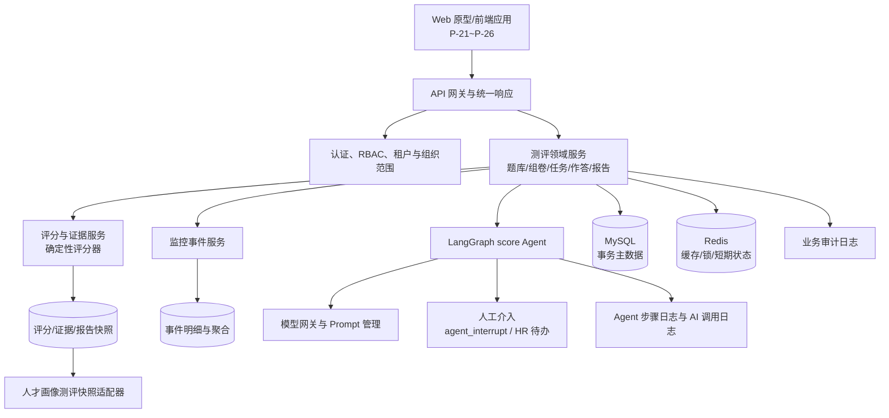
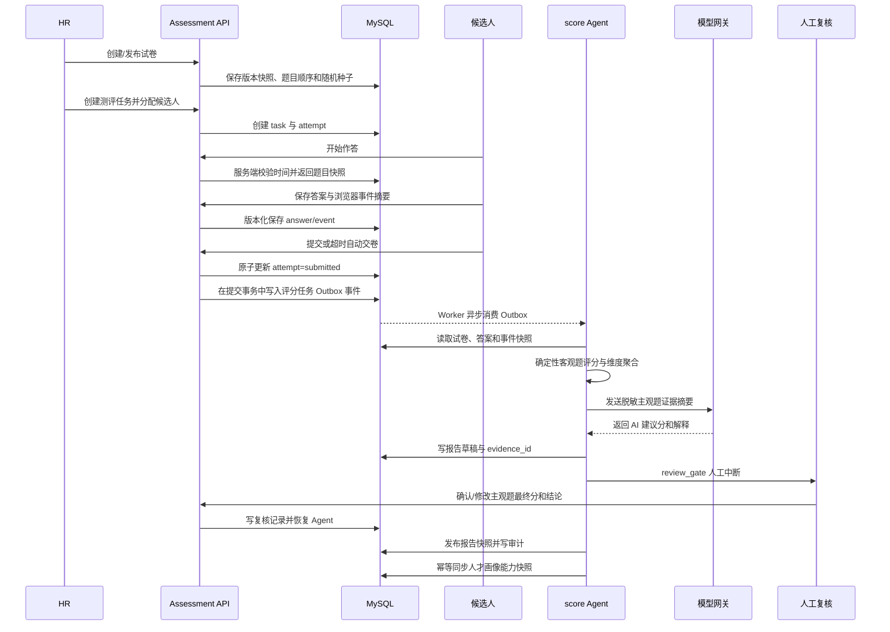
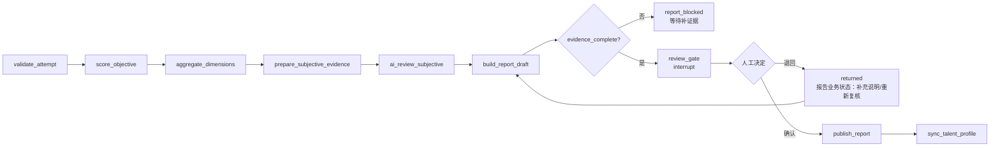
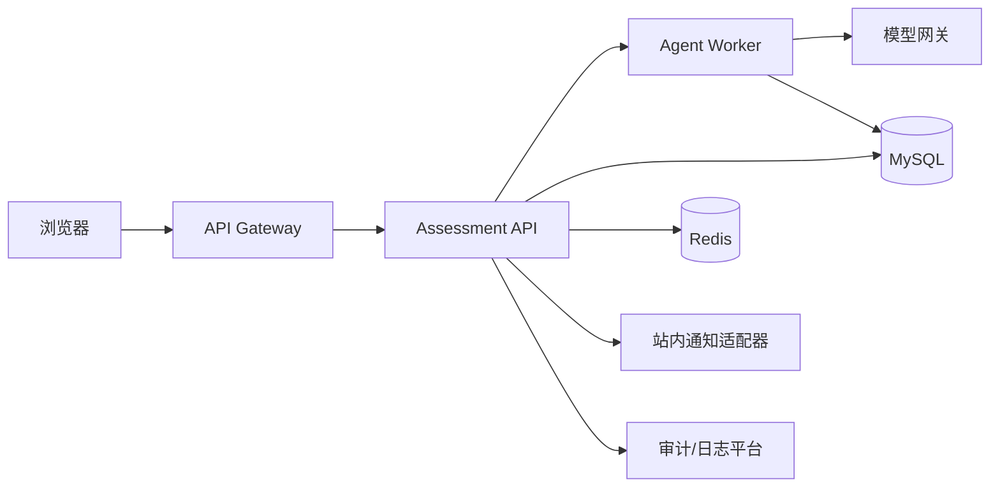

# 人才测评分析 Agent 架构设计

| 项目 | 内容 |
| --- | --- |
| 文档版本 | v1.0 |
| 编写日期 | 2026-09-28 |
| 适用范围 | 人才测评 Agent 本期：题库、组卷、在线作答、作答监控、能力报告与证据引用 |
| 关联需求分析 | [`需求分析文档.md`](./需求分析文档.md) |
| 关联原型 | P-21~P-26 |
| 配套文档 | [数据库设计文档.md](./数据库设计文档.md)、[数据字典.md](./数据字典.md)、[接口设计文档.md](./接口设计文档.md)、[开发实施文档.md](./开发实施文档.md)、[约束性文档.md](./约束性文档.md) |
| 目标读者 | 产品、后端、前端、数据、测试、运维和安全评审人员 |

本设计使用的测评接口整体编号范围为 `API-096~API-159`，数据表整体编号范围为 `TBL-29~TBL-46`。一个接口对应一个 API 编号，编号按实际接口连续扩展，不为压缩编号合并接口。

## 1. 设计目标

人才测评分析 Agent 负责把“试卷定义、候选人作答、确定性评分、主观题辅助分析、人工复核、能力报告和人才画像快照”串成一条可追溯的业务链路。系统的核心不是让模型直接做人员决策，而是让模型在明确边界内生成可复核建议，并让每个高影响结论都能回到题目、作答摘要、评分快照和复核记录。

本期目标：

- 支持题库维护、题目版本、能力维度和审核责任链。
- 支持固定卷和随机卷，发布后冻结题目版本、顺序、随机种子和完整评分上下文；任何影响评分结果的变更都必须创建新的 Paper 版本。
- 支持测评任务、批量候选人、服务端时间、自动保存和断点恢复。
- 支持客观题确定性评分、主观题 AI 建议分和人工最终确认。
- 支持切屏、粘贴、无操作、刷新、设备变化等异常事件摘要，但不自动生成“作弊”结论。
- 支持带稳定 `evidence_id` 的能力报告、发布控制和历史版本快照。

## 2. 范围与边界

### 2.1 本期范围

| 能力域 | 本期交付 |
| --- | --- |
| 题库 | 题目创建、版本、题型、能力维度、难度、来源、审核、启停 |
| 组卷 | 固定卷、随机卷、能力维度配额、规则校验、版本冻结、发布 |
| 任务 | 创建任务、候选人范围、时间窗口、作答时长、提醒、进度 |
| 作答 | 单选、多选、量表、简答、自动保存、断点恢复、提交和超时 |
| 监控 | 浏览器事件摘要、阈值配置、异常聚合、人工核查和审计 |
| 分析 | 客观题评分、维度聚合、主观题 AI 辅助分析、报告草稿 |
| 报告 | 能力结构、优势/短板、提升建议、证据引用、复核、发布、导出 |

### 2.2 明确不做

- 不采集摄像头、麦克风或剪贴板原文。
- 不由模型直接写入最终分数、能力等级或人才标签。
- 不由系统自动认定作弊、取消成绩或静默扣分。
- 不在本期实现短信、邮件、第三方 IM 的具体发送，仅保留通知适配接口。
- 不以测评结果覆盖人才档案中的履历、项目和其他事实字段，只写入带来源的测评能力快照。

## 3. 角色与数据权限

权限由服务端根据登录身份、租户、组织和资源关系裁剪，前端传入的 `tenant_id`、`org_id`、`talent_id` 不能扩大访问范围。

| 角色 | 主要操作 | 数据范围 |
| --- | --- | --- |
| `ADM` | 配置题库、维度、权限、组织和系统参数；查看全局审计 | 租户全量，受审计授权约束 |
| `HR` | 题库审核、组卷、下发任务、查看结果、复核和发布报告 | 授权组织及下属组织 |
| `MGR` | 查看本部门任务和候选人结果，参与业务复核 | 本部门及下属范围 |
| `EMP` | 查看本人任务、在线作答和本人已发布报告 | 仅本人 |
| `AIOPS` | 模型路由、Prompt、AI 调用日志、Agent 运行诊断 | 仅运行元数据，默认不看答案原文 |
| `AUDIT` | 查看不可变审计记录和导出审计报表 | 经授权的租户审计范围 |

权限规则：

1. 题库审核、试卷发布、主观题复核、报告发布属于高影响写操作，必须记录操作者、时间、前后状态和幂等键。
2. `EMP` 只能看到本人已发布报告；报告草稿、AI 建议分和他人作答事件均不可见。
3. `MGR` 看到的题目、答案和证据按组织范围与字段敏感级别裁剪。
4. `AIOPS` 的运行详情默认使用脱敏文本，模型调用日志与业务审计日志通过任务 ID 关联但分权查看。

## 4. 总体架构



### 4.1 分层职责

| 层 | 职责 | 不能承担的职责 |
| --- | --- | --- |
| 展示层 | 表单、列表、状态、作答交互、证据下钻 | 不决定权限、截止时间和最终分 |
| API 层 | 参数校验、权限上下文、幂等入口、统一错误码 | 不直接编排长流程 |
| 测评领域服务 | 题库、试卷、任务、尝试实例、答案和报告状态机 | 不让模型绕过领域规则写库 |
| Agent 编排层 | 状态持久化、节点顺序、重试、人工中断、任务回放 | 不替代确定性评分器和权限服务 |
| 评分与证据层 | 规则评分、维度聚合、证据生成和完整性校验 | 不生成没有来源的结论 |
| 数据层 | 事务主数据、快照、事件、日志和索引 | 不把 Redis 当作唯一事实源 |

## 5. 核心组件设计

### 5.1 测评领域服务

建议按领域拆分以下服务边界，服务内部可以先落在同一个后端模块中，接口和事务边界保持清晰：

| 组件 | 主要职责 | 关键不变量 |
| --- | --- | --- |
| `QuestionBankService` | 题目版本、维度绑定、审核、启停 | 已引用版本不可覆盖；未审核题目不可组卷 |
| `PaperService` | 规则配置、固定/随机组卷、发布冻结 | 发布后题目快照、顺序、答案规则和完整评分上下文不可变；评分上下文版本为 Paper `version_no` |
| `AssessmentTaskService` | 任务、候选人分配、提醒、撤回 | 任务时间和状态由服务端决定 |
| `AttemptService` | 开始、答题、自动保存、恢复、提交 | 旧版本答案不能覆盖新版本；重复提交幂等 |
| `MonitoringService` | 事件上报、聚合和人工处置 | 只记录事件，不直接改变分数 |
| `ReportService` | 报告草稿、证据、复核、发布和历史 | 缺证据或未确认高影响结论不能发布 |
| `ProfileSnapshotAdapter` | 将已发布能力快照同步人才画像 | 同一报告版本重复同步结果一致 |

### 5.2 共享 Agent 基座

复用现有 `agent_task`、`agent_step`、`agent_interrupt`，不新增第二套 Agent 状态机：

- `agent_task.task_type = score` 表示测评分析任务。
- `agent_task.business_key = assessment_attempt:{attempt_id}`，保证同一作答实例可查找和去重。
- 每个节点写入 `agent_step`，包含输入摘要、输出摘要、状态、耗时、重试次数和版本。
- `review_gate` 通过 `agent_interrupt` 创建人工待办，包含报告 ID、候选人范围、待确认项和恢复 token。
- 恢复时从最后一个成功节点继续，不重新执行已经完成的确定性评分和外部副作用。
- Agent 唯一运行状态为 `queued`、`running`、`waiting_human`、`success`、`failed`；人工恢复是动作，不新增 `resumed` 状态。
- 正常结束统一写 `success`，不写 `completed`。

## 6. 端到端数据流



关键事务边界：

1. 提交答案只处理尝试实例、答案版本和提交状态；不在请求线程中同步调用模型。
2. Agent 读取 Attempt 创建时绑定的发布 Paper 评分上下文和题目快照，不读取会被后续编辑覆盖的题库或当前最新 Paper 版本。
3. 报告发布、审计记录和待同步画像快照必须具备同一业务幂等键。
4. 画像或向量同步失败时，报告仍保留为已发布，系统创建补偿任务并明确展示“画像同步待重试”，不报告虚假成功。

### 6.1 Attempt 契约冻结补充（人工决策）

Attempt 状态机固定为：

```text
not_started -> in_progress -> submitted
in_progress -> auto_submitted
not_started / in_progress -> cancelled
```

`submitted`、`auto_submitted`、`cancelled` 为终态，禁止新增状态。API-131 首次请求创建 Attempt；若当前任务已有 `in_progress` Attempt，则返回已有记录，不创建新记录且不增加 Candidate 的 `attempt_count`。已有终态 Attempt 时，必须依据 `attempt_limit` 判断是否允许下一次创建。

API-131 使用服务端时间，并在同一事务中锁定 `assessment_task_candidate` 行，校验 `attempt_count < attempt_limit`，生成 `attempt_no`，递增 `attempt_count`，从 TBL-33 生成 `paper_snapshot`，同时写入 `duration_min_snapshot` 和 `deadline_at_snapshot` 后创建 Attempt。`Attempt` 在业务语义上绑定创建时任务所关联的已发布 Paper `version_no`；该版本代表本次测评完整评分上下文。`attempt_no` 是该任务下候选人的第 N 次 Attempt；`attempt_count` 是已创建 Attempt 数量，也是次数限制的权威依据。本轮不新增 Attempt 字段或改变现有快照结构。

答案版本从 `0` 开始。API-134 必须校验客户端版本与 Attempt 当前版本一致；首次客户端版本为 `0`，成功后将当前答案记录写为版本 `1`，并递增 Attempt 版本。后续保存按 `N -> N+1` 更新同一答案记录，不保存无限历史答案；冲突返回 `40902`，不得覆盖并发更新。API-133 只读 Attempt 内的 `paper_snapshot`，不得回读可变题库内容。

API-138 只有 `confirm=true` 才能正式提交，且只允许主动执行 `in_progress -> submitted`。提交事务锁定 Attempt，校验 `in_progress`，执行提交前检查、冻结答案、写入提交时间、更新 Candidate，并写入评分任务 Outbox 事件；以上操作必须同一数据库事务完成。评分 Outbox 固定为 `event_type=assessment.score.requested`、`aggregate_type=assessment_attempt`，payload 严格为 `attempt_id`、`task_id`、`tenant_id`、`answer_version`，幂等键为 `attempt_id:score:v{answer_version}`。本轮不向 payload 增加 `rule_version`；后续评分流程必须通过 Attempt 创建时绑定的 Paper 版本取得 `assessment_score.rule_version`，不得读取当前最新 Paper。成功响应严格返回 `attempt_id`、`status`、`submitted_at`、`outbox_event_id`，不返回 `agent_task_id`。事务成功后 API-138 返回提交成功，评分 Worker 后续异步消费 Outbox；Outbox 写入失败时事务整体回滚。相同 `Idempotency-Key` 重复提交返回首次成功结果；不同 `Idempotency-Key` 提交已为 `submitted` 的 Attempt 返回 `40902`。超时 Worker 以服务端时间判断 `server_now >= deadline_at_snapshot`，只执行 `in_progress -> auto_submitted`，并复用主动提交的冻结和后续处理原则。数据库状态锁负责处理 API-138 与 Worker 的并发。

API-139 中 `Idempotency-Key` 是 HTTP 请求级幂等，`client_event_id` 是客户端事件级幂等；二者不一致不视为冲突。唯一作用域为 `tenant_id + attempt_id + client_event_id`，不同 `Idempotency-Key` 携带相同事件标识时返回首次 `event_id`。`client_event_id` 为 VARCHAR(64) NOT NULL。

Candidate 联动固定为：API-131 成功开始设置 `assignment_status=started`、`attempt_count+1`、`progress=0`；API-134 只更新 `progress`；API-138 设置 `assignment_status=submitted`、`progress=100`；自动交卷设置 `assignment_status=submitted`、`progress` 按最终答案计算；`deadline_at` 按冻结规则保持不变。不得新增 Candidate 字段。

## 7. `score` Agent 图设计



### 7.1 节点契约

| 节点 | 输入 | 输出 | 约束 |
| --- | --- | --- | --- |
| `validate_attempt` | `attempt_id` | 可评分的尝试快照 | 必须是已提交或服务端已自动交卷 |
| `score_objective` | 题目快照、客观答案 | 客观题分数 | 只调用规则引擎，不调用模型 |
| `aggregate_dimensions` | 单题分数、维度权重 | 维度分和总分基线 | 使用固定规则版本，结果可重复 |
| `prepare_subjective_evidence` | 主观答案、评分量表 | 脱敏作答摘要 | 不发送无关个人信息和监控原文 |
| `ai_review_subjective` | 脱敏摘要、rubric、Prompt 版本 | AI 建议分、理由、置信度 | 只能写建议字段 |
| `build_report_draft` | 确定性分、AI 建议、证据 | 报告草稿 | 每条结论必须绑定 `evidence_id` |
| `review_gate` | 报告草稿、待确认项 | `agent_interrupt` | 主观最终分和高影响结论必须人工确认 |
| `publish_report` | 已确认报告 | 发布快照、审计记录 | 发布前再次校验状态和证据完整性 |
| `sync_talent_profile` | 已发布能力快照 | 画像同步结果 | 幂等、可补偿、不可覆盖原始履历事实 |

### 7.2 Agent 状态机

```text
queued
  -> running
  -> waiting_human
  -> running
  -> success

running -> failed
waiting_human -> failed
```

状态转换只能由服务端执行。`waiting_human` 表示通过 `agent_interrupt` 等待人工处理；人工确认或退回后执行恢复动作并回到 `running`，不写入 `resumed` 状态。正常结束统一写 `success`，不写 `completed`。`failed` 必须带 `error_code`、最后成功步骤和可重试标识；重试是动作或执行次数，不是状态。

## 8. 评分、报告和证据

### 8.1 评分来源

| 来源类型 | 字段 | 是否进入最终报告 | 说明 |
| --- | --- | --- | --- |
| `deterministic` | `objective_score` | 是 | 单选、多选、量表按规则计算 |
| `ai_assisted` | `subjective_ai_score` | 否，待人工确认 | 只能作为建议分和解释 |
| `human_confirmed` | `final_score` | 是 | HR/MGR 按权限确认后的结果 |
| `manual_override` | `final_score` + `review_comment` | 是 | 必须记录原值、新值和理由 |

默认规则：

- 单选题：答案完全匹配得满分，否则 0 分。
- 多选题：默认全对得分，错选或漏选为 0 分；规则版本可配置但发布后冻结，且本项目用所属 Paper `version_no` 表示该评分上下文版本。
- 量表题：按题目绑定的选项分值计算。
- 简答题：AI 按评分量表给出建议，不得自动写入最终分。
- 能力维度分数由题目维度权重聚合，报告不能通过自然语言改写数值来源。

### 8.2 证据模型

每条优势、短板、风险提示和提升建议至少绑定一个稳定 `evidence_id`。证据至少包含：

```json
{
  "evidence_id": "E-09",
  "report_id": "R-20260928-001",
  "question_id": "Q-2026-0191",
  "answer_id": "A-20260928-001-09",
  "dimension_code": "team_collaboration",
  "answer_summary": "候选人说明了冲突识别和协同动作，但缺少结果复盘证据。",
  "score_snapshot": {"ai_suggested": 12, "final": null, "max": 15},
  "source_type": "ai_assisted",
  "status": "pending_review"
}
```

报告发布前必须满足：

1. 所有客观题均已评分。
2. 所有主观题有 AI 建议或明确的人工评分结果。
3. 所有高影响结论有人工确认记录。
4. 所有报告结论至少有一个 `evidence_id`。
5. 证据引用的题目版本、答案版本和评分规则版本必须与该 Attempt 创建时绑定的 Paper 评分上下文一致；报告自身 `version_no` 是独立的报告版本，通过 `report_id` 关联评分快照。
6. `unsupported` 结论不能进入已发布报告。

## 9. 数据模型

除已冻结表级字段例外外，测评表带 `tenant_id`，需要组织隔离的表同时带 `org_id`；所有状态变更和发布动作写审计日志。历史试卷、评分和报告只追加版本；TBL-36 `assessment_answer` 仅保存当前答案，按 Attempt 版本控制更新，不保存无限历史。

| 编号 | 表 | 作用 | 关键字段 |
| --- | --- | --- | --- |
| TBL-29 | `assessment_dimension` | 能力维度和等级规则 | `dimension_code`, `name`, `level_rules`, `status` |
| TBL-30 | `assessment_question` | 题目主档和版本 | `question_type`, `stem`, `options`, `answer_key`, `rubric`, `question_version`, `status` |
| TBL-31 | `assessment_question_dimension` | 题目与能力维度权重 | `question_id`, `dimension_id`, `dimension_code`, `weight`, `score_ratio` |
| TBL-32 | `assessment_paper` | 试卷草稿和发布版本；`version_no` 同时是完整评分上下文版本 | `paper_type`, `rules`, `total_score`, `duration_min`, `random_seed`, `status`, `version_no` |
| TBL-33 | `assessment_paper_question` | 发布后的题目快照 | `paper_id`, `question_id`, `question_version`, `seq_no`, `score`, `snapshot` |
| TBL-34 | `assessment_task` | 测评任务和时间窗口 | `paper_id`, `target_scope`, `duration_min`, `start_at`, `deadline_at`, `attempt_limit`, `status` |
| TBL-35 | `assessment_attempt` | 候选人作答实例 | `task_id`, `talent_id`, `user_id`, `duration_min_snapshot`, `deadline_at_snapshot`, `started_at`, `submitted_at`, `status`, `answer_version` |
| TBL-36 | `assessment_answer` | 单题当前答案和评分 | `id`, `attempt_id`, `paper_question_id`, `answer_version`, `answer`, `answered_at`, `objective_score`, `subjective_ai_score`, `final_score`, `score_source`, `review_status`, `review_comment` |
| TBL-37 | `assessment_event` | 作答监控事件 | `id`, `tenant_id`, `attempt_id`, `client_event_id`, `event_type`, `occurred_at`, `received_at`, `duration_ms`, `metadata_summary`, `severity`, `review_status`, `reviewed_by`, `reviewed_at` |
| TBL-38 | `assessment_score` | 维度聚合和总分快照；`rule_version = assessment_paper.version_no` | `attempt_id`, `report_id?`, `score_key`, `score`, `score_source`, `rule_version` |
| TBL-39 | `assessment_evidence` | 报告证据引用 | `report_id`, `evidence_id`, `question_id`, `answer_id`, `quote`, `score_snapshot` |
| TBL-40 | `assessment_report` | 报告草稿、复核和发布快照 | `attempt_id`, `status`, `summary`, `strengths`, `gaps`, `recommendations`, `version_no`, `published_at` |
| TBL-41 | `assessment_review` | 主观题和报告复核 | `report_id`, `review_type`, `decision`, `comment`, `reviewer_id`, `reviewed_at` |
| TBL-42 | `assessment_event_review` | 异常事件复核 | `event_id`, `attempt_id`, `decision`, `comment`, `reviewer_id`, `reviewed_at` |
| TBL-43 | `assessment_task_candidate` | 候选人分配、进度和提醒状态 | `task_id`, `talent_id`, `assignment_status`, `progress`, `deadline_at`, `reminder_status` |
| TBL-44 | `assessment_monitor_rule` | 监控阈值、规则版本和启停 | `event_type`, `threshold_config`, `enabled`, `version_no` |
| TBL-45 | `assessment_notification` | 通知和提醒投递记录 | `task_id`, `task_candidate_id`, `channel`, `status`, `idempotency_key` |
| TBL-46 | `outbox_event` | 统一业务事件箱和补偿投递 | `aggregate_type`, `aggregate_id`, `event_type`, `status`, `retry_count`, `idempotency_key` |

TBL-36 不包含 `tenant_id` 或其他公共字段；答案仅保存当前记录。唯一约束为 `uk_attempt_question_answer(attempt_id, paper_question_id)`，不创建重复普通索引；`attempt_id`、`paper_question_id` 只建立逻辑关联，不创建物理 ForeignKey。

建议索引：

- `assessment_task(tenant_id, org_id, status, start_at)`。
- `assessment_attempt` 物理索引固定为 `idx_attempt_task_status_saved(task_id, status, last_saved_at)`；`(task_id, user_id, status)` 仅作为查询优化建议，不创建为物理索引。TBL-35 仅保留 `uk_attempt_task_user_no(task_id, user_id, attempt_no)`，不创建条件唯一索引。
- TBL-36 仅建立唯一约束 `uk_attempt_question_answer(attempt_id, paper_question_id)`，不创建重复普通索引；唯一约束本身提供当前答案查询路径。
- `assessment_event` 仅建立普通索引 `idx_attempt_event_received(attempt_id, received_at, event_type)`；不建立 `(attempt_id, occurred_at, event_type)` 索引。
- TBL-37 事件唯一约束为 `UNIQUE (tenant_id, attempt_id, client_event_id)`，约束名为 `uk_attempt_client_event`；重复事件返回首次 `event_id`，不得重复写入或触发副作用。`client_event_id` 为 VARCHAR(64) NOT NULL。

TBL-37 字段契约严格只有 13 个字段：`id` BIGINT UNSIGNED PK NOT NULL、`tenant_id` BIGINT UNSIGNED NOT NULL、`attempt_id` BIGINT UNSIGNED NOT NULL、`client_event_id` VARCHAR(64) NOT NULL、`event_type` VARCHAR(32) NOT NULL、`occurred_at` DATETIME(3) NOT NULL、`received_at` DATETIME(3) NOT NULL、`duration_ms` INT UNSIGNED NULL、`metadata_summary` JSON NOT NULL、`severity` VARCHAR(16) NOT NULL、`review_status` VARCHAR(24) NOT NULL、`reviewed_by` BIGINT UNSIGNED NULL、`reviewed_at` DATETIME(3) NULL。所有字段均无数据库默认值，由应用服务显式赋值；不增加公共字段、`server_received_at`、`event_status` 或 `event_payload`，不创建物理 ForeignKey。`received_at` 表示服务端收到事件的时间。

`event_type` 枚举为 `visibility_hidden`、`paste`、`idle`、`refresh`、`submit_after_deadline`、`device_change`。`severity` 枚举为 `low`、`medium`、`high`、`critical`，服务端映射为 `refresh=low`、`idle=low`、`visibility_hidden=medium`、`paste=medium`、`device_change=high`、`submit_after_deadline=critical`。`review_status` 枚举为 `unreviewed`、`reviewed`、`escalated`，API-139 创建时固定为 `unreviewed`。API-139 成功响应严格只返回 `event_id`，即 `{"event_id": "123456"}`。

TBL-35 数据层最终冻结为数据库设计文档定义的 15 个字段，不增加 `org_id`、`created_at`、`created_by`、`updated_at`、`updated_by`、`row_version`、`deleted_at` 或其他公共/业务字段；本表级定义优先于业务表公共字段默认规则。同一 `task_id + user_id` 的 `in_progress` 唯一性由 Attempt Service 通过锁定 `assessment_task_candidate` 行、事务内查询并创建 Attempt 保证，不使用条件唯一索引或状态辅助字段。
- `assessment_event_review(event_id, reviewed_at)`。
- `assessment_task_candidate(task_id, assignment_status, deadline_at)`，作为 P-23 进度和提醒的权威来源。
- `assessment_monitor_rule(event_type, enabled, version_no)`。
- `assessment_notification(task_candidate_id, channel, status, idempotency_key)`。
- `outbox_event(status, next_attempt_at)`，统一承载通知、画像同步和其他业务补偿事件。
- `assessment_evidence(report_id, evidence_id)` 唯一。
- `assessment_score(attempt_id, rule_version, score_key)` 唯一；`report_id` 可为空，报告生成后再关联。
- `assessment_report(attempt_id, version_no)` 唯一。

## 10. 接口设计

统一响应沿用现有约定：`code == 0` 表示成功；ID 以字符串传输；写接口支持 `Idempotency-Key`；状态冲突返回 `40902`，非法状态流转返回 `42201`，无权限返回 `40301`。

| 接口组 | 编号 | 主要接口 |
| --- | --- | --- |
| 题库与维度 | API-096~API-108 | 维度、题目列表、详情、模板、导出、创建、版本、审核、启停 |
| 试卷 | API-109~API-118 | 草稿、题目池、加入/移除/排序、校验、发布 |
| 任务 | API-119~API-130 | 列表、详情、进度、创建、激活、提醒、结果、分析、监控、归档、撤回、规则 |
| 作答 | API-131~API-139 | 开始、题目、保存、提醒、进度、提交校验、提交、事件 |
| 监控 | API-140~API-149 | 结果、导出、事件、复核、待办、升级、分布、规则、详情 |
| 报告 | API-150~API-159 | 报告、评分、版本、证据、复核、导出、发布校验、发布、Agent 运行和回放 |

典型接口：

```text
PUT  /api/v1/assessment/attempts/{attempt_id}/answers/{paper_question_id}  # API-134
POST /api/v1/assessment/attempts/{attempt_id}/events                    # API-139
POST /api/v1/assessment/attempts/{attempt_id}/submit                    # API-138
GET  /api/v1/assessment/reports/{report_id}                             # API-150
POST /api/v1/assessment/reports/{report_id}/reviews                     # API-154
POST /api/v1/assessment/reports/{report_id}/publish                     # API-157
```

答案保存请求至少包含 `answer_version`；服务端只接受当前版本或明确的幂等重放，首次 `0` 成功后写入当前答案版本 `1`，后续按 `N -> N+1` 更新同一答案记录，不保存无限历史；旧版本返回冲突而不是覆盖并发更新。API-138 只负责主动提交；自动交卷由后台 Worker 按 `server_now >= deadline_at_snapshot` 触发，客户端时间只能作为展示信息。

## 11. 作答监控与合规

| 事件 | 记录内容 | 默认阈值 | 处置 |
| --- | --- | ---: | --- |
| `visibility_hidden` | 切出开始/结束、累计时长 | 单次 > 10 秒 | 加入异常摘要 |
| `paste` | 题目区、时间、内容长度摘要 | 单次即记录 | 不保存剪贴板原文 |
| `idle` | 开始/结束、持续时长 | > 5 分钟 | 提醒候选人，不自动扣分 |
| `refresh` | 页面刷新、客户端版本 | 10 分钟内 ≥ 5 次 | 标记高频刷新 |
| `submit_after_deadline` | 客户端提交和服务端接收时间 | 超过截止时间 | 仅作为事件类型记录，不参与 API-138 状态转换；API-138 只能执行 `in_progress -> submitted` |
| `device_change` | 设备指纹摘要变化 | 任务内出现新设备 | 进入人工复核摘要 |

监控服务只负责记录、聚合和提示。报告中使用“异常事件待核查”“事件时间线”“需人工确认”等文案；异常事件不能直接触发扣分、取消成绩或模型生成作弊结论。

## 12. 可靠性与失败恢复

### 12.1 幂等键

| 操作 | 幂等键建议 |
| --- | --- |
| 创建任务 | `tenant_id:task:client_request_id` |
| 保存答案 | `attempt_id:paper_question_id:answer_version` |
| 提交作答 | `attempt_id:submit` |
| 创建评分任务 | `attempt_id:score:v{answer_version}` |
| 发布报告 | `report_id:publish:v{report_version}` |
| 同步画像 | `talent_id:assessment_report:v{report_version}` |

### 12.2 失败处理

- 模型网关超时：保留 `ai_review_subjective` 失败步骤，按指数退避重试；超过上限进入人工待办，不影响客观题分数。
- Attempt 创建时绑定的 Paper 版本缺失：阻断评分/报告生成并返回可识别错误，不使用当前最新 Paper 或默认规则静默评分。
- 证据缺失：报告停留在 `evidence_incomplete`，发布按钮禁用，创建补证据待办。
- 人工复核超时：报告保持 `waiting_review`，可由 HR 重新分配待办，不自动发布。
- 画像同步失败：写入补偿队列，报告发布状态不回滚；补偿成功后追加同步审计。
- 重复消息：依据幂等键返回已有结果，不重复发送通知、不重复生成报告版本。

## 13. 报告状态机

```text
draft
  -> scoring
  -> waiting_review
  -> approved
  -> published

waiting_review -> returned -> draft
waiting_review -> evidence_incomplete
published -> superseded
```

状态约束：

- `draft` 可以重新生成，但不能覆盖已发布版本。
- `waiting_review` 只能由有复核权限的人员处理。
- `approved` 说明人工确认完成，但仍需执行发布校验。
- `published` 生成不可覆盖的版本快照，并写发布审计。
- `superseded` 只能由新的报告版本替代，旧版仍可按权限查看。

## 14. 安全、审计与脱敏

1. 所有请求从认证上下文取得租户和组织范围，服务层二次校验资源归属。
2. 答案原文、评分说明和报告内容按字段级权限返回；列表接口不返回不必要的敏感文本。
3. 发送给模型的主观题材料只包含评分所需的题干摘要、作答摘要、rubric 和必要上下文。
4. 业务审计至少记录：操作者、角色、租户、资源 ID、动作、旧状态、新状态、请求 ID、幂等键和时间。
5. Agent 任务、Agent 步骤、AI 调用日志和业务审计通过 `trace_id`、`task_id`、`business_key` 串联。
6. 导出 PDF 视为敏感数据读取动作，必须经过权限校验并写导出审计。

## 15. 部署与运行拓扑



- API 服务保持无状态，可水平扩展。
- Agent Worker 与 API 解耦，通过持久化任务表或队列拉取待执行任务。
- Redis 只用于短期状态、限流、分布式锁和幂等缓存；权威状态写 MySQL。
- 模型网关统一处理模型路由、Prompt 版本、超时、熔断、Token 统计和脱敏策略。
- 生产环境将测评数据、日志和导出文件按租户权限隔离，开发环境使用脱敏样例。

## 16. 可观测性

### 16.1 业务指标

| 指标 | 目标/用途 |
| --- | --- |
| 任务创建到首个候选人开始耗时 | 观察通知和任务初始化链路 |
| 答案保存成功率 | 目标 ≥ 99.9% |
| 断点恢复成功率 | 目标 ≥ 99.5% |
| 客观题评分重复一致率 | 目标 100% |
| 主观题 AI 建议生成成功率 | 目标 ≥ 98%，失败进入人工队列 |
| 报告证据完整率 | 已发布报告目标 100% |
| 人工复核一次通过率 | 观察 rubric 和报告质量 |
| 画像同步补偿成功率 | 目标 ≥ 99.5% |

### 16.2 日志与告警

- 日志字段统一包含 `trace_id`、`task_id`、`attempt_id`、`report_id`、`tenant_id`、`node_name`。
- 监控 Agent 失败率、模型超时率、待复核积压、提交冲突率、报告发布阻断数和画像补偿积压。
- 任何跨租户访问、越权查询、重复发布和非法状态流转都触发安全告警并写审计。

## 17. 页面与接口映射

| 页面 | 角色 | 主要接口 | 关键状态 |
| --- | --- | --- | --- |
| P-21 题库管理 | `ADM/HR` | API-096~API-108 | 默认、待审核、空、错误、无权限 |
| P-22 组卷工作台 | `ADM/HR` | API-109~API-118 | 固定卷、随机卷、校验提醒、冲突 |
| P-23 测评任务 | `ADM/HR` | API-119~API-130 | 待开始、进行中、已完成、无权限 |
| P-24 在线作答 | `EMP` | API-131~API-139 | 作答中、断网恢复、超时、已提交、无权限 |
| P-25 结果与监控 | `ADM/HR/MGR` | API-140~API-149 | 默认、异常待核查、空、错误、越权 |
| P-26 能力报告 | `ADM/HR/MGR/EMP` | API-150~API-159 | 草稿、待复核、证据不足、已发布、已替代 |

页面状态规则：通用状态统一为 `loading / empty / error / forbidden / conflict`，但仅在页面适用时要求覆盖；不适用状态不强行增加。`reconnecting`、`expired`、`submitted`、`auto_submitted`、`evidence_incomplete`、`waiting_review`、`published`、`superseded` 等属于业务状态，单独按页面定义。

## 18. 分期实施计划

1. **数据层**：完成 TBL-29~TBL-46 的字段、枚举、索引、迁移和权限码。
2. **模型层**：实现能力维度、题目版本、题目维度绑定、试卷、任务、候选人分配、尝试、答案、事件、监控规则、通知、评分、证据、报告和复核模型。
3. **DAO 层**：实现查询、当前答案版本更新、状态更新、幂等、组织范围和事务封装。
4. **题库与组卷**：完成题目审核状态机、固定/随机规则、配额校验、发布冻结和题目快照。
5. **任务与作答**：完成任务创建、候选人分配、服务端时间、答案保存、断点恢复、提交和自动交卷。
6. **第三批 3A**：完成监控、异常聚合、事件复核、人工待办和审计关联。
7. **第三批 3B**：完成确定性评分、AI 辅助评分、评分快照和证据引用；不依赖报告发布。
8. **第三批 3C**：完成报告、报告复核、发布和 `outbox_event` 画像快照补偿。
9. **第四批联调与验收**：完成六个页面联调、权限测试、状态覆盖、故障恢复、性能和安全验收。

每个阶段都必须有可运行接口、最小测试集和可回滚迁移；不得把所有能力合并到最后一次交付。

## 19. 验收标准

### 19.1 业务正确性

- 未审核或停用题目不能进入新试卷。
- 已发布试卷可复现题目版本、顺序和随机种子。
- 服务端时间决定开始、截止、自动交卷和超时。
- 客观题由规则引擎重复计算得到相同分数。
- 主观题 AI 建议分不能直接成为最终分。
- 缺少证据或人工确认时，报告不能发布。
- 发布后的报告、试卷、评分和证据版本不可被覆盖；TBL-36 当前答案允许在 Attempt 版本校验通过后更新，不保存无限历史答案。

### 19.2 安全与合规

- `ADM/HR/MGR/EMP/AIOPS/AUDIT` 按角色和组织范围访问数据。
- 候选人只能查看本人任务和本人已发布报告。
- 不保存剪贴板原文，不采集默认摄像头/麦克风数据。
- 异常事件只进入人工核查，不自动生成作弊结论。
- 题目、答案、报告、AI 调用和审计记录可以按 ID 串联回放。

### 19.3 性能基线

- 普通题库、任务和报告列表接口 P95 小于 500ms，不包含模型调用。
- 客观题评分单个尝试实例 P95 小于 2s。
- 答案保存接口在并发写入下不发生旧版本覆盖新版本。
- 模型超时、队列积压和人工待办积压可观测、可告警、可恢复。

## 20. 默认决策与后续评审点

本设计采用以下默认值，实施前如需调整必须同步更新接口、数据模型和验收标准：

1. 多选题默认“全对得分，错选或漏选 0 分”。
2. 主观题允许 AI 生成建议分，但最终分必须人工确认。
3. HR 发布后候选人可查看本人报告；发布前只能看到任务状态。
4. 监控阈值采用第 11 节默认值，并由系统配置覆盖，不由前端自由修改。
5. 站内通知作为本期可运行实现，邮件和短信仅保留适配接口。
6. 测评能力快照追加到人才画像来源列表，不覆盖原履历和项目事实。
